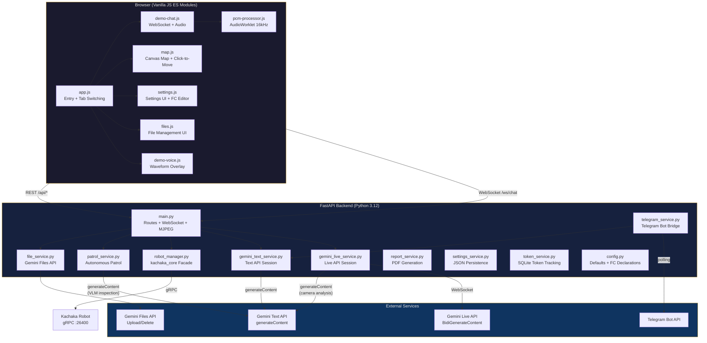

# Kachaka + Gemini

[繁體中文版 README](README.zh-TW.md) | [中文架構文件](docs/architecture-zh.md)

A web interface connecting a [Kachaka](https://kachaka.life/) mobile robot to Google's Gemini API for voice and text conversations with real-time function-calling robot control. Includes a Telegram bot bridge and an autonomous patrol inspection system with AI-powered visual analysis.

## Features

- **Dual API modes** -- Text API (multi-turn REST with `google-genai` SDK) and Live API (real-time bidirectional WebSocket with native audio via `BidiGenerateContent`)
- **Voice interaction** -- PCM audio capture (16 kHz) via AudioWorklet, gapless playback at 24 kHz, configurable TTS voice (Aoede, Puck, Charon, Kore, Fenrir)
- **Robot control via function calling** -- Gemini autonomously calls 13 functions: navigation, shelf transport, camera capture, patrol, crowd checking, drink delivery, staff notification, and more
- **Per-function enable/disable** -- Graphical card-based function declaration editor with individual toggle switches
- **Google Search grounding** -- Optional web search integration; handles model-level incompatibilities (e.g. `gemini-3-flash-preview` Google Search + function calling conflict) via a dedicated API workaround
- **Interactive map** -- Canvas-rendered floor map with click-to-move, drag-to-set-pose, real-time robot pose tracking
- **Front camera** -- MJPEG streaming endpoint; two-stage camera analysis for Live API (image forwarded to Text API model since Live API `toolResponse` does not support multimodal data)
- **Autonomous patrol** -- Multi-point patrol with Gemini VLM inspection per checkpoint, structured OK/NG classification, AI summary report, and PDF export
- **Telegram bot bridge** -- Per-chat Gemini sessions, photo analysis, patrol completion notifications with PDF attachment
- **Gemini Files API** -- Upload documents/images to Gemini for context injection into Text API conversations, with expiry tracking and re-upload
- **Settings profiles** -- Save/load/delete named setting snapshots for different deployment scenarios
- **Exhibition mode** -- NO_INTERRUPTION activity handling, mic muting during AI speech, configurable quick action buttons, customizable title
- **Context window compression** -- Sliding window compression for Live API sessions to handle long conversations
- **Interim response** -- Pre-generated TTS audio clips played during function call execution for seamless UX
- **Token tracking** -- SQLite-backed per-session and daily token usage statistics

## Architecture Overview



## Quick Start

### Prerequisites

- Docker and Docker Compose
- A Gemini API key ([Google AI Studio](https://aistudio.google.com/apikey))
- A Kachaka robot on the same network (optional -- the app runs without one)

### Run

```bash
# Set your robot's IP (default: <YOUR_ROBOT_IP>:26400)
export ROBOT_IP=<YOUR_ROBOT_IP>:26400

docker compose up -d
```

Open **http://localhost:9000** in a browser. Enter your Gemini API key in **Settings > General**, then return to the **Demo** tab -- the WebSocket auto-connects to Gemini on page load.

### Development

Source code is volume-mounted into the container with `--reload` enabled, so edits to `src/` are picked up automatically.

```bash
# Rebuild after changing requirements.txt or Dockerfile
docker compose up -d --build
```

### Multi-arch Build

Multi-arch images (amd64 + arm64) are built automatically via [GitHub Actions](.github/workflows/deploy.yml) on tagged releases (`v*`).

## Tech Stack

| Layer | Technology |
|-------|-----------|
| Backend | Python 3.12, FastAPI, Uvicorn |
| Frontend | Vanilla JavaScript (ES modules), Jinja2 templates, CSS |
| AI | Google Gemini API (`google-genai` SDK), Live API (raw WebSocket) |
| Robot | `kachaka-sdk-toolkit` (`kachaka_core`), `kachaka-api` (gRPC) |
| Database | SQLite (WAL mode) for tokens and patrol data |
| Messaging | `python-telegram-bot` for Telegram bridge |
| Reports | ReportLab (PDF), CJK font support (WenQuanYi Zen Hei) |
| Vision | Pillow, OpenCV (headless), Pydantic (structured VLM output) |
| Container | Docker, multi-arch (amd64/arm64) |

## Project Structure

```
kachaka-gemini/
|-- Dockerfile
|-- docker-compose.yml
|-- CLAUDE.md                         # Project conventions for Claude Code
|-- data/                             # Runtime data (gitignored)
|   |-- settings.json                 # Persisted settings
|   |-- tokens.db                     # Token usage database
|   |-- patrol.db                     # Patrol runs + inspection results
|   |-- files.json                    # Gemini Files API metadata
|   |-- uploads/                      # Local file copies for Gemini Files API
|   |-- profiles/                     # Named settings profiles
|   `-- report/
|       |-- images/                   # Patrol inspection images
|       `-- video/                    # Patrol video recordings
|-- docs/
|   |-- architecture.md               # Detailed architecture documentation
|   `-- google-search-function-calling.md
`-- src/
    |-- backend/
    |   |-- main.py                   # FastAPI routes + WebSocket handler + MJPEG
    |   |-- config.py                 # Defaults, function declarations, persona, knowledge base
    |   |-- gemini_live_service.py    # Live API (BidiGenerateContent) WebSocket session
    |   |-- gemini_text_service.py    # Text API (generateContent) multi-turn session
    |   |-- robot_manager.py          # kachaka_core facade (connection, commands, camera)
    |   |-- patrol_service.py         # Autonomous multi-point patrol with VLM inspection
    |   |-- patrol_db.py              # SQLite patrol runs + inspection results
    |   |-- telegram_service.py       # Telegram bot bridge (per-chat sessions)
    |   |-- file_service.py           # Gemini Files API lifecycle management
    |   |-- report_service.py         # PDF report generation + video analysis
    |   |-- frame_hub.py              # Centralized camera frame access
    |   |-- profile_service.py        # Named settings profile CRUD
    |   |-- settings_service.py       # JSON settings persistence + migration
    |   |-- token_service.py          # SQLite token usage tracking
    |   |-- requirements.txt
    |   `-- fonts/                    # Optional CJK font overrides
    `-- frontend/
        |-- templates/
        |   |-- index.html            # Main SPA template
        |   `-- demo-patrol.html      # Standalone patrol history page
        `-- static/
            |-- css/
            |   |-- style.css         # Main stylesheet
            |   `-- demo-patrol.css   # Patrol page styles
            |-- js/
            |   |-- app.js            # Entry point, tab switching, message handling
            |   |-- demo-chat.js      # WebSocket client, audio capture/playback
            |   |-- demo-voice.js     # Waveform overlay (listening/speaking)
            |   |-- demo-status.js    # Robot status polling, connection light
            |   |-- demo-patrol.js    # Patrol UI (start/cancel/history)
            |   |-- demo-patrol-page.js # Standalone patrol dashboard (history/reports/tokens)
            |   |-- map.js            # Canvas map rendering, coordinate transforms
            |   |-- settings.js       # Settings UI, FC editor, import/export
            |   |-- files.js          # File management UI (upload/toggle/delete)
            |   |-- state.js          # Shared reactive state
            |   `-- pcm-processor.js  # AudioWorklet processor (16kHz PCM)
            `-- favicon.png
```

## API Reference

### REST Endpoints

| Method | Path | Description |
|--------|------|-------------|
| `GET` | `/` | Web UI (main SPA) |
| `GET` | `/demo/patrol` | Standalone patrol history page |
| **Robot** | | |
| `GET` | `/api/state` | Robot state (battery, pose, map info) |
| `GET` | `/api/map` | Floor map PNG |
| `GET` | `/api/camera/front` | MJPEG camera stream |
| `GET` | `/api/locations` | Registered locations |
| `GET` | `/api/shelves` | Registered shelves |
| `POST` | `/api/move` | Move robot to coordinates `{x, y, theta}` |
| `POST` | `/api/cancel_command` | Cancel current robot command |
| `POST` | `/api/return_home` | Return robot to charging dock |
| `POST` | `/api/manual_control` | Manual drive `{direction: forward\|backward\|left\|right}` |
| `POST` | `/api/robot/connect` | Connect to robot `{ip}` |
| `POST` | `/api/robot/disconnect` | Disconnect from robot |
| `GET` | `/api/robot/status` | Connection status |
| **Settings** | | |
| `GET` | `/api/settings` | Current settings (API key masked) |
| `GET` | `/api/settings/defaults` | Default settings |
| `POST` | `/api/settings` | Update settings |
| `GET` | `/api/models?mode=live\|text` | Query available Gemini models |
| **Profiles** | | |
| `GET` | `/api/profiles` | List saved profiles |
| `POST` | `/api/profiles` | Save current settings as profile `{name}` |
| `POST` | `/api/profiles/load` | Load a named profile `{name}` |
| `DELETE` | `/api/profiles/{name}` | Delete a profile |
| **Files** | | |
| `GET` | `/api/files` | List uploaded files |
| `POST` | `/api/files/upload` | Upload file to Gemini Files API |
| `DELETE` | `/api/files/{file_id}` | Delete a file |
| `PATCH` | `/api/files/{file_id}/toggle` | Enable/disable file `{enabled}` |
| `POST` | `/api/files/{file_id}/reupload` | Re-upload expired file |
| **Tokens** | | |
| `GET` | `/api/token_usage` | Token usage summary (all-time + today) |
| `POST` | `/api/token_usage/reset` | Reset token counters |
| **Patrol** | | |
| `GET` | `/api/patrol/status` | Current patrol status and progress |
| `POST` | `/api/patrol/start` | Start patrol `{points?}` |
| `POST` | `/api/patrol/cancel` | Cancel running patrol |
| `GET` | `/api/patrol/runs` | Patrol run history `?limit=20&offset=0` |
| `GET` | `/api/patrol/runs/{run_id}` | Single run details + inspections |
| `GET` | `/api/patrol/runs/{run_id}/pdf` | Download patrol report PDF |
| `GET` | `/api/patrol/report/image/{path}` | Serve inspection image |
| `GET` | `/api/patrol/report/video/{filename}` | Serve patrol video |
| `GET` | `/api/patrol/token_stats` | Daily patrol token usage |
| `POST` | `/api/patrol/analyze` | Generate AI analysis report for date range |
| **Audio** | | |
| `POST` | `/api/generate_interim_audio` | Pre-generate TTS clips for interim responses |
| `GET` | `/api/interim_audio` | Retrieve generated interim audio data |

### WebSocket `/ws/chat`

**Client to Server:**

| Message | Description |
|---------|-------------|
| `{type: "connect"}` | Open Gemini session (mode from `api_mode` setting) |
| `{type: "disconnect"}` | Close Gemini session |
| `{type: "text", content: "..."}` | Send text message |
| `{type: "audio", data: "<base64>"}` | Send PCM audio chunk (Live API only) |
| `{type: "clear_history"}` | Clear conversation history |
| `{type: "start_patrol"}` | Start patrol via WebSocket |

**Server to Client:**

| Message | Description |
|---------|-------------|
| `{type: "status", message, api_mode?}` | Connection status |
| `{type: "text", content}` | Model text response |
| `{type: "audio", data}` | Model audio response (PCM 24 kHz, Live API only) |
| `{type: "turn_complete"}` | Model turn finished |
| `{type: "interrupted"}` | User interrupted AI via VAD |
| `{type: "function_call", name, args}` | Function call initiated |
| `{type: "function_result", name, result}` | Function call completed |
| `{type: "function_call_blocked", name, args}` | FC skipped (Google Search conflict) |
| `{type: "google_search", sources}` | Search grounding sources |
| `{type: "token_usage", prompt, response, total}` | Token counts |
| `{type: "error", message}` | Error |
| `{type: "gemini_disconnected", code, reason}` | Server-side disconnect |
| `{type: "history_cleared"}` | History clear confirmation |
| `{type: "thinking"}` | Text API is processing (typing indicator) |
| `{type: "patrol_started"}` | Patrol started via WebSocket |

## Function Declarations

The 13 default function declarations (editable via Settings UI):

| Function | Description |
|----------|-------------|
| `move_to_location` | Navigate to a registered location by ID |
| `move_shelf` | Transport a shelf to a destination |
| `return_shelf` | Return a shelf to its home position |
| `get_robot_status` | Query battery, pose, and command state |
| `cancel_command` | Stop the current robot task |
| `capture_camera` | Capture and analyze a front camera image |
| `guide_to_booth` | Guide a visitor to a booth (move + dwell + return) |
| `start_patrol` | Start autonomous multi-point patrol |
| `get_patrol_history` | Query recent patrol run summaries |
| `check_crowd` | Move to location, capture image, analyze crowd density |
| `notify_staff` | Send a message to staff via Telegram |
| `deliver_drink` | Move the drink shelf to a configured destination |
| `return_drink` | Return the drink shelf and go to charger |

Each function can be individually enabled/disabled via toggle switches in the FC editor.

## Configuration

All settings are persisted to `data/settings.json` and editable through the web UI.

### Environment Variables

| Variable | Default | Description |
|----------|---------|-------------|
| `ROBOT_IP` | `<YOUR_ROBOT_IP>:26400` | Kachaka robot gRPC address |

### Key Settings

| Setting | Default | Description |
|---------|---------|-------------|
| `gemini_api_key` | `""` | Google Gemini API key |
| `api_mode` | `"text"` | `"text"` or `"live"` |
| `text_model` | `"gemini-3-flash-preview"` | Model for Text API |
| `live_model` | `"gemini-2.5-flash-native-audio-preview-12-2025"` | Model for Live API |
| `text_enable_google_search` | `true` | Enable Google Search (Text mode) |
| `live_enable_google_search` | `false` | Enable Google Search (Live mode) |
| `voice_name` | `"Aoede"` | TTS voice for Live API |
| `live_auto_interrupt` | `true` | Auto VAD (false = exhibition/NO_INTERRUPTION mode) |
| `robot_ip` | env `ROBOT_IP` | Robot gRPC address (saved to settings) |
| `telegram_bot_token` | `""` | Telegram bot token (hot-reloaded on change) |
| `telegram_chat_id` | `""` | Staff notification chat ID |

Generation parameters (`temperature`, `max_output_tokens`, `top_p`, `top_k`) and safety settings are configurable per API mode (`text_*` / `live_*` prefixes).

## Deployment

### Docker (recommended)

```bash
# Development with hot-reload
export ROBOT_IP=<YOUR_ROBOT_IP>:26400
docker compose up -d

# Production (no volume mount, no --reload)
docker build -t kachaka-gemini-live .
docker run -d -p 9000:9000 \
  -e ROBOT_IP=<YOUR_ROBOT_IP>:26400 \
  -v $(pwd)/data:/app/data \
  kachaka-gemini-live
```

The Docker image includes a health check (`/api/state`), runs on Python 3.12-slim, and installs WenQuanYi Zen Hei fonts for CJK PDF support.

### Multi-arch

Multi-arch images are built via GitHub Actions CI. Push a version tag to trigger:

```bash
git tag v1.0.0 && git push --tags
```

## Modularizing VLM Analysis with vlm-service

The current codebase contains three separate locations that call the Gemini API directly for image/video analysis:

- `robot_manager._fc_capture_camera()` -- camera capture + free-text analysis
- `robot_manager._fc_inspect_location()` -- move to location + capture + free-text analysis
- `patrol_service._inspect_with_gemini()` -- structured OK/NG inspection (the only one using `response_schema`)

For production deployments, consider consolidating these into a shared AI service layer using [`vlm-service`](https://github.com/Sigma-Snaken/vlm-service):

1. **Install**: Add `vlm-service` to `requirements.txt`
2. **Create `ai_service.py`**: A thin facade wrapping `vlm-service`'s `GeminiProvider`
3. **Migrate callers**: Replace direct `genai.Client()` calls with `ai_service.inspect()` / `ai_service.analyze_video()`

Benefits:

- **Structured output** -- All VLM calls return schema-constrained JSON (via `response_mime_type` + `response_json_schema`), enabling programmatic downstream processing
- **Token tracking** -- Every call returns usage metadata automatically
- **Lazy client** -- Single `GeminiProvider` instance, recreated only when API key changes
- **Dynamic schemas** -- Build venue-specific inspection schemas at runtime (e.g., custom NG criteria per checkpoint)

See [kachaka-gemini-v2](https://github.com/Sigma-Snaken/kachaka-gemini-v2) for a working implementation with `ai_service.py`.

## Known Limitations

- **Google Search + Function Calling conflict**: Some models (e.g. `gemini-3-flash-preview`) return 400 when both are sent in the same request. The Text API works around this by intercepting `google_search` function calls and executing them via a dedicated API call. See [docs/google-search-function-calling.md](docs/google-search-function-calling.md) for details.
- **Live API camera analysis**: The Live API `toolResponse` does not support multimodal data. Camera images are analyzed via a separate Text API `generateContent` call, and the text result is returned so the Live model reads it aloud.
- **Live API safety settings**: `BidiGenerateContent` does not currently support safety settings; the `live_safety_settings` field is reserved.
- **Live API history**: Server-side conversation state cannot be selectively cleared; clearing history requires reconnecting the WebSocket session.
- **Camera dependency**: Camera features require a connected Kachaka robot.
- **No tests**: There are no automated tests, linter, or type checker configured.

## License

This project is licensed under the Apache License 2.0 - see the [LICENSE](LICENSE) file for details.

Copyright 2026 Sigma Robotics
