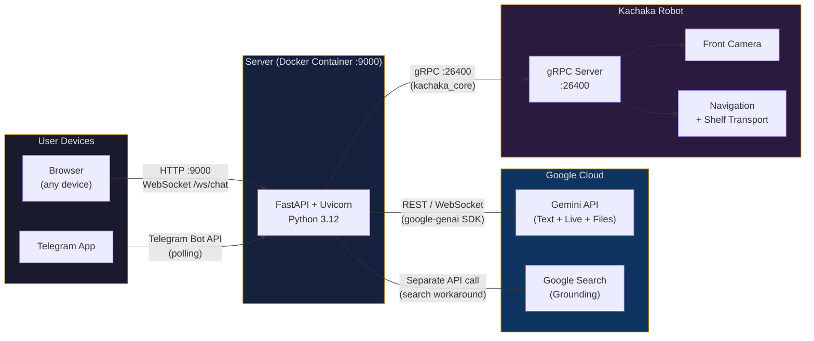
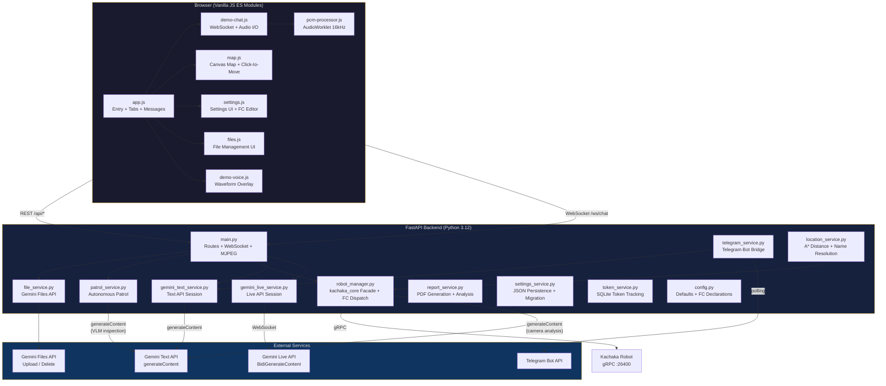

# Kachaka + Gemini

[繁體中文版 README](README.zh-TW.md) | [Architecture (EN)](docs/architecture.md) | [架構文件 (中文)](docs/architecture-zh.md)

A web interface connecting a [Kachaka](https://kachaka.life/) mobile robot to Google's Gemini API for voice and text conversations with real-time function-calling robot control. Includes a Telegram bot bridge, autonomous patrol inspection with AI-powered visual analysis, and a full settings management UI.

## Features

- **Dual API modes** -- Text API (multi-turn chat via `google-genai` SDK `generateContent`) and Live API (real-time bidirectional WebSocket via `BidiGenerateContent` with native audio)
- **Voice interaction** -- PCM audio capture at 16 kHz via AudioWorklet, 24 kHz playback, configurable TTS voices (Aoede, Puck, Charon, Kore, Fenrir)
- **Robot control via function calling** -- Gemini autonomously invokes 14 functions: navigation, camera capture with VLM analysis, shelf transport, drink delivery, visitor guiding, patrol, staff notification, and more
- **Per-function enable/disable** -- Graphical card-based function declaration editor with individual toggle switches; import/export JSON
- **Google Search grounding** -- Optional web search integration; handles the Google Search + function calling model conflict via a dedicated workaround (see [docs/google-search-function-calling.md](docs/google-search-function-calling.md))
- **Interactive map** -- Canvas-rendered floor map with click-to-move, drag-to-set-pose, and real-time robot pose tracking
- **Front camera** -- MJPEG streaming endpoint with live camera feed in the UI
- **A* pathfinding** -- Location distances computed via A* on the robot's occupancy grid map, used for distance-sorted location enums in system prompts
- **Autonomous patrol** -- Multi-point patrol with Gemini VLM inspection per checkpoint, structured JSON OK/NG classification (Pydantic schema), AI summary report generation, and PDF export with CJK support
- **Telegram bot bridge** -- Per-chat Gemini sessions with text and photo support, patrol completion notifications with PDF attachment
- **Gemini Files API** -- Upload documents/images as persistent context for Text API conversations, with 48-hour expiry tracking and one-click re-upload
- **Settings profiles** -- Save/load/delete named setting snapshots for different deployment scenarios
- **Exhibition mode** -- `NO_INTERRUPTION` activity handling to prevent VAD interrupts, automatic mic muting during AI speech with configurable buffer, manual interrupt button, customizable quick action buttons and title
- **Context window compression** -- Sliding window compression (25,600 token trigger) for long Live API sessions
- **Token tracking** -- SQLite-backed per-session and daily token usage statistics for both conversation and patrol APIs

## System Topology



## Architecture Overview



## Quick Start

### Prerequisites

- Docker and Docker Compose
- A Gemini API key ([Google AI Studio](https://aistudio.google.com/apikey))
- A Kachaka robot on the same network (optional -- the app runs without one)

### Run

```bash
# Set your robot's gRPC address (optional)
export ROBOT_IP=<YOUR_ROBOT_IP>:26400

docker compose up -d
```

Open **http://localhost:9000** in a browser. Enter your Gemini API key in **Settings > General**, then return to the **Demo** tab. The WebSocket auto-connects to Gemini on page load.

### Development

Source code is volume-mounted into the container with `--reload` enabled, so edits to files under `src/` are picked up automatically without rebuilding.

```bash
# Rebuild only after changing requirements.txt or Dockerfile
docker compose up -d --build
```

### Production Deploy

Use the pre-built multi-arch image from GHCR:

```bash
# docker-compose.prod.yml pulls from ghcr.io
export ROBOT_IP=<YOUR_ROBOT_IP>:26400
docker compose -f docker-compose.prod.yml up -d
```

### Multi-arch Build (CI)

Multi-arch images (linux/amd64 + linux/arm64) are built automatically via [GitHub Actions](.github/workflows/deploy.yml). Push a version tag or use workflow dispatch to trigger a build:

```bash
git tag v1.0.0 && git push --tags
```

Images are published to `ghcr.io/sigmarobotics/kachaka-gemini` with semver tags and `latest`.

## Tech Stack

| Layer | Technology |
|-------|-----------|
| Backend | Python 3.12, FastAPI, Uvicorn |
| Frontend | Vanilla JavaScript (ES modules), Jinja2 templates, CSS |
| AI | Google Gemini API (`google-genai` SDK), Live API (raw WebSocket via `websockets`) |
| Robot | [`kachaka-sdk-toolkit`](https://github.com/sigmarobotics/kachaka-sdk-toolkit) (`kachaka_core`), `kachaka-api` >= 3.14 (gRPC) |
| Pathfinding | A* on occupancy grid (NumPy + Pillow), obstacle inflation |
| Database | SQLite WAL mode (`tokens.db` for usage, `patrol.db` for runs/inspections) |
| Messaging | `python-telegram-bot` >= 21.0 for Telegram bridge |
| Reports | ReportLab (PDF generation), WenQuanYi Zen Hei (CJK font support) |
| Vision | Pillow, OpenCV (headless), Pydantic (structured VLM output schema) |
| Container | Docker (Python 3.12-slim), multi-arch (amd64/arm64), GHCR |

## Project Structure

```
kachaka-gemini/
|-- Dockerfile
|-- docker-compose.yml               # Development (volume mount + --reload)
|-- docker-compose.prod.yml          # Production (GHCR image, data volume only)
|-- .github/workflows/deploy.yml     # Multi-arch CI build
|-- CLAUDE.md                        # Project conventions for Claude Code
|-- data/                            # Runtime data (gitignored)
|   |-- settings.json                # Persisted settings
|   |-- tokens.db                    # Token usage database
|   |-- patrol.db                    # Patrol runs + inspection results
|   |-- files.json                   # Gemini Files API metadata
|   |-- uploads/                     # Local file copies for Gemini Files API
|   |-- profiles/                    # Named settings profiles
|   `-- report/
|       |-- images/                  # Patrol inspection images (OK/NG tagged)
|       `-- video/                   # Patrol video recordings
|-- docs/
|   |-- architecture.md              # Detailed architecture documentation
|   |-- architecture-zh.md           # Architecture doc (Chinese)
|   `-- google-search-function-calling.md
`-- src/
    |-- backend/
    |   |-- main.py                  # FastAPI routes + WebSocket handler + MJPEG stream
    |   |-- config.py                # Default settings, 14 function declarations, persona, knowledge base
    |   |-- gemini_live_service.py   # Live API (BidiGenerateContent) WebSocket session
    |   |-- gemini_text_service.py   # Text API (generateContent) multi-turn session
    |   |-- robot_manager.py         # kachaka_core facade + FC dispatch + Telegram helpers
    |   |-- patrol_service.py        # Autonomous multi-point patrol with VLM inspection
    |   |-- patrol_db.py             # SQLite patrol runs + inspection results
    |   |-- location_service.py      # Location enum with A* distances + name resolution
    |   |-- pathfinding.py           # A* on PNG occupancy grid with obstacle inflation
    |   |-- telegram_service.py      # Telegram bot bridge (per-chat Gemini sessions)
    |   |-- file_service.py          # Gemini Files API lifecycle (upload/toggle/reupload/delete)
    |   |-- report_service.py        # PDF report generation + AI analysis reports
    |   |-- frame_hub.py             # Centralized camera frame access
    |   |-- profile_service.py       # Named settings profile CRUD
    |   |-- settings_service.py      # JSON settings persistence + auto-migration
    |   |-- token_service.py         # SQLite token usage tracking
    |   |-- requirements.txt
    |   `-- fonts/                   # Optional CJK font overrides
    `-- frontend/
        |-- templates/
        |   |-- index.html           # Main SPA template (Demo + Settings tabs)
        |   `-- demo-patrol.html     # Standalone patrol history/reports page
        `-- static/
            |-- css/
            |   |-- style.css        # Main stylesheet
            |   `-- demo-patrol.css  # Patrol page styles
            |-- js/
            |   |-- app.js           # Entry point, tab switching, WebSocket, message handling
            |   |-- demo-chat.js     # Audio capture (AudioWorklet) + playback
            |   |-- demo-voice.js    # Waveform overlay (listening/speaking states)
            |   |-- demo-status.js   # Robot status polling, connection indicators
            |   |-- demo-patrol.js   # Patrol UI (start/cancel/progress/history)
            |   |-- demo-patrol-page.js  # Standalone patrol dashboard
            |   |-- map.js           # Canvas map rendering, coordinate transforms, click-to-move
            |   |-- settings.js      # Settings UI, FC editor, model query, import/export
            |   |-- files.js         # File management UI (upload/toggle/delete/reupload)
            |   |-- state.js         # Shared reactive state (pose, map info)
            |   `-- pcm-processor.js # AudioWorklet processor (16kHz PCM capture)
            `-- favicon.png
```

## API Reference

### REST Endpoints

| Method | Path | Description |
|--------|------|-------------|
| `GET` | `/` | Web UI (main SPA) |
| `GET` | `/demo/patrol` | Standalone patrol history page |
| **Robot** | | |
| `GET` | `/api/state` | Robot state (battery, pose, map info) |
| `GET` | `/api/map` | Floor map PNG |
| `GET` | `/api/camera/front` | MJPEG camera stream |
| `GET` | `/api/locations` | Registered locations (with A* distances) |
| `GET` | `/api/shelves` | Registered shelves |
| `POST` | `/api/move` | Move to coordinates `{x, y, theta}` |
| `POST` | `/api/cancel_command` | Cancel current robot command |
| `POST` | `/api/return_home` | Return robot to charging dock |
| `POST` | `/api/manual_control` | Manual drive `{direction: forward\|backward\|left\|right}` |
| `POST` | `/api/robot/connect` | Connect to robot `{ip}` |
| `POST` | `/api/robot/disconnect` | Disconnect from robot |
| `GET` | `/api/robot/status` | Connection status |
| **Settings** | | |
| `GET` | `/api/settings` | Current settings (API key masked) |
| `GET` | `/api/settings/defaults` | Default settings |
| `POST` | `/api/settings` | Update settings |
| `GET` | `/api/models?mode=text\|live` | Query available Gemini models by capability |
| **Profiles** | | |
| `GET` | `/api/profiles` | List saved profiles |
| `POST` | `/api/profiles` | Save current settings as profile `{name}` |
| `POST` | `/api/profiles/load` | Load a named profile `{name}` |
| `DELETE` | `/api/profiles/{name}` | Delete a profile |
| **Files** | | |
| `GET` | `/api/files` | List uploaded files (with expiry status) |
| `POST` | `/api/files/upload` | Upload file to Gemini Files API (max 2 GB) |
| `DELETE` | `/api/files/{file_id}` | Delete file (Gemini + local + metadata) |
| `PATCH` | `/api/files/{file_id}/toggle` | Enable/disable file `{enabled}` |
| `POST` | `/api/files/{file_id}/reupload` | Re-upload expired file to Gemini |
| **Tokens** | | |
| `GET` | `/api/token_usage` | Token usage summary (all-time + today) |
| `POST` | `/api/token_usage/reset` | Reset token counters |
| **Patrol** | | |
| `GET` | `/api/patrol/status` | Current patrol status and progress |
| `POST` | `/api/patrol/start` | Start patrol `{points?}` |
| `POST` | `/api/patrol/cancel` | Cancel running patrol |
| `GET` | `/api/patrol/runs?limit=20&offset=0` | Patrol run history (paginated) |
| `GET` | `/api/patrol/runs/{run_id}` | Single run details + inspections |
| `GET` | `/api/patrol/runs/{run_id}/pdf` | Download patrol report PDF |
| `GET` | `/api/patrol/report/image/{path}` | Serve inspection image |
| `GET` | `/api/patrol/report/video/{filename}` | Serve patrol video |
| `GET` | `/api/patrol/token_stats` | Daily patrol token usage |
| `POST` | `/api/patrol/analyze` | AI analysis report for date range `{start_date, end_date, prompt?}` |

### WebSocket `/ws/chat`

**Client to Server:**

| Message | Description |
|---------|-------------|
| `{type: "connect"}` | Open Gemini session (mode from `api_mode` setting) |
| `{type: "disconnect"}` | Close Gemini session |
| `{type: "text", content: "..."}` | Send text message |
| `{type: "audio", data: "<base64>"}` | Send PCM audio chunk (Live API only) |
| `{type: "clear_history"}` | Clear conversation history |
| `{type: "start_patrol"}` | Start patrol via WebSocket |

**Server to Client:**

| Message | Description |
|---------|-------------|
| `{type: "status", message, api_mode?}` | Connection status |
| `{type: "text", content}` | Model text response |
| `{type: "audio", data}` | Model audio response (PCM 24 kHz, Live API only) |
| `{type: "turn_complete"}` | Model turn finished |
| `{type: "interrupted"}` | User interrupted AI via VAD |
| `{type: "function_call", name, args}` | Function call initiated |
| `{type: "function_result", name, result}` | Function call completed |
| `{type: "function_call_blocked", name, args}` | FC blocked (Google Search conflict) |
| `{type: "google_search", sources}` | Search grounding sources |
| `{type: "token_usage", prompt, response, total}` | Token counts |
| `{type: "error", message}` | Error message |
| `{type: "gemini_disconnected", code, reason}` | Server-side session disconnect |
| `{type: "history_cleared"}` | History clear confirmation |
| `{type: "thinking"}` | Text API processing (typing indicator) |
| `{type: "patrol_started"}` | Patrol started via WebSocket |

## Function Declarations

14 default function declarations (9 enabled, 5 disabled by default). All are editable via the Settings UI.

| Function | Default | Description |
|----------|---------|-------------|
| `capture_camera` | Enabled | Capture front camera image and analyze with Gemini VLM |
| `inspect_location` | Enabled | Move to a named location, capture + analyze, then return home |
| `patrol_all` | Enabled | Start autonomous multi-point patrol |
| `rotate` | Enabled | Rotate in place by specified degrees |
| `guide_to_booth` | Enabled | Guide a visitor to a named location, dwell, then return home |
| `notify_staff` | Enabled | Send a notification to staff via Telegram |
| `deliver_drink` | Enabled | Move the drink shelf to a configured destination |
| `return_drink` | Enabled | Return the drink shelf to its home location and go to charger |
| `get_patrol_history` | Enabled | Query recent patrol run summaries |
| `move_to_location` | Disabled | Low-level: move to a location by ID |
| `move_shelf` | Disabled | Low-level: move a shelf to a destination by IDs |
| `return_shelf` | Disabled | Low-level: return a shelf to its home |
| `get_robot_status` | Disabled | Query battery, pose, and command state |
| `cancel_command` | Disabled | Stop the current robot task |

Location-based functions (`inspect_location`, `guide_to_booth`) dynamically populate their `location_name` enum from the robot's registered locations at session connect time.

## Configuration

All settings are persisted to `data/settings.json` and editable through the web UI. Settings auto-migrate from older formats on load.

### Environment Variables

| Variable | Default | Description |
|----------|---------|-------------|
| `ROBOT_IP` | `""` | Kachaka robot gRPC address (e.g. `<YOUR_ROBOT_IP>:26400`). Overridden by `robot_ip` in settings. |

### Key Settings

| Setting | Default | Description |
|---------|---------|-------------|
| `gemini_api_key` | `""` | Google Gemini API key |
| `api_mode` | `"text"` | `"text"` or `"live"` |
| `text_model` | `"gemini-3-flash-preview"` | Model for Text API |
| `live_model` | `"gemini-2.5-flash-native-audio-preview-12-2025"` | Model for Live API |
| `text_enable_google_search` | `true` | Enable Google Search grounding (Text mode) |
| `live_enable_google_search` | `false` | Enable Google Search grounding (Live mode) |
| `voice_name` | `"Aoede"` | TTS voice for Live API |
| `live_auto_interrupt` | `true` | VAD auto-interrupt (`false` = exhibition/NO_INTERRUPTION mode) |
| `mute_buffer_s` | `1.5` | Seconds to keep mic muted after turn ends (exhibition mode) |
| `show_camera` | `true` | Show camera feed in Demo tab |
| `robot_ip` | env `ROBOT_IP` | Robot gRPC address (saved to settings on connect) |
| `patrol_points` | `[]` | List of location IDs for patrol |
| `patrol_telegram_notify` | `true` | Send Telegram notification on patrol completion |
| `inspect_dwell_time` | `10` | Seconds to wait at inspection location |
| `guide_dwell_time` | `30` | Seconds to wait at guide destination |
| `drink_shelf_id` | `"S01"` | Shelf ID for drink delivery |
| `kiosk_location` | `""` | Location ID for drink delivery destination / A* distance origin |
| `exhibition_title` | `"AI 機器人互動展示"` | Title shown in Demo tab header |
| `exhibition_quick_actions` | (see config.py) | Configurable quick action buttons |
| `telegram_bot_token` | `""` | Telegram bot token (hot-reloaded on change) |
| `telegram_chat_ids` | `[]` | Staff notification chat IDs (one per line in UI) |

Generation parameters (`temperature`, `max_output_tokens`, `top_p`, `top_k`) and safety settings are configurable per API mode via `text_*` / `live_*` prefixed keys.

## Deployment

### Docker (recommended)

```bash
# Development with hot-reload (volume-mounted source)
export ROBOT_IP=<YOUR_ROBOT_IP>:26400
docker compose up -d

# Production (GHCR pre-built image)
export ROBOT_IP=<YOUR_ROBOT_IP>:26400
docker compose -f docker-compose.prod.yml up -d

# Manual production build
docker build -t kachaka-gemini .
docker run -d -p 9000:9000 \
  -e ROBOT_IP=<YOUR_ROBOT_IP>:26400 \
  -v $(pwd)/data:/app/data \
  kachaka-gemini
```

The Docker image includes:
- Health check on `/api/state` (30s interval)
- WenQuanYi Zen Hei fonts for CJK PDF support
- Python 3.12-slim base

### Multi-arch CI

Push a version tag to trigger [GitHub Actions](.github/workflows/deploy.yml):

```bash
git tag v1.0.0 && git push --tags
```

This builds `linux/amd64` + `linux/arm64` images and pushes to `ghcr.io/sigmarobotics/kachaka-gemini` with semver and `latest` tags.

## Modularizing VLM Analysis with vlm-service

The current codebase contains three separate locations that call the Gemini API directly for image/video analysis:

- `robot_manager._fc_capture_camera()` -- camera capture + free-text analysis
- `robot_manager._fc_inspect_location()` -- move to location + capture + free-text analysis
- `patrol_service._inspect_with_gemini()` -- structured OK/NG inspection (the only one using `response_schema`)

For production deployments, consider consolidating these into a shared AI service layer using [`vlm-service`](https://github.com/sigmarobotics/vlm-service):

1. **Install**: Add `vlm-service` to `requirements.txt`
2. **Create `ai_service.py`**: A thin facade wrapping `vlm-service`'s `GeminiProvider`
3. **Migrate callers**: Replace direct `genai.Client()` calls with `ai_service.inspect()` / `ai_service.analyze_video()`

Benefits:

- **Structured output** -- All VLM calls return schema-constrained JSON via `response_mime_type` + `response_json_schema`
- **Token tracking** -- Every call returns usage metadata automatically
- **Lazy client** -- Single `GeminiProvider` instance, recreated only when API key changes
- **Dynamic schemas** -- Build venue-specific inspection schemas at runtime

## Known Limitations

- **Google Search + Function Calling conflict**: Some models (e.g. `gemini-3-flash-preview`) return HTTP 400 when both are in the same request. The Text API works around this by injecting a `google_search` function declaration and executing searches via a dedicated API call. See [docs/google-search-function-calling.md](docs/google-search-function-calling.md).
- **Live API camera analysis**: The Live API `toolResponse` does not support multimodal data. Camera images are analyzed via a separate Text API `generateContent` call, and the text result is returned in the tool response for the Live model to read aloud.
- **Live API safety settings**: `BidiGenerateContent` does not currently support safety settings; the `live_safety_settings` field is reserved for future use.
- **Live API history**: Server-side conversation state cannot be selectively cleared; clearing history reconnects the WebSocket session.
- **Camera dependency**: Camera features require a connected Kachaka robot with an active `CameraStreamer`.
- **No tests**: There are no automated tests, linter, or type checker configured in this project.

## License

This project is licensed under the Apache License 2.0 -- see the [LICENSE](LICENSE) file for details.

Copyright 2026 Sigma Robotics
