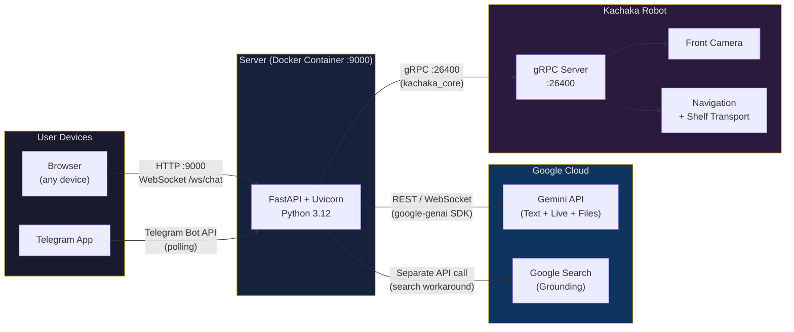
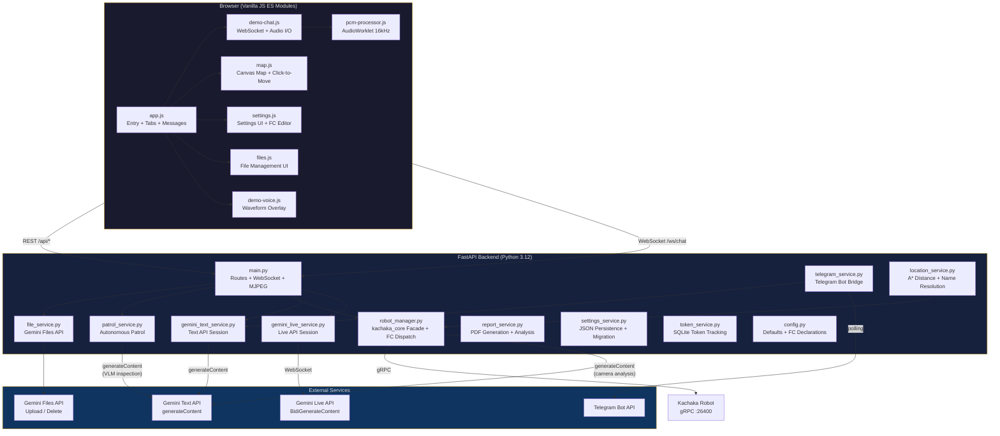

# Kachaka + Gemini

[English README](README.md) | [Architecture (EN)](docs/architecture.md) | [架構文件 (中文)](docs/architecture-zh.md)

一個將 [Kachaka](https://kachaka.life/) 移動機器人連接至 Google Gemini API 的網頁介面，支援語音與文字對話，並具備即時 function calling 機器人控制功能。包含 Telegram 機器人橋接、搭載 AI 視覺分析的自主巡邏檢查，以及完整的設定管理介面。

## 功能特色

- **雙 API 模式** -- Text API（透過 `google-genai` SDK `generateContent` 進行多輪對話）與 Live API（透過 `BidiGenerateContent` 的即時雙向 WebSocket 原生音訊）
- **語音互動** -- 透過 AudioWorklet 以 16 kHz 擷取 PCM 音訊、24 kHz 播放，可設定 TTS 語音（Aoede、Puck、Charon、Kore、Fenrir）
- **透過 function calling 控制機器人** -- Gemini 自主呼叫 14 個函式：導航、相機拍攝與 VLM 分析、貨架搬運、飲品配送、訪客導引、巡邏、員工通知等
- **個別函式啟用/停用** -- 圖形化卡片式函式宣告編輯器，每個函式都有獨立的開關切換；支援 JSON 匯入/匯出
- **Google Search 搜尋基礎** -- 選用的網路搜尋整合；透過專用的變通方案處理 Google Search + function calling 模型衝突（參見 [docs/google-search-function-calling.md](docs/google-search-function-calling.md)）
- **互動式地圖** -- Canvas 渲染的樓層地圖，支援點擊移動、拖曳設定位姿，以及即時機器人位姿追蹤
- **前置相機** -- MJPEG 串流端點，於介面中顯示即時相機畫面
- **A* 路徑搜尋** -- 透過機器人佔據柵格地圖上的 A* 演算法計算地點距離，用於系統提示中依距離排序的地點列舉
- **自主巡邏** -- 多點巡邏搭配 Gemini VLM 檢查站檢查，結構化 JSON OK/NG 分類（Pydantic schema）、AI 摘要報告生成，以及支援 CJK 的 PDF 匯出
- **Telegram 機器人橋接** -- 每個聊天室獨立的 Gemini 對話，支援文字與圖片，巡邏完成時附帶 PDF 通知
- **Gemini Files API** -- 上傳文件/圖片作為 Text API 對話的持久化上下文，具備 48 小時到期追蹤與一鍵重新上傳功能
- **設定檔案配置** -- 儲存/載入/刪除具名設定快照，適用於不同部署情境
- **展覽模式** -- `NO_INTERRUPTION` 活動處理以防止 VAD 中斷，AI 說話時自動靜音麥克風（可設定緩衝時間），手動中斷按鈕，可自訂快速操作按鈕與標題
- **上下文視窗壓縮** -- 滑動視窗壓縮（25,600 token 觸發）適用於長時間 Live API 對話
- **Token 使用追蹤** -- SQLite 支援的每次對話及每日 token 使用統計，涵蓋對話與巡邏 API

## 系統拓撲



## 架構概覽



## 快速開始

### 前置需求

- Docker 與 Docker Compose
- Gemini API 金鑰（[Google AI Studio](https://aistudio.google.com/apikey)）
- 同一網路中的 Kachaka 機器人（非必要 -- 應用程式可在無機器人的情況下運行）

### 執行

```bash
# 設定機器人的 gRPC 位址（非必要）
export ROBOT_IP=<YOUR_ROBOT_IP>:26400

docker compose up -d
```

在瀏覽器中開啟 **http://localhost:9000**。在 **Settings > General** 中輸入您的 Gemini API 金鑰，然後回到 **Demo** 分頁。頁面載入時 WebSocket 會自動連線至 Gemini。

### 開發

原始碼以 volume mount 方式掛載至容器中，並啟用 `--reload`，因此對 `src/` 下檔案的修改會自動生效，無需重新建置。

```bash
# 僅在修改 requirements.txt 或 Dockerfile 時需要重新建置
docker compose up -d --build
```

### 正式環境部署

使用 GHCR 上預建的多架構映像檔：

```bash
# docker-compose.prod.yml 從 ghcr.io 拉取映像檔
export ROBOT_IP=<YOUR_ROBOT_IP>:26400
docker compose -f docker-compose.prod.yml up -d
```

### 多架構建置（CI）

多架構映像檔（linux/amd64 + linux/arm64）透過 [GitHub Actions](.github/workflows/deploy.yml) 自動建置。推送版本標籤或使用 workflow dispatch 觸發建置：

```bash
git tag v1.0.0 && git push --tags
```

映像檔發布至 `ghcr.io/sigma-snaken/kachaka-gemini`，具有 semver 標籤與 `latest` 標籤。

## 技術棧

| 層級 | 技術 |
|------|------|
| 後端 | Python 3.12, FastAPI, Uvicorn |
| 前端 | Vanilla JavaScript (ES modules), Jinja2 templates, CSS |
| AI | Google Gemini API (`google-genai` SDK), Live API (透過 `websockets` 的原生 WebSocket) |
| 機器人 | [`kachaka-sdk-toolkit`](https://github.com/Sigma-Snaken/kachaka-sdk-toolkit) (`kachaka_core`), `kachaka-api` >= 3.14 (gRPC) |
| 路徑搜尋 | A* 佔據柵格演算法 (NumPy + Pillow)，障礙物膨脹 |
| 資料庫 | SQLite WAL 模式 (`tokens.db` 用於使用量、`patrol.db` 用於巡邏執行/檢查) |
| 通訊 | `python-telegram-bot` >= 21.0 用於 Telegram 橋接 |
| 報告 | ReportLab (PDF 生成), WenQuanYi Zen Hei (CJK 字型支援) |
| 視覺 | Pillow, OpenCV (headless), Pydantic (結構化 VLM 輸出 schema) |
| 容器 | Docker (Python 3.12-slim), 多架構 (amd64/arm64), GHCR |

## 專案結構

```
kachaka-gemini/
|-- Dockerfile
|-- docker-compose.yml               # 開發環境（volume mount + --reload）
|-- docker-compose.prod.yml          # 正式環境（GHCR 映像檔，僅 data volume）
|-- .github/workflows/deploy.yml     # 多架構 CI 建置
|-- CLAUDE.md                        # Claude Code 專案慣例
|-- data/                            # 執行期資料（已 gitignore）
|   |-- settings.json                # 持久化設定
|   |-- tokens.db                    # Token 使用量資料庫
|   |-- patrol.db                    # 巡邏執行 + 檢查結果
|   |-- files.json                   # Gemini Files API 中繼資料
|   |-- uploads/                     # Gemini Files API 的本地檔案副本
|   |-- profiles/                    # 具名設定配置檔
|   `-- report/
|       |-- images/                  # 巡邏檢查圖片（OK/NG 標記）
|       `-- video/                   # 巡邏影片錄製
|-- docs/
|   |-- architecture.md              # 詳細架構文件
|   |-- architecture-zh.md           # 架構文件（中文）
|   `-- google-search-function-calling.md
`-- src/
    |-- backend/
    |   |-- main.py                  # FastAPI 路由 + WebSocket 處理器 + MJPEG 串流
    |   |-- config.py                # 預設設定、14 個函式宣告、人設、知識庫
    |   |-- gemini_live_service.py   # Live API (BidiGenerateContent) WebSocket 對話
    |   |-- gemini_text_service.py   # Text API (generateContent) 多輪對話
    |   |-- robot_manager.py         # kachaka_core 外觀模式 + FC 分派 + Telegram 輔助功能
    |   |-- patrol_service.py        # 自主多點巡邏搭配 VLM 檢查
    |   |-- patrol_db.py             # SQLite 巡邏執行 + 檢查結果
    |   |-- location_service.py      # 地點列舉搭配 A* 距離 + 名稱解析
    |   |-- pathfinding.py           # A* 佔據柵格 PNG 搭配障礙物膨脹
    |   |-- telegram_service.py      # Telegram 機器人橋接（每聊天室 Gemini 對話）
    |   |-- file_service.py          # Gemini Files API 生命週期（上傳/切換/重新上傳/刪除）
    |   |-- report_service.py        # PDF 報告生成 + AI 分析報告
    |   |-- frame_hub.py             # 集中式相機畫面存取
    |   |-- profile_service.py       # 具名設定配置檔 CRUD
    |   |-- settings_service.py      # JSON 設定持久化 + 自動遷移
    |   |-- token_service.py         # SQLite token 使用量追蹤
    |   |-- requirements.txt
    |   `-- fonts/                   # 選用的 CJK 字型覆寫
    `-- frontend/
        |-- templates/
        |   |-- index.html           # 主要 SPA 模板（Demo + Settings 分頁）
        |   `-- demo-patrol.html     # 獨立巡邏歷史/報告頁面
        `-- static/
            |-- css/
            |   |-- style.css        # 主要樣式表
            |   `-- demo-patrol.css  # 巡邏頁面樣式
            |-- js/
            |   |-- app.js           # 進入點、分頁切換、WebSocket、訊息處理
            |   |-- demo-chat.js     # 音訊擷取 (AudioWorklet) + 播放
            |   |-- demo-voice.js    # 波形覆層（聆聽/說話狀態）
            |   |-- demo-status.js   # 機器人狀態輪詢、連線指示器
            |   |-- demo-patrol.js   # 巡邏 UI（開始/取消/進度/歷史）
            |   |-- demo-patrol-page.js  # 獨立巡邏儀表板
            |   |-- map.js           # Canvas 地圖渲染、座標轉換、點擊移動
            |   |-- settings.js      # 設定 UI、FC 編輯器、模型查詢、匯入/匯出
            |   |-- files.js         # 檔案管理 UI（上傳/切換/刪除/重新上傳）
            |   |-- state.js         # 共享響應式狀態（位姿、地圖資訊）
            |   `-- pcm-processor.js # AudioWorklet 處理器（16kHz PCM 擷取）
            `-- favicon.png
```

## API 參考

### REST 端點

| 方法 | 路徑 | 說明 |
|------|------|------|
| `GET` | `/` | 網頁 UI（主要 SPA） |
| `GET` | `/demo/patrol` | 獨立巡邏歷史頁面 |
| **機器人** | | |
| `GET` | `/api/state` | 機器人狀態（電量、位姿、地圖資訊） |
| `GET` | `/api/map` | 樓層地圖 PNG |
| `GET` | `/api/camera/front` | MJPEG 相機串流 |
| `GET` | `/api/locations` | 已註冊地點（含 A* 距離） |
| `GET` | `/api/shelves` | 已註冊貨架 |
| `POST` | `/api/move` | 移動至座標 `{x, y, theta}` |
| `POST` | `/api/cancel_command` | 取消目前機器人指令 |
| `POST` | `/api/return_home` | 機器人返回充電座 |
| `POST` | `/api/manual_control` | 手動駕駛 `{direction: forward\|backward\|left\|right}` |
| `POST` | `/api/robot/connect` | 連接至機器人 `{ip}` |
| `POST` | `/api/robot/disconnect` | 中斷機器人連線 |
| `GET` | `/api/robot/status` | 連線狀態 |
| **設定** | | |
| `GET` | `/api/settings` | 目前設定（API 金鑰已遮蔽） |
| `GET` | `/api/settings/defaults` | 預設設定 |
| `POST` | `/api/settings` | 更新設定 |
| `GET` | `/api/models?mode=text\|live` | 依功能查詢可用的 Gemini 模型 |
| **設定檔** | | |
| `GET` | `/api/profiles` | 列出已儲存的設定檔 |
| `POST` | `/api/profiles` | 將目前設定儲存為設定檔 `{name}` |
| `POST` | `/api/profiles/load` | 載入具名設定檔 `{name}` |
| `DELETE` | `/api/profiles/{name}` | 刪除設定檔 |
| **檔案** | | |
| `GET` | `/api/files` | 列出已上傳的檔案（含到期狀態） |
| `POST` | `/api/files/upload` | 上傳檔案至 Gemini Files API（最大 2 GB） |
| `DELETE` | `/api/files/{file_id}` | 刪除檔案（Gemini + 本地 + 中繼資料） |
| `PATCH` | `/api/files/{file_id}/toggle` | 啟用/停用檔案 `{enabled}` |
| `POST` | `/api/files/{file_id}/reupload` | 重新上傳已到期的檔案至 Gemini |
| **Token** | | |
| `GET` | `/api/token_usage` | Token 使用量摘要（全部 + 今日） |
| `POST` | `/api/token_usage/reset` | 重設 token 計數器 |
| **巡邏** | | |
| `GET` | `/api/patrol/status` | 目前巡邏狀態與進度 |
| `POST` | `/api/patrol/start` | 開始巡邏 `{points?}` |
| `POST` | `/api/patrol/cancel` | 取消執行中的巡邏 |
| `GET` | `/api/patrol/runs?limit=20&offset=0` | 巡邏執行歷史（分頁） |
| `GET` | `/api/patrol/runs/{run_id}` | 單次執行詳情 + 檢查結果 |
| `GET` | `/api/patrol/runs/{run_id}/pdf` | 下載巡邏報告 PDF |
| `GET` | `/api/patrol/report/image/{path}` | 取得檢查圖片 |
| `GET` | `/api/patrol/report/video/{filename}` | 取得巡邏影片 |
| `GET` | `/api/patrol/token_stats` | 每日巡邏 token 使用量 |
| `POST` | `/api/patrol/analyze` | 指定日期範圍的 AI 分析報告 `{start_date, end_date, prompt?}` |

### WebSocket `/ws/chat`

**客戶端至伺服器：**

| 訊息 | 說明 |
|------|------|
| `{type: "connect"}` | 開啟 Gemini 對話（模式依 `api_mode` 設定） |
| `{type: "disconnect"}` | 關閉 Gemini 對話 |
| `{type: "text", content: "..."}` | 傳送文字訊息 |
| `{type: "audio", data: "<base64>"}` | 傳送 PCM 音訊片段（僅 Live API） |
| `{type: "clear_history"}` | 清除對話歷史 |
| `{type: "start_patrol"}` | 透過 WebSocket 開始巡邏 |

**伺服器至客戶端：**

| 訊息 | 說明 |
|------|------|
| `{type: "status", message, api_mode?}` | 連線狀態 |
| `{type: "text", content}` | 模型文字回應 |
| `{type: "audio", data}` | 模型音訊回應（PCM 24 kHz，僅 Live API） |
| `{type: "turn_complete"}` | 模型輪次完成 |
| `{type: "interrupted"}` | 使用者透過 VAD 中斷 AI |
| `{type: "function_call", name, args}` | 函式呼叫已發起 |
| `{type: "function_result", name, result}` | 函式呼叫已完成 |
| `{type: "function_call_blocked", name, args}` | FC 被阻擋（Google Search 衝突） |
| `{type: "google_search", sources}` | 搜尋基礎來源 |
| `{type: "token_usage", prompt, response, total}` | Token 計數 |
| `{type: "error", message}` | 錯誤訊息 |
| `{type: "gemini_disconnected", code, reason}` | 伺服器端對話中斷 |
| `{type: "history_cleared"}` | 歷史清除確認 |
| `{type: "thinking"}` | Text API 處理中（打字指示器） |
| `{type: "patrol_started"}` | 巡邏已透過 WebSocket 開始 |

## 函式宣告

預設 14 個函式宣告（9 個預設啟用、5 個預設停用）。全部皆可透過設定 UI 編輯。

| 函式 | 預設 | 說明 |
|------|------|------|
| `capture_camera` | 啟用 | 拍攝前置相機影像並透過 Gemini VLM 分析 |
| `inspect_location` | 啟用 | 移動至指定地點、拍攝 + 分析，然後返回充電座 |
| `patrol_all` | 啟用 | 開始自主多點巡邏 |
| `rotate` | 啟用 | 原地旋轉指定角度 |
| `guide_to_booth` | 啟用 | 引導訪客至指定地點、等待，然後返回充電座 |
| `notify_staff` | 啟用 | 透過 Telegram 傳送員工通知 |
| `deliver_drink` | 啟用 | 將飲品貨架移動至設定的目的地 |
| `return_drink` | 啟用 | 將飲品貨架歸還至原位並前往充電座 |
| `get_patrol_history` | 啟用 | 查詢近期巡邏執行摘要 |
| `move_to_location` | 停用 | 底層操作：依 ID 移動至地點 |
| `move_shelf` | 停用 | 底層操作：依 ID 將貨架移至目的地 |
| `return_shelf` | 停用 | 底層操作：將貨架歸還原位 |
| `get_robot_status` | 停用 | 查詢電量、位姿與指令狀態 |
| `cancel_command` | 停用 | 停止目前機器人任務 |

基於地點的函式（`inspect_location`、`guide_to_booth`）會在對話連接時，從機器人的已註冊地點動態填充其 `location_name` 列舉值。

## 設定

所有設定皆持久化至 `data/settings.json`，並可透過網頁 UI 編輯。設定在載入時會自動從舊格式遷移。

### 環境變數

| 變數 | 預設值 | 說明 |
|------|--------|------|
| `ROBOT_IP` | `""` | Kachaka 機器人 gRPC 位址（例如 `<YOUR_ROBOT_IP>:26400`）。可被設定中的 `robot_ip` 覆寫。 |

### 主要設定

| 設定 | 預設值 | 說明 |
|------|--------|------|
| `gemini_api_key` | `""` | Google Gemini API 金鑰 |
| `api_mode` | `"text"` | `"text"` 或 `"live"` |
| `text_model` | `"gemini-3-flash-preview"` | Text API 使用的模型 |
| `live_model` | `"gemini-2.5-flash-native-audio-preview-12-2025"` | Live API 使用的模型 |
| `text_enable_google_search` | `true` | 啟用 Google Search 搜尋基礎（Text 模式） |
| `live_enable_google_search` | `false` | 啟用 Google Search 搜尋基礎（Live 模式） |
| `voice_name` | `"Aoede"` | Live API 的 TTS 語音 |
| `live_auto_interrupt` | `true` | VAD 自動中斷（`false` = 展覽/NO_INTERRUPTION 模式） |
| `mute_buffer_s` | `1.5` | 輪次結束後保持麥克風靜音的秒數（展覽模式） |
| `show_camera` | `true` | 在 Demo 分頁中顯示相機畫面 |
| `robot_ip` | 環境變數 `ROBOT_IP` | 機器人 gRPC 位址（連接時儲存至設定） |
| `patrol_points` | `[]` | 巡邏用的地點 ID 列表 |
| `patrol_telegram_notify` | `true` | 巡邏完成時傳送 Telegram 通知 |
| `inspect_dwell_time` | `10` | 在檢查地點等待的秒數 |
| `guide_dwell_time` | `30` | 在導引目的地等待的秒數 |
| `drink_shelf_id` | `"S01"` | 飲品配送用的貨架 ID |
| `kiosk_location` | `""` | 飲品配送目的地 / A* 距離起點的地點 ID |
| `exhibition_title` | `"AI 機器人互動展示"` | Demo 分頁標題列顯示的標題 |
| `exhibition_quick_actions` | （參見 config.py） | 可設定的快速操作按鈕 |
| `telegram_bot_token` | `""` | Telegram 機器人 token（變更時熱重載） |
| `telegram_chat_ids` | `[]` | 員工通知聊天 ID（UI 中每行一個） |

生成參數（`temperature`、`max_output_tokens`、`top_p`、`top_k`）與安全設定可透過 `text_*` / `live_*` 前綴鍵按 API 模式分別設定。

## 部署

### Docker（建議）

```bash
# 開發環境搭配熱重載（volume-mounted 原始碼）
export ROBOT_IP=<YOUR_ROBOT_IP>:26400
docker compose up -d

# 正式環境（GHCR 預建映像檔）
export ROBOT_IP=<YOUR_ROBOT_IP>:26400
docker compose -f docker-compose.prod.yml up -d

# 手動正式環境建置
docker build -t kachaka-gemini .
docker run -d -p 9000:9000 \
  -e ROBOT_IP=<YOUR_ROBOT_IP>:26400 \
  -v $(pwd)/data:/app/data \
  kachaka-gemini
```

Docker 映像檔包含：
- `/api/state` 健康檢查（30 秒間隔）
- WenQuanYi Zen Hei 字型，支援 CJK PDF
- Python 3.12-slim 基礎映像

### 多架構 CI

推送版本標籤以觸發 [GitHub Actions](.github/workflows/deploy.yml)：

```bash
git tag v1.0.0 && git push --tags
```

此流程建置 `linux/amd64` + `linux/arm64` 映像檔並推送至 `ghcr.io/sigma-snaken/kachaka-gemini`，具有 semver 與 `latest` 標籤。

## 透過 vlm-service 模組化 VLM 分析

目前的程式碼中有三個位置直接呼叫 Gemini API 進行影像/影片分析：

- `robot_manager._fc_capture_camera()` -- 相機拍攝 + 自由文字分析
- `robot_manager._fc_inspect_location()` -- 移動至地點 + 拍攝 + 自由文字分析
- `patrol_service._inspect_with_gemini()` -- 結構化 OK/NG 檢查（唯一使用 `response_schema` 的位置）

對於正式環境部署，建議使用 [`vlm-service`](https://github.com/Sigma-Snaken/vlm-service) 將這些整合至共享的 AI 服務層：

1. **安裝**：將 `vlm-service` 加入 `requirements.txt`
2. **建立 `ai_service.py`**：封裝 `vlm-service` 的 `GeminiProvider` 的薄外觀層
3. **遷移呼叫方**：將直接的 `genai.Client()` 呼叫替換為 `ai_service.inspect()` / `ai_service.analyze_video()`

優點：

- **結構化輸出** -- 所有 VLM 呼叫透過 `response_mime_type` + `response_json_schema` 回傳 schema 約束的 JSON
- **Token 追蹤** -- 每次呼叫自動回傳使用量中繼資料
- **延遲初始化客戶端** -- 單一 `GeminiProvider` 實例，僅在 API 金鑰變更時重新建立
- **動態 Schema** -- 在執行期建立場域特定的檢查 schema

## 已知限制

- **Google Search + Function Calling 衝突**：部分模型（如 `gemini-3-flash-preview`）在同一請求中同時包含兩者時回傳 HTTP 400。Text API 透過注入 `google_search` 函式宣告並經由專用 API 呼叫執行搜尋來解決此問題。參見 [docs/google-search-function-calling.md](docs/google-search-function-calling.md)。
- **Live API 相機分析**：Live API 的 `toolResponse` 不支援多模態資料。相機影像透過獨立的 Text API `generateContent` 呼叫分析，文字結果回傳至 tool response 中供 Live 模型朗讀。
- **Live API 安全設定**：`BidiGenerateContent` 目前不支援安全設定；`live_safety_settings` 欄位保留供未來使用。
- **Live API 歷史**：伺服器端對話狀態無法選擇性清除；清除歷史會重新連接 WebSocket 對話。
- **相機依賴**：相機功能需要已連接的 Kachaka 機器人且具有作用中的 `CameraStreamer`。
- **無測試**：本專案未設定自動化測試、linter 或型別檢查工具。

## 授權

本專案採用 Apache License 2.0 授權 -- 詳見 [LICENSE](LICENSE) 檔案。

Copyright 2026 Sigma Robotics
