# 系統架構文件

本文件詳細描述 Kachaka + Gemini 系統的內部架構，重點涵蓋 Text API / Live API 雙模式切換機制、Google Search 多層次呼叫策略、以及元件間的資料流。

---

## 目錄

- [系統總覽](#系統總覽)
- [高層架構圖](#高層架構圖)
- [雙 API 模式架構](#雙-api-模式架構)
  - [模式切換機制](#模式切換機制)
  - [Text API 模式詳解](#text-api-模式詳解)
  - [Live API 模式詳解](#live-api-模式詳解)
  - [雙模式差異對照](#雙模式差異對照)
- [Google Search 多層次呼叫架構](#google-search-多層次呼叫架構)
  - [問題背景](#問題背景)
  - [Text API 的分離式呼叫策略](#text-api-的分離式呼叫策略)
  - [Grounding 衝突處理](#grounding-衝突處理)
  - [Live API 的原生支援](#live-api-的原生支援)
  - [Google Search 完整流程圖](#google-search-完整流程圖)
- [函式呼叫架構](#函式呼叫架構)
- [對話資料流](#對話資料流)
  - [Text API 對話流程](#text-api-對話流程)
  - [Live API 對話流程](#live-api-對話流程)
  - [巡檢流程](#巡檢流程)
  - [Telegram 橋接流程](#telegram-橋接流程)
- [系統指令組裝](#系統指令組裝)
- [設定系統](#設定系統)
- [部署架構](#部署架構)

---

## 系統總覽

Kachaka + Gemini 是一個網頁應用程式，將 [Kachaka](https://kachaka.life/) 移動機器人橋接至 Google Gemini AI API。系統支援三種互動管道：

1. **網頁文字聊天** — 透過 Text API（REST `generateContent`）
2. **即時語音對話** — 透過 Live API（WebSocket `BidiGenerateContent`）
3. **Telegram 機器人** — 橋接至 Text API 會話

後端為 Python FastAPI 應用程式，同時提供 REST API 與 WebSocket 代理。前端為原生 JavaScript 單頁應用，無建置步驟。

---

## 高層架構圖

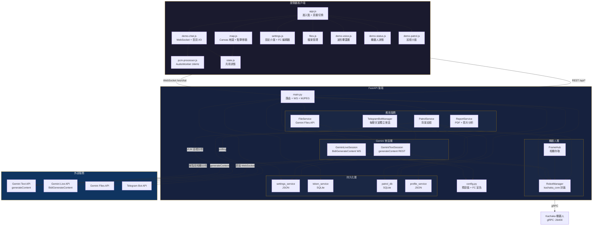

---

## 雙 API 模式架構

系統支援兩種根本不同的 Gemini API 模式，可在運行時透過介面切換。

### 模式切換機制

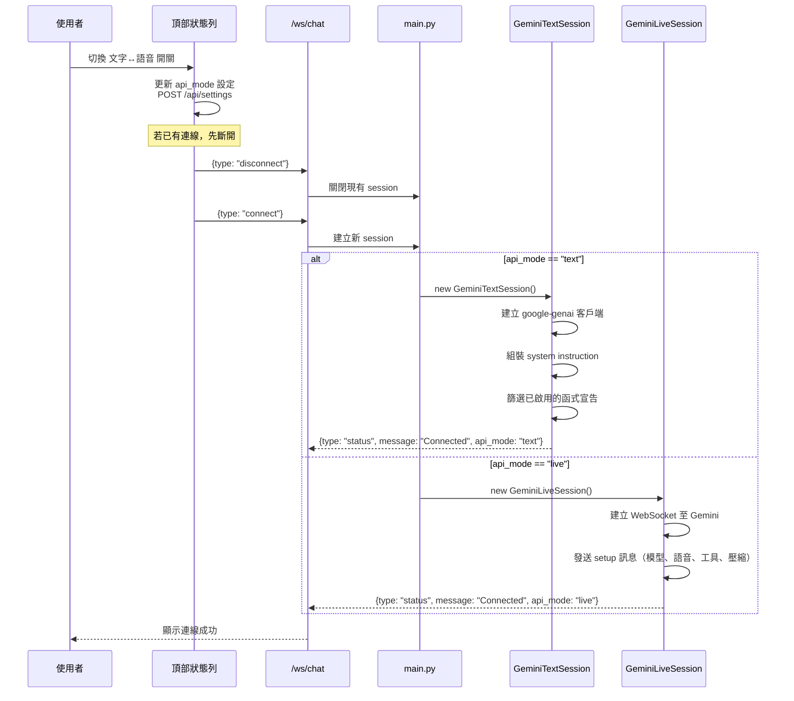

**關鍵程式碼**（`main.py` WebSocket handler）：

```python
if msg_type == "connect":
    settings = settings_service.get_all()
    if settings.get("api_mode") == "live":
        session = GeminiLiveSession(send_to_client, settings)
    else:
        session = GeminiTextSession(send_to_client, settings)
    await session.connect()
```

### Text API 模式詳解

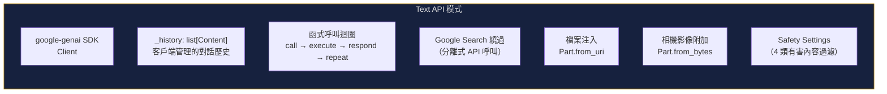

**特點：**

| 面向 | 說明 |
|------|------|
| 傳輸方式 | REST `generateContent` — 每次發送完整對話歷史 |
| 歷史管理 | 客戶端 `_history` 列表（`list[Content]`），完整保留所有對話 |
| 音訊 | 不支援 |
| 清除歷史 | 直接重設 `_history` 列表 |
| Google Search | 需使用分離式 API 呼叫（見下方詳解） |
| 相機分析 | 影像直接以 `Part.from_bytes` 附加在函式回應中 |
| 檔案注入 | 首則訊息時注入已啟用檔案的 `Part.from_uri` |
| Safety Settings | 支援（4 類 × 4 等級） |

### Live API 模式詳解

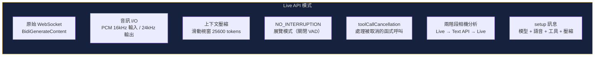

**特點：**

| 面向 | 說明 |
|------|------|
| 傳輸方式 | WebSocket `BidiGenerateContent` — 持久雙向連線 |
| 歷史管理 | 伺服器端（Gemini）管理，搭配滑動視窗壓縮（25600 tokens 觸發） |
| 音訊 | 原生支援（16 kHz PCM 輸入 / 24 kHz PCM 輸出） |
| 清除歷史 | 需重新連線 WebSocket |
| Google Search | 原生支援（兩工具同時存在於 setup 訊息） |
| 相機分析 | 兩階段 — `toolResponse` 不支援多模態資料，需透過 Text API 分析後回傳文字 |
| Safety Settings | 目前不支援 |
| 展覽模式 | `activityHandling: NO_INTERRUPTION` 防止 VAD 打斷回應 |

### 雙模式差異對照

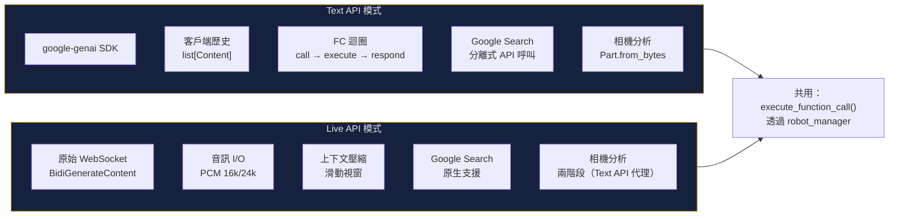

| 面向 | Text API | Live API |
|------|----------|----------|
| 傳輸 | REST (`generateContent`) | WebSocket (`BidiGenerateContent`) |
| 歷史 | 客戶端管理 (`_history`) | 伺服器端管理（Gemini） |
| 音訊 | 不支援 | 原生（PCM 16kHz 輸入 / 24kHz 輸出） |
| Google Search | 分離式 API 呼叫繞過 | 原生（兩工具共存於 setup） |
| 相機分析 | 影像直接附加至回應 | 兩階段（先 Text API 分析，再文字回傳） |
| 清除歷史 | 重設 `_history` 列表 | 重新連線 WebSocket |
| 上下文管理 | 每次發送完整歷史 | 滑動視窗壓縮（25600 tokens） |
| Safety Settings | 支援 | 不支援 |

---

## Google Search 多層次呼叫架構

### 問題背景

部分 Gemini 模型（如 `gemini-3-flash-preview`）**無法在同一個 API 請求中同時使用 Google Search 與 Function Calling**。發送兩者會收到：

```
400 INVALID_ARGUMENT: Tool use with function calling is unsupported by the model.
```

所有嘗試的組合方式均失敗：

| 嘗試方式 | 結果 |
|---------|------|
| `google_search` + `function_declarations`（分開的 Tool 物件） | 400 |
| `google_search_retrieval` + `function_declarations` | 400: "google_search_retrieval is not supported" |
| 兩工具 + `tool_config.function_calling_config.mode = "AUTO"` | 400 |
| 兩者放在同一個 `types.Tool()` | SDK 靜默丟棄 `google_search`，模型產生幻覺 |

### Text API 的分離式呼叫策略

核心思路：**將 Google Search 偽裝成一般函式宣告**，當模型嘗試呼叫時攔截並以獨立 API 呼叫執行搜尋。

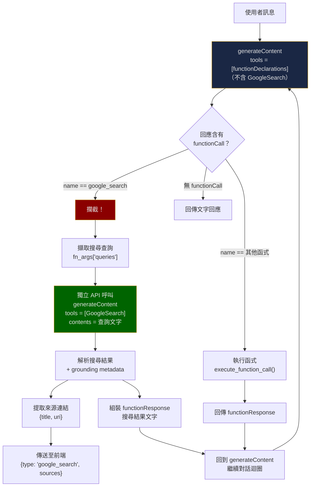

#### 第 1 層：函式宣告注入

在 `connect()` 階段，只將 `functionDeclarations` 作為工具發送（**不含 GoogleSearch**）。同時，將 `google_search` 注入為一般函式宣告：

```python
# gemini_text_service.py — connect()
if enable_google_search:
    func_decls.append({
        "name": "google_search",
        "description": "搜尋 Google 以取得即時資訊...",
        "parameters": {
            "type": "object",
            "properties": {
                "queries": {
                    "type": "array",
                    "items": {"type": "string"}
                }
            },
            "required": ["queries"]
        }
    })
tool_list = [types.Tool(function_declarations=func_decls)]
# ↑ 注意：沒有加入 GoogleSearch 工具
```

#### 第 2 層：函式呼叫攔截

在 `_generate()` 迴圈中，檢查模型回傳的函式呼叫名稱：

```python
# gemini_text_service.py — _generate()
if fn_name == "google_search":
    result = await self._handle_google_search(fn_args)
else:
    result = await asyncio.to_thread(
        execute_function_call, fn_name, fn_args
    )
```

#### 第 3 層：獨立搜尋 API 呼叫

`_handle_google_search()` 使用**完全獨立的 `generateContent` 呼叫**，僅攜帶 `GoogleSearch` 工具：

```python
# gemini_text_service.py — _handle_google_search()
search_config = types.GenerateContentConfig(
    tools=[types.Tool(google_search=types.GoogleSearch())],
)
response = await asyncio.to_thread(
    self._client.models.generate_content,
    model=self._model,
    contents=search_query,
    config=search_config,
)
# 解析搜尋結果 + grounding metadata
```

#### 第 4 層：結果回傳與繼續對話

搜尋結果以 `functionResponse` 的形式加入對話歷史，然後繼續呼叫 `generateContent` 讓模型根據搜尋結果產生最終回應。

### Grounding 衝突處理

當 Text API 回應中**同時包含 Google Search grounding metadata 與函式呼叫**時，會發生衝突。系統的處理策略：

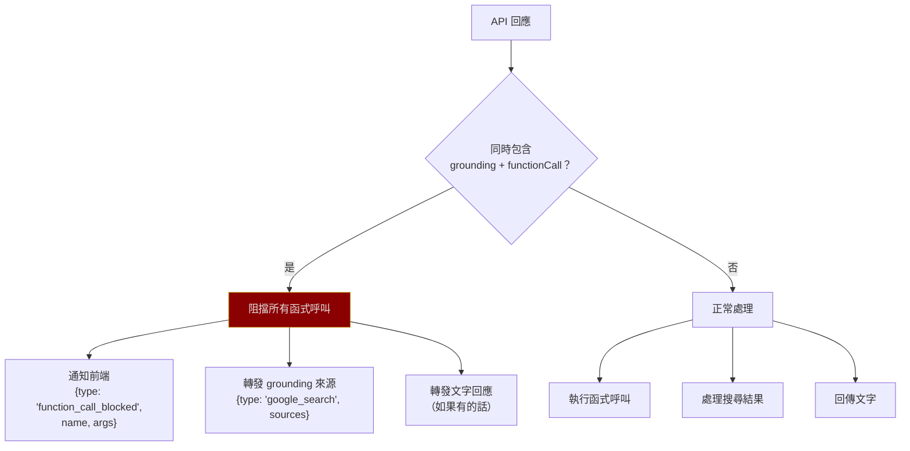

```python
if used_google_search and function_call_parts:
    # 同時有 grounding + FC → 阻擋函式呼叫，避免重複執行
    for part in function_call_parts:
        await self._send_to_client({
            "type": "function_call_blocked",
            "name": fc.name,
            "args": dict(fc.args) if fc.args else {},
        })
```

### Live API 的原生支援

Live API **原生支援同時使用 Google Search 與 Function Calling**，兩者作為 `tools` 陣列中的獨立項目：

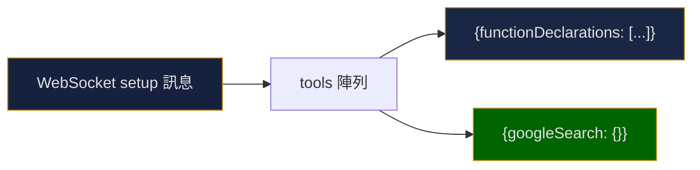

```python
# gemini_live_service.py — connect()
tools = [{"functionDeclarations": func_decls}]
if enable_google_search:
    tools.append({"googleSearch": {}})  # 獨立的工具項目
```

**不需要任何繞過機制**。Live API 的 `BidiGenerateContent` 協定原生支援兩種工具共存。

### Google Search 完整流程圖

以下是完整的 Google Search 呼叫流程，涵蓋 Text API 與 Live API 兩種模式：

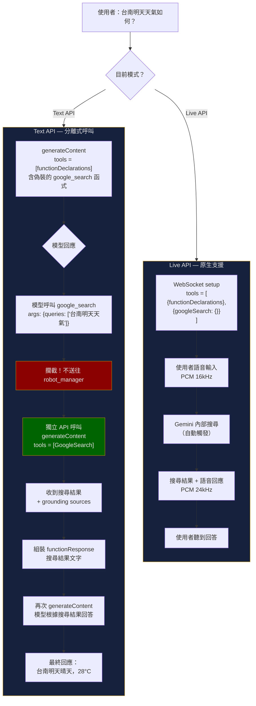

---

## 函式呼叫架構

函式呼叫是 Gemini 自然語言理解與實體機器人控制之間的橋樑。兩種 API 模式共用同一個函式分派器。

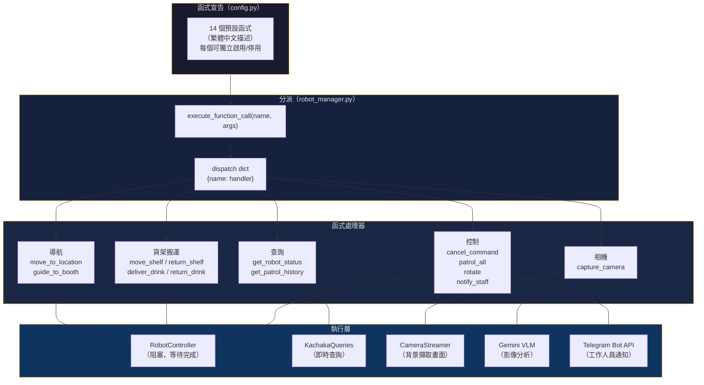

### 相機分析的模式差異

相機拍照分析在兩種模式下的處理方式不同：

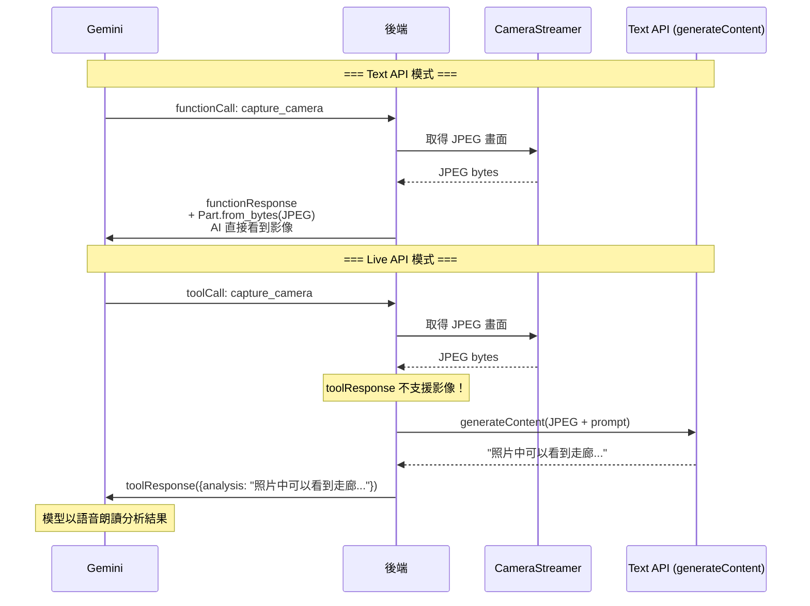

---

## 對話資料流

### Text API 對話流程

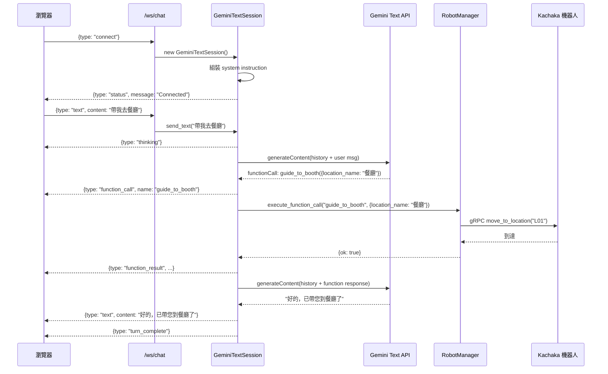

### Live API 對話流程

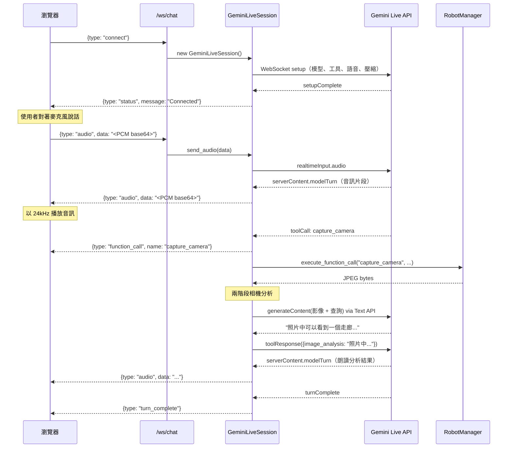

### 巡檢流程

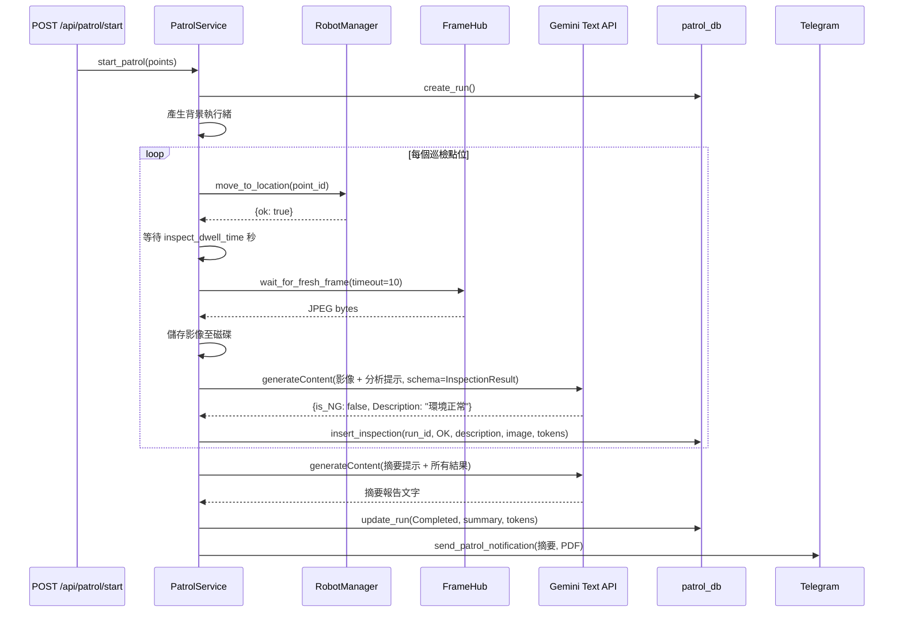

### Telegram 橋接流程

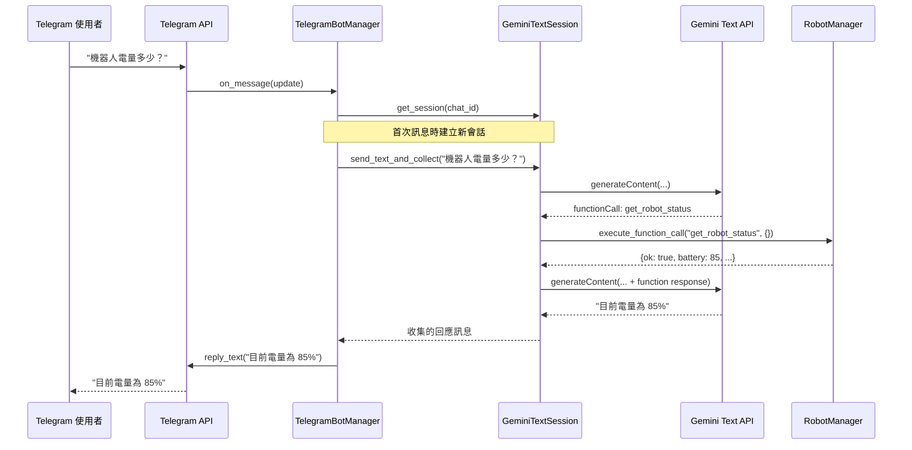

---

## 系統指令組裝

兩種 API 模式使用相同的方式組裝系統提示詞，由 4 個可設定的區段串接而成：

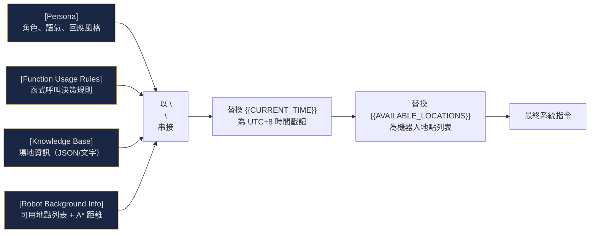

所有 4 個區段皆可透過 Settings > Prompt 頁籤的文字編輯器修改。

---

## 設定系統

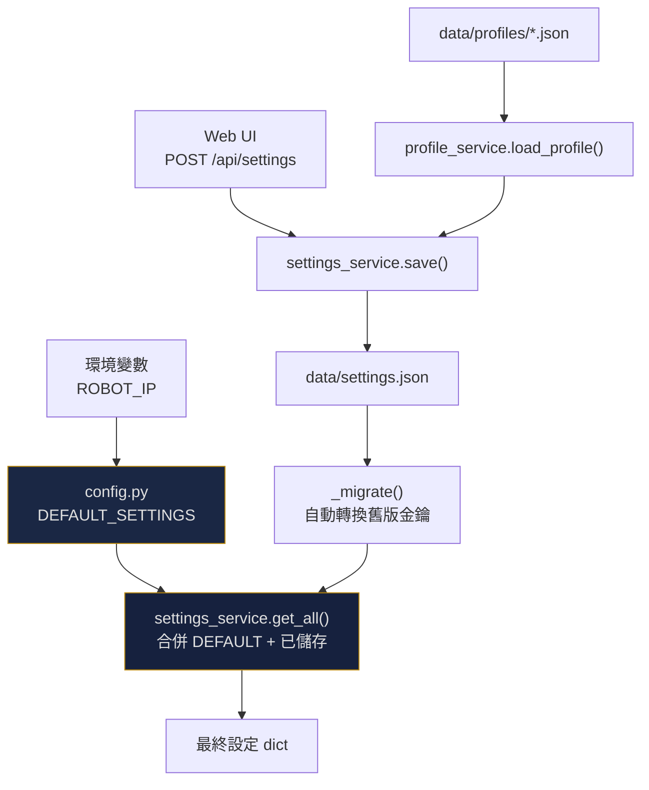

### 設定遷移

`settings_service._migrate()` 自動處理向下相容：

| 舊金鑰 | 新金鑰 | 說明 |
|--------|--------|------|
| `gemini_model` | `text_model` / `live_model` | 分離為雙模式各自的模型設定 |
| `enable_google_search` | `text_enable_google_search` + `live_enable_google_search` | 分離為雙模式各自的搜尋開關 |
| `drink_shelf_home` | `kiosk_location` | 更名 |
| `telegram_chat_id`（字串） | `telegram_chat_ids`（陣列） | 支援多個 Chat ID |
| `patrol_points`（物件陣列） | `patrol_points`（字串陣列） | 簡化為地點 ID 字串 |

---

## 部署架構

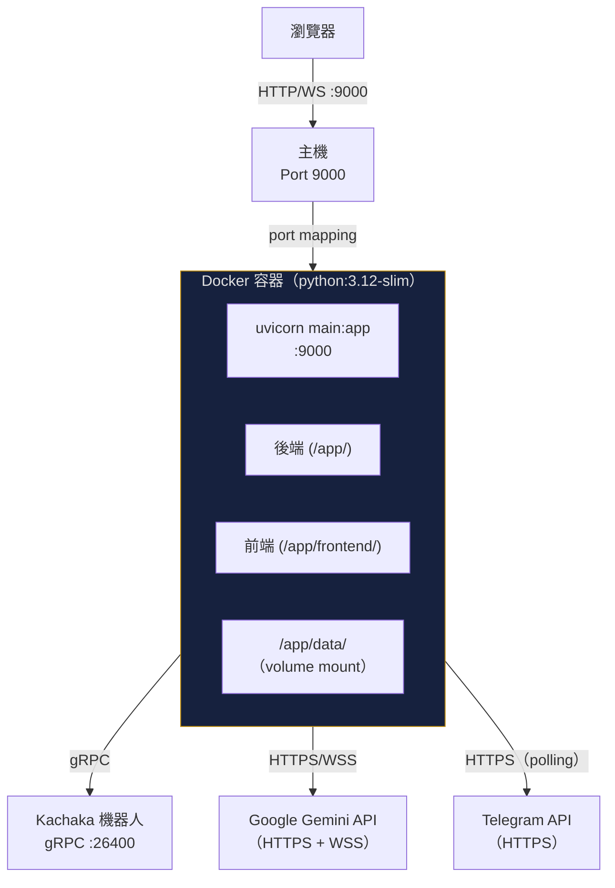

### 開發模式

```yaml
# docker-compose.yml
volumes:
  - ./src/backend:/app          # 即時程式碼重載
  - ./src/frontend:/app/frontend
  - ./data:/app/data            # 持久化資料
command: uvicorn main:app --host 0.0.0.0 --port 9000 --reload
```

### 生產模式

```yaml
# docker-compose.prod.yml
image: ghcr.io/sigmarobotics/kachaka-gemini:latest
volumes:
  - ./data:/app/data            # 僅掛載資料
# 不掛載原始碼，不使用 --reload
```

### 多架構建置

`build-multiarch.sh` 使用 `docker buildx` 建置 `linux/amd64` 與 `linux/arm64`，支援 x86-64 伺服器與 ARM 設備（Raspberry Pi、Jetson 等）。
