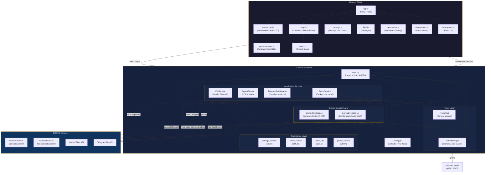
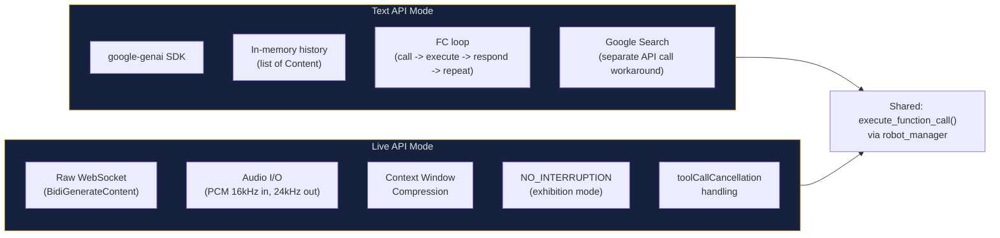
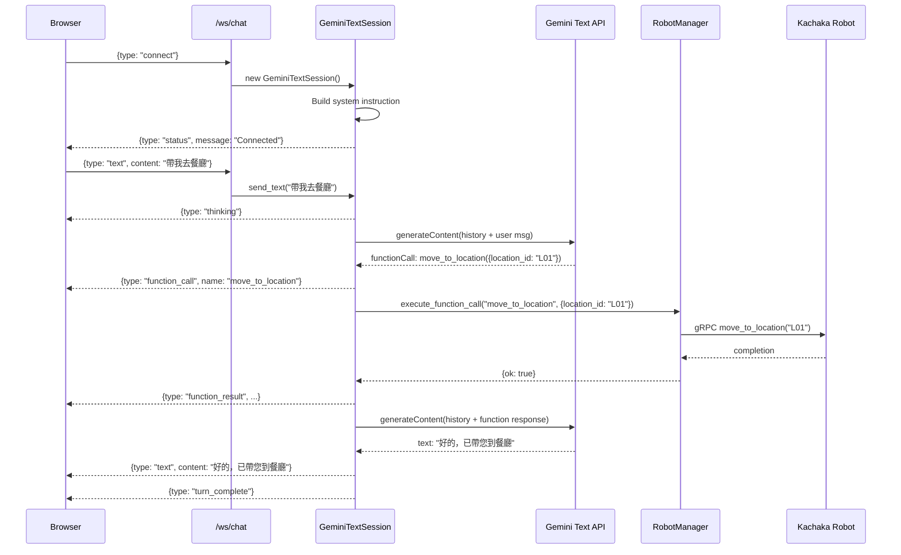
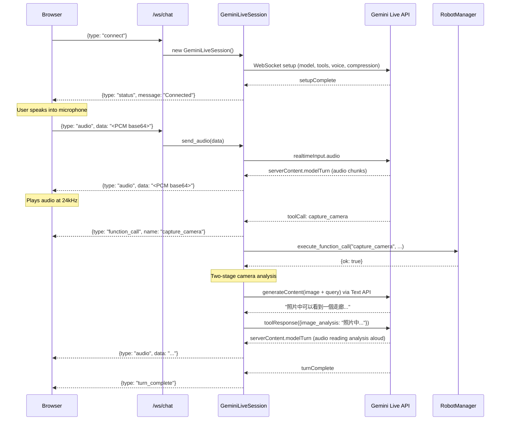
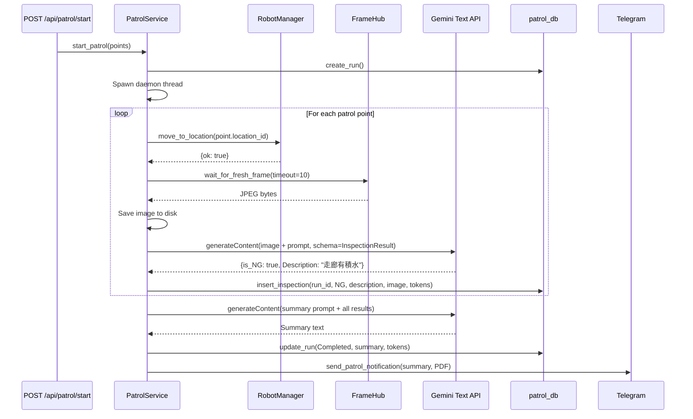
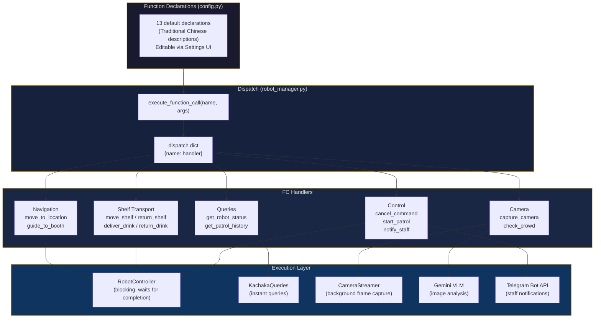
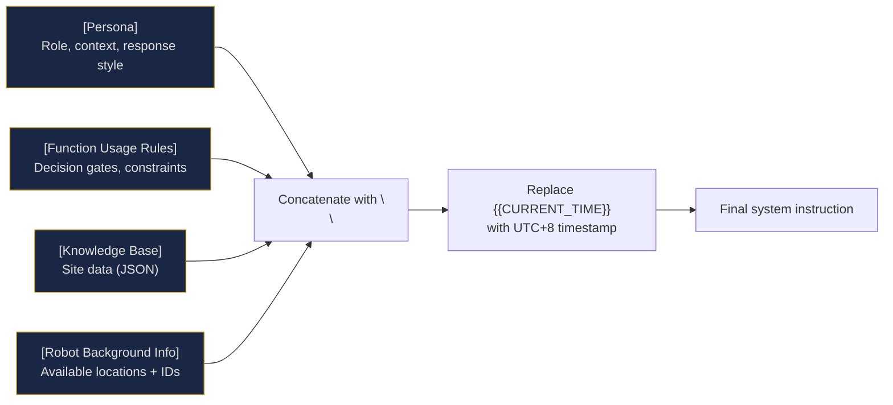
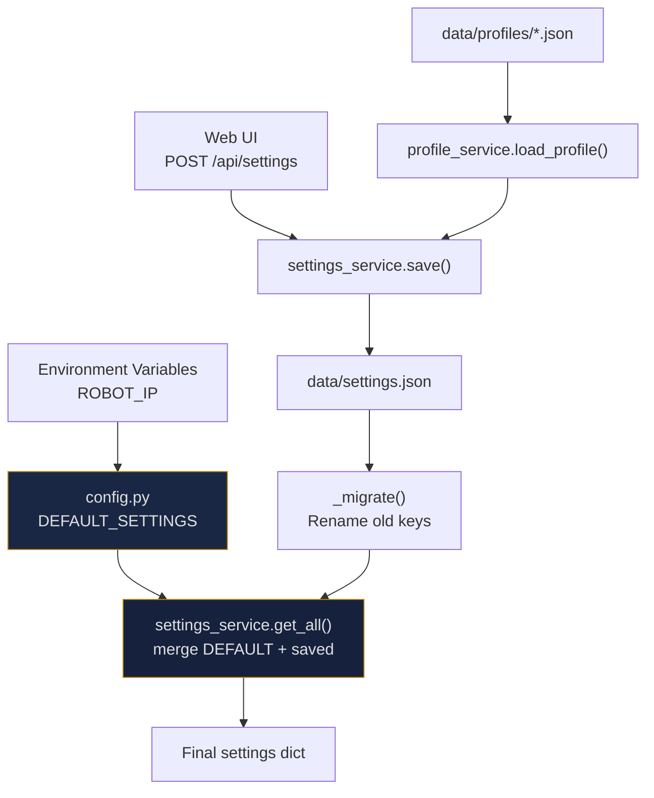
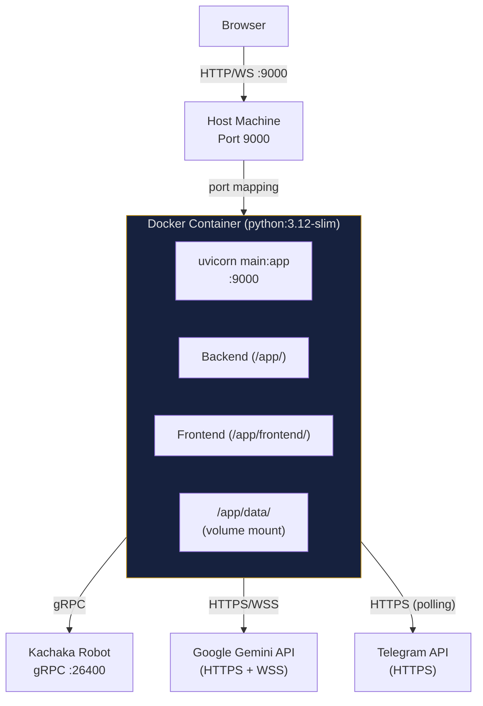

# Architecture Documentation

This document describes the internal architecture of the Kachaka + Gemini system, covering component design, data flows, key technical decisions, and deployment.

## Table of Contents

- [System Overview](#system-overview)
- [Architecture Diagram](#architecture-diagram)
- [Component Breakdown](#component-breakdown)
  - [Backend Modules](#backend-modules)
  - [Frontend Modules](#frontend-modules)
- [Dual API Mode Design](#dual-api-mode-design)
- [Data Flow](#data-flow)
  - [Text API Conversation Flow](#text-api-conversation-flow)
  - [Live API Conversation Flow](#live-api-conversation-flow)
  - [Patrol Flow](#patrol-flow)
  - [Telegram Bridge Flow](#telegram-bridge-flow)
- [Function Calling Architecture](#function-calling-architecture)
- [Data Model](#data-model)
- [System Instruction Assembly](#system-instruction-assembly)
- [Key Technical Decisions](#key-technical-decisions)
- [Configuration System](#configuration-system)
- [Error Handling Patterns](#error-handling-patterns)
- [Deployment Architecture](#deployment-architecture)

---

## System Overview

Kachaka + Gemini is a web application that bridges a [Kachaka](https://kachaka.life/) mobile robot to Google's Gemini AI API. The system enables natural language (text and voice) conversations with the AI, which can autonomously control the robot through function calling. The system supports three interaction channels: a web-based chat UI, real-time voice via the Gemini Live API, and a Telegram bot bridge.

The backend is a Python FastAPI application serving both REST endpoints and a WebSocket proxy between the browser and Gemini. The frontend is a vanilla JavaScript single-page application with no build step. Persistent data is stored in SQLite databases and JSON files on disk.

---

## Architecture Diagram



---

## Component Breakdown

### Backend Modules

All backend modules live in `src/backend/`. In the Docker container, they are copied to `/app/`.

#### `main.py` -- FastAPI Application

The central entry point. Responsibilities:

- **FastAPI app** with `Jinja2Templates` for HTML rendering and `StaticFiles` for serving CSS/JS
- **REST API** for robot control, settings, profiles, files, patrol, and token usage
- **WebSocket `/ws/chat`** handler that creates `GeminiLiveSession` or `GeminiTextSession` depending on the current `api_mode` setting
- **MJPEG stream** at `/api/camera/front` via `StreamingResponse` (10 FPS)
- **Startup hooks**: auto-connect to robot, start Telegram bot, initialize patrol DB
- **Shutdown hooks**: stop Telegram bot, disconnect robot

The WebSocket handler dispatches client messages by `type`:

| `type` | Action |
|--------|--------|
| `connect` | Create session (Live or Text), call `session.connect()` |
| `disconnect` | Close session |
| `text` | Forward to `session.send_text()` |
| `audio` | Forward to `session.send_audio()` (Live only) |
| `clear_history` | Call `session.clear_history()` |
| `start_patrol` | Invoke `patrol_service.start_patrol()` |

#### `gemini_live_service.py` -- Live API Session

`GeminiLiveSession` manages a raw WebSocket connection to the Gemini Live API (`BidiGenerateContent`).

Key responsibilities:

- **Setup**: Sends a JSON setup message with model, generation config (voice, temperature, etc.), tools (function declarations + optional Google Search), system instruction, and `contextWindowCompression` (sliding window, 25600 trigger tokens)
- **Exhibition mode**: When `live_auto_interrupt` is false, sets `activityHandling: NO_INTERRUPTION` to prevent VAD from interrupting model output
- **Receive loop** (`_receive_from_gemini`): Async task that processes Gemini messages -- forwards text/audio to the browser, dispatches function calls, handles `toolCallCancellation`, and tracks token usage
- **Function call execution**: Runs `robot_manager.execute_function_call()` in a thread pool via `asyncio.to_thread` to avoid blocking the event loop (movement commands are blocking gRPC calls)
- **Two-stage camera analysis**: When `capture_camera` is called, the Live API `toolResponse` cannot carry images. Instead, `_analyze_camera_image()` sends the JPEG to a Text API `generateContent` call, and the resulting text analysis is included in the tool response so the Live model reads it aloud
- **Tool call cancellation tracking**: Maintains `_cancelled_fc_ids` set; if Gemini cancels a tool call (e.g. user interrupted), the completed response is discarded instead of being sent back

#### `gemini_text_service.py` -- Text API Session

`GeminiTextSession` manages a stateful conversation via the `google-genai` SDK's `generate_content`.

Key responsibilities:

- **In-memory history** (`_history` list of `types.Content`): Maintains the full conversation for multi-turn context
- **Function calling loop** (`_generate`): Calls `generate_content` in a loop -- if the response contains function calls, executes them, appends function responses to history, and loops again
- **Google Search workaround**: Some models (e.g. `gemini-3-flash-preview`) cannot combine Google Search and function declarations in one request. The Text API injects a `google_search` function declaration into the tools list. When the model emits this call, `_handle_google_search()` makes a separate API call with `GoogleSearch` tool only and returns the result
- **Grounding conflict resolution**: If a response contains both Google Search grounding metadata and function calls, the function calls are blocked (sent to frontend as `function_call_blocked`)
- **File injection**: On the first message, enabled files from the Gemini Files API are injected as `Part.from_uri` alongside the user's text
- **Camera image attachment**: For `capture_camera`, the JPEG frame is attached as `Part.from_bytes` alongside the function response so the model can see and analyze it

#### `robot_manager.py` -- Robot Manager

`RobotManager` is a module-level singleton facade over `kachaka_core` components.

Key design:

- **Connection lifecycle**: `connect(ip)` creates `KachakaConnection`, pings, then starts `RobotController`, `KachakaQueries`, and `CameraStreamer`. `disconnect()` stops all components and removes the connection from the pool.
- **Thread safety**: All connection/disconnection operations are guarded by `self._lock`
- **State queries**: `get_state()` returns battery/pose/map info from `RobotController.state`. Map PNG is fetched once and cached.
- **Function call dispatch**: `execute_function_call(name, args)` routes to private `_fc_*` handler methods. Movement commands use `RobotController` (blocking, waits for completion). Camera/status commands use `CameraStreamer`/`KachakaQueries` directly.
- **Auto-connect**: On startup, reads saved IP from settings and attempts connection

The 13 function call handlers:

| Handler | Behavior |
|---------|----------|
| `_fc_move_to_location` | `ctrl.move_to_location(id, timeout=120)` |
| `_fc_move_shelf` | `ctrl.move_shelf(shelf_id, dest_id, timeout=120)` |
| `_fc_return_shelf` | `ctrl.return_shelf(shelf_id, timeout=60)` |
| `_fc_get_robot_status` | Reads battery, pose, command state |
| `_fc_cancel_command` | `client.cancel_command()` |
| `_fc_capture_camera` | Returns frame from `CameraStreamer` |
| `_fc_guide_to_booth` | Move to location, dwell (configurable), return home |
| `_fc_start_patrol` | Delegates to `PatrolService` |
| `_fc_get_patrol_history` | Reads recent runs from `patrol_db` |
| `_fc_check_crowd` | Move, capture, analyze via Gemini, Telegram notify, return |
| `_fc_notify_staff` | Send Telegram message via Bot API |
| `_fc_deliver_drink` | `ctrl.move_shelf(drink_shelf_id, destination)` |
| `_fc_return_drink` | `ctrl.return_shelf(drink_shelf_id)` + `return_home()` |

#### `patrol_service.py` -- Patrol Service

`PatrolService` orchestrates autonomous multi-point patrols in a background daemon thread.

Flow:

1. **Start**: Validates preconditions (robot connected, API key, patrol points), creates DB run, spawns daemon thread
2. **Per point**: Move robot -> wait for arrival -> capture camera frame via `FrameHub` -> VLM inspection via Gemini `generateContent` with Pydantic structured output (`InspectionResult: {is_NG, Description}`) -> save image (renamed with OK/NG tag) -> insert inspection into DB
3. **Summary**: After all points, generates an AI summary report via Gemini
4. **Notification**: If `patrol_telegram_notify` is true, sends a Telegram message with summary + PDF attachment
5. **Cancellation**: `cancel_patrol()` sets a threading event; the loop checks it before each step and after each movement

State machine: `IDLE -> STARTING -> MOVING <-> INSPECTING -> GENERATING_REPORT -> COMPLETED`

Progress callbacks allow external consumers (e.g. WebSocket broadcast) to receive real-time updates.

#### `telegram_service.py` -- Telegram Bot Bridge

`TelegramBotManager` runs a Telegram bot that bridges messages to per-chat `GeminiTextSession` instances.

- Each Telegram chat gets its own `GeminiTextSession` (stored in `_sessions` dict by `chat_id`)
- Text messages are sent via `session.send_text_and_collect()` which replaces the callback to collect responses
- Photo messages download the image, inject it into the session's history as `Part.from_bytes`, then call `_generate()`
- `/start` and `/clear` commands are handled
- `send_patrol_notification()` sends patrol completion messages with optional PDF attachment

#### `file_service.py` -- Gemini Files API

Manages the lifecycle of files uploaded to the Gemini Files API.

- **Upload**: Saves file locally to `data/uploads/` with sanitized filename, uploads to Gemini via `client.files.upload`, stores metadata in `data/files.json` (atomic writes via temp file + `os.replace`)
- **Expiry**: Files expire after 48 hours (Gemini's server-side TTL). The `expired` field is computed dynamically on `list_files()`
- **Re-upload**: `reupload_file()` re-uploads from local copy when a file has expired
- **Toggle**: Files can be enabled/disabled without deletion
- **Injection**: `get_enabled_files()` returns URIs for non-expired, enabled files. The Text API session injects these as `Part.from_uri` on the first user message.

Thread safety: `_meta_lock` guards metadata reads/writes.

#### Other Backend Modules

| Module | Purpose |
|--------|---------|
| `settings_service.py` | JSON file persistence. Merges saved values with `DEFAULT_SETTINGS` on load. Includes `_migrate()` for backward-compatible key renames. |
| `token_service.py` | SQLite (WAL mode) for per-session token usage tracking. Thread-safe via module-level lock. |
| `patrol_db.py` | SQLite (WAL mode) for patrol runs and inspection results. Context manager with auto-commit/rollback. |
| `report_service.py` | PDF generation via ReportLab with CJK font support (NotoSansCJK or WenQuanYi Zen Hei). Also handles video analysis via Gemini Files API. |
| `frame_hub.py` | Thin wrapper over `RobotManager` camera access. Provides `wait_for_fresh_frame()` with timeout for patrol inspections. |
| `profile_service.py` | CRUD for named settings profiles stored as JSON files in `data/profiles/`. |
| `config.py` | Default settings, 13 function declarations (in Traditional Chinese), persona text, static knowledge, robot background info, knowledge base JSON. Detects Docker vs local dev layout for `DATA_DIR`. |

### Frontend Modules

All frontend code lives in `src/frontend/`. No build step -- ES modules are loaded directly by the browser.

| Module | Purpose |
|--------|---------|
| `app.js` | Entry point. Tab switching (Demo/Settings), WebSocket lifecycle, message routing, mode switching (Text/Live), quick actions, status polling (2s interval), chat UI (bubbles, typing indicator), export/clear. |
| `demo-chat.js` | WebSocket client for audio. AudioWorklet-based mic capture at 16 kHz PCM. Gapless audio playback at 24 kHz via AudioContext. Mute/unmute for exhibition mode. |
| `demo-voice.js` | Full-screen waveform overlay with listening (blue) and speaking (green) states. Canvas animation. |
| `demo-status.js` | Polls `/api/robot/status` and updates connection indicator lights. |
| `demo-patrol.js` | Patrol start/cancel buttons, progress display, history listing. |
| `demo-patrol-page.js` | Standalone patrol dashboard for `/demo/patrol` page (history grid, report modal, token chart). |
| `map.js` | Renders the floor map PNG on a `<canvas>`, transforms between world coordinates and pixel space. Supports click-to-move and drag-to-set-pose. |
| `settings.js` | Three-tab settings UI (General / Text API / Live API). Graphical function declaration editor with per-function toggle switches, import/export. Generation parameter sliders. Robot connection panel. |
| `files.js` | File management UI: upload, enable/disable toggle, delete, re-upload expired files. |
| `state.js` | Shared reactive state object (robot pose, map info). Provides `escapeHtml()` utility. |
| `pcm-processor.js` | AudioWorklet processor that captures PCM samples and posts them to the main thread as `Float32Array`. |

---

## Dual API Mode Design

The application supports two fundamentally different Gemini API modes, selectable at runtime via the settings UI.



| Aspect | Text API | Live API |
|--------|----------|----------|
| Transport | REST (`generateContent`) | WebSocket (`BidiGenerateContent`) |
| History | Client-managed (`_history` list) | Server-managed (Gemini side) |
| Audio | Not supported | Native (PCM 16kHz in, 24kHz out) |
| Google Search | Workaround (separate API call) | Native (both tools in setup) |
| Camera analysis | Image attached to function response | Two-stage (separate `generateContent` call) |
| Session lifetime | Lives until WebSocket closes | Lives until WebSocket closes |
| Context management | Full history sent each call | Sliding window compression (25600 tokens) |
| Clear history | Reset `_history` list | Reconnect WebSocket |

---

## Data Flow

### Text API Conversation Flow



### Live API Conversation Flow



### Patrol Flow



### Telegram Bridge Flow


---

## Function Calling Architecture

Function calling is the bridge between Gemini's natural language understanding and physical robot control.



### Adding a New Function

1. Add declaration to `DEFAULT_FUNCTION_DECLARATIONS` in `config.py` (include `name`, `description`, `parameters`)
2. Add handler method `_fc_<name>` in `RobotManager`
3. Add the name to the `dispatch` dict in `execute_function_call()`
4. Add interim phrase to `DEFAULT_INTERIM_PHRASES` in `config.py` (for Live API TTS during execution)

### Per-function Enable/Disable

Function declarations include an `enabled` field (default `True`). When building the tools list for a Gemini session, declarations with `enabled: false` are filtered out. The `enabled` key is stripped before sending to the API (Gemini does not recognize it).

```python
func_decls = [
    {k: v for k, v in f.items() if k != "enabled"}
    for f in all_decls if f.get("enabled", True)
]
```

---

## Data Model

### SQLite: `tokens.db`

```
token_usage
  id          INTEGER PRIMARY KEY AUTOINCREMENT
  session_id  TEXT NOT NULL
  timestamp   TEXT NOT NULL (ISO 8601)
  prompt      INTEGER NOT NULL DEFAULT 0
  response    INTEGER NOT NULL DEFAULT 0
  total       INTEGER NOT NULL DEFAULT 0
```

### SQLite: `patrol.db`

```
patrol_runs
  id                    INTEGER PRIMARY KEY AUTOINCREMENT
  start_time            TEXT NOT NULL
  end_time              TEXT
  status                TEXT NOT NULL DEFAULT 'Running'
  report_content        TEXT          -- AI summary
  model_id              TEXT
  video_path            TEXT
  video_analysis        TEXT
  input_tokens          INTEGER NOT NULL DEFAULT 0
  output_tokens         INTEGER NOT NULL DEFAULT 0
  total_tokens          INTEGER NOT NULL DEFAULT 0
  report_input_tokens   INTEGER NOT NULL DEFAULT 0
  report_output_tokens  INTEGER NOT NULL DEFAULT 0
  report_total_tokens   INTEGER NOT NULL DEFAULT 0
  video_input_tokens    INTEGER NOT NULL DEFAULT 0
  video_output_tokens   INTEGER NOT NULL DEFAULT 0
  video_total_tokens    INTEGER NOT NULL DEFAULT 0

inspection_results
  id              INTEGER PRIMARY KEY AUTOINCREMENT
  run_id          INTEGER NOT NULL  -> patrol_runs(id)
  point_name      TEXT NOT NULL
  coordinate_x    REAL
  coordinate_y    REAL
  prompt          TEXT
  ai_response     TEXT              -- Raw JSON from VLM
  is_ng           INTEGER NOT NULL DEFAULT 0
  ai_description  TEXT
  image_path      TEXT
  timestamp       TEXT NOT NULL (ISO 8601)
  input_tokens    INTEGER NOT NULL DEFAULT 0
  output_tokens   INTEGER NOT NULL DEFAULT 0
  total_tokens    INTEGER NOT NULL DEFAULT 0
```

### JSON: `settings.json`

Persisted to `data/settings.json`. Contains all user-configurable settings merged with `DEFAULT_SETTINGS` from `config.py` on load. Key groups:

- **API keys**: `gemini_api_key`, `telegram_bot_token`
- **Mode**: `api_mode` (`"text"` or `"live"`)
- **Per-mode model + parameters**: `text_model`, `live_model`, `text_temperature`, `live_temperature`, etc.
- **System instruction sections**: `persona`, `static_knowledge`, `knowledge_base`, `robot_background_info`
- **Function declarations**: `function_declarations` (array of objects with `name`, `description`, `parameters`, `enabled`)
- **Patrol config**: `patrol_points`, `patrol_model`, `patrol_system_prompt`, etc.
- **Exhibition config**: `exhibition_title`, `exhibition_quick_actions`, `live_auto_interrupt`, `drink_shelf_id`, etc.
- **Telegram**: `telegram_bot_token`, `telegram_chat_id`
- **Audio**: `voice_name`, `interim_phrases`, `interim_audio`, `enable_interim_response`

### JSON: `files.json`

Metadata for files uploaded to the Gemini Files API:

```json
[
  {
    "id": "a1b2c3d4e5f6",
    "filename": "document.pdf",
    "mime_type": "application/pdf",
    "size_bytes": 102400,
    "local_path": "/app/data/uploads/a1b2c3d4e5f6_document.pdf",
    "gemini_name": "files/abc123",
    "gemini_uri": "https://generativelanguage.googleapis.com/...",
    "uploaded_at": "2026-03-03T10:00:00+00:00",
    "expires_at": "2026-03-05T10:00:00+00:00",
    "enabled": true
  }
]
```

---

## System Instruction Assembly

Both API modes construct the system prompt from 4 configurable sections:



The default persona is configured for deployment at the Banqiao Veterans Home (board and care facility in New Taipei City), with:
- Role: Smart assistant deployed in the main lobby on a Kachaka robot
- Core goal: Help elderly residents with information, navigation, and material transport
- Language: Traditional Chinese
- Response length: Max 3 sentences per reply (except tour information)
- Grounding: Uses `{{CURRENT_TIME}}` for time-aware responses

All 4 sections are editable through the Settings UI in an accordion-style editor.

---

## Key Technical Decisions

### Why raw WebSocket for Live API instead of SDK

The `google-genai` SDK does not fully expose the `BidiGenerateContent` WebSocket protocol's capabilities. Using raw WebSocket allows:
- Direct control over the setup message (e.g. `contextWindowCompression`, `activityHandling`)
- Handling of `toolCallCancellation` messages
- Fine-grained audio chunk forwarding
- Custom reconnection logic

### Why kachaka_core instead of direct KachakaApiClient

`kachaka_core` (from `kachaka-sdk-toolkit`) provides:
- Connection pooling (`KachakaConnection.get(ip)`)
- `RobotController` with blocking movement commands, timeout, and command ID verification
- `CameraStreamer` with background frame capture (avoids blocking `get_front_camera_image()` in a loop)
- `KachakaQueries` for lightweight state queries

### Why separate Google Search API call

Models like `gemini-3-flash-preview` return HTTP 400 when Google Search and function declarations are in the same request. Rather than disabling one feature, the Text API intercepts `google_search` function calls and executes them via a dedicated API call with `GoogleSearch` tool only. See [google-search-function-calling.md](google-search-function-calling.md) for the full analysis.

### Why no frontend build step

The application is designed for rapid iteration in exhibition/demo environments. Vanilla ES modules eliminate build tool complexity, allow instant edits via Docker volume mount, and keep the frontend dependency-free.

### Why SQLite (not a server database)

The application is designed for single-instance deployment on or near the robot. SQLite with WAL mode provides:
- Zero-configuration persistence
- Safe concurrent reads from multiple threads
- Volume-mountable data directory for Docker

### Why Pydantic structured output for patrol inspections

Using `response_schema=InspectionResult` with `response_mime_type="application/json"` ensures Gemini returns structured JSON with `is_NG` and `Description` fields. This eliminates fragile text parsing and provides reliable OK/NG classification.

---

## Configuration System



### Settings Migration

`settings_service._migrate()` handles backward compatibility:
- `gemini_model` -> `text_model` or `live_model` (depending on current `api_mode`)
- `enable_google_search` -> `text_enable_google_search` + `live_enable_google_search`

### Parameter Clamping

`config._clamp(value, lo, hi, default, cast)` ensures generation parameters stay within valid ranges:
- `temperature`: [0.0, 2.0]
- `max_output_tokens`: [1, 65536]
- `top_p`: [0.0, 1.0]
- `top_k`: [1, 100]

---

## Error Handling Patterns

### Robot Connection

- `robot_manager.connect()` returns `{"ok": bool, "error": str}` -- never throws
- Failed connections clean up via `KachakaConnection.remove(ip)`
- Auto-connect on startup logs warnings but does not crash the app

### Gemini Session Errors

- Both session types catch exceptions in their main loops and send `{type: "error"}` to the client
- Live API `ConnectionClosed` triggers `{type: "gemini_disconnected"}` for frontend auto-reconnect
- Token usage tracking is best-effort (errors are silenced)

### Patrol Resilience

- Movement failures at a point cause that point to be skipped (patrol continues)
- Camera frame timeout (10s) skips the inspection for that point
- The entire patrol loop is wrapped in try/except; on fatal error, the DB run is updated to "Error" status

### Tool Call Cancellation (Live API)

When Gemini sends `toolCallCancellation`, the IDs are stored in `_cancelled_fc_ids`. If a function call completes after being cancelled, its `toolResponse` is not sent back to Gemini (avoids confusing the session state).

### Telegram Notifications

All Telegram API calls are wrapped in try/except -- notification failures are logged but never crash the patrol or main application.

---

## Deployment Architecture



### Development Mode

```yaml
# docker-compose.yml
volumes:
  - ./src/backend:/app          # Live code reload
  - ./src/frontend:/app/frontend
  - ./data:/app/data            # Persistent data
command: uvicorn main:app --host 0.0.0.0 --port 9000 --reload
```

- Source code is volume-mounted for instant edits
- `--reload` watches for file changes
- `data/` directory is shared between host and container

### Production Mode

```bash
docker build -t kachaka-gemini-live .
docker run -d -p 9000:9000 \
  -e ROBOT_IP=<YOUR_ROBOT_IP>:26400 \
  -v $(pwd)/data:/app/data \
  kachaka-gemini-live
```

- No volume mount for source code
- No `--reload` flag
- Health check: `curl -f http://localhost:9000/api/state` (30s interval)
- CJK fonts (`fonts-wqy-zenhei`) installed for PDF report generation

### Multi-arch

`build-multiarch.sh` uses `docker buildx` to build for `linux/amd64` and `linux/arm64`, supporting deployment on both standard servers and ARM devices (e.g. Jetson, Raspberry Pi).
