# Architecture Documentation

This document describes the internal architecture of the Kachaka + Gemini system. It covers component design, data flows, key technical decisions, and deployment, written for developers contributing to or maintaining the codebase.

## Table of Contents

- [System Overview](#system-overview)
- [High-Level Architecture](#high-level-architecture)
- [Hardware / Network Topology](#hardware--network-topology)
- [Component Breakdown](#component-breakdown)
  - [Backend Modules](#backend-modules)
  - [Frontend Modules](#frontend-modules)
- [Dual API Mode Design](#dual-api-mode-design)
- [Data Flow](#data-flow)
  - [WebSocket Message Flow](#websocket-message-flow)
  - [Text API Conversation Flow](#text-api-conversation-flow)
  - [Live API Conversation Flow](#live-api-conversation-flow)
  - [Function Calling Dispatch Flow](#function-calling-dispatch-flow)
  - [Patrol Execution Flow](#patrol-execution-flow)
  - [Settings Data Flow](#settings-data-flow)
  - [Telegram Bridge Flow](#telegram-bridge-flow)
- [Data Model](#data-model)
- [System Instruction Assembly](#system-instruction-assembly)
- [Key Technical Decisions](#key-technical-decisions)
- [Error Handling Patterns](#error-handling-patterns)
- [Deployment Architecture](#deployment-architecture)

---

## System Overview

Kachaka + Gemini is a web application that bridges a [Kachaka](https://kachaka.life/) mobile robot to Google's Gemini AI API. Users interact through natural language (text or voice), and Gemini autonomously controls the robot through function calling. Three interaction channels are supported:

1. **Web chat UI** -- text and voice via a single-page app at `:9000`
2. **Gemini Live API** -- real-time audio streaming with voice input/output
3. **Telegram bot** -- per-chat AI sessions with text and photo support

The backend is a Python FastAPI application (16 modules) serving REST endpoints and a WebSocket proxy between the browser and Gemini. The frontend is a vanilla JavaScript SPA (11 modules, no build step). Persistent data lives in two SQLite databases and two JSON files on disk.

---

## High-Level Architecture

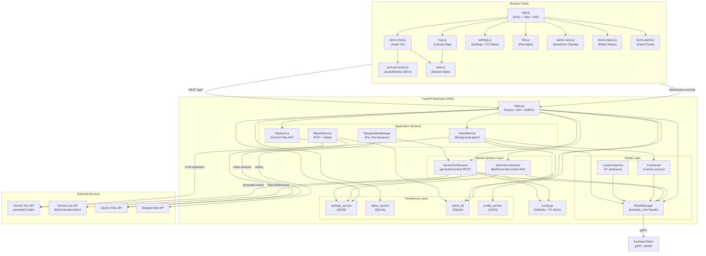

---

## Hardware / Network Topology

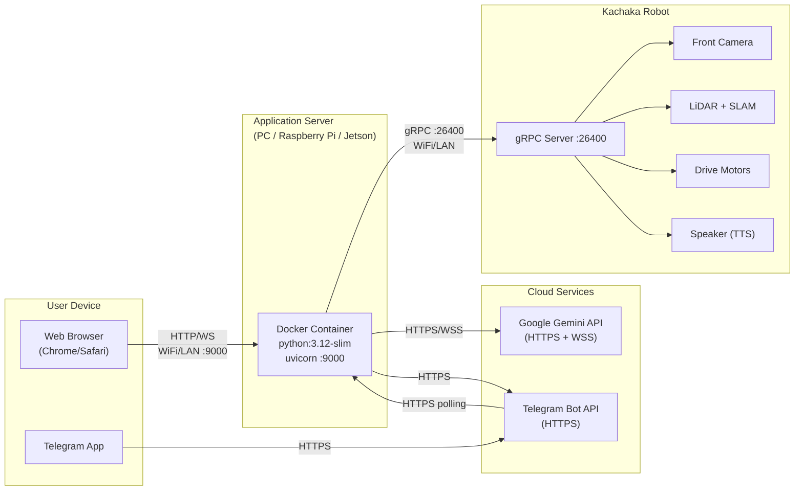

Key network facts:
- The robot exposes a gRPC server on port 26400 (typically at `<YOUR_ROBOT_IP>:26400`)
- The application server and robot must be on the same LAN (WiFi or Ethernet)
- All Gemini API traffic goes over the public internet (HTTPS for Text API, WSS for Live API)
- The browser connects to the FastAPI server via HTTP (REST) and WebSocket (`/ws/chat`)
- Telegram bot uses long polling (not webhooks), so no inbound port is needed

---

## Component Breakdown

### Backend Modules

All backend modules live in `src/backend/`. In the Docker container, they are at `/app/`.

#### `main.py` -- FastAPI Application (585 lines)

Central entry point. Responsibilities:

- **FastAPI app** with `Jinja2Templates` for HTML rendering and `StaticFiles` for `/static`
- **REST API**: robot control, settings, profiles, files, patrol runs, token usage, model listing
- **WebSocket `/ws/chat`**: Creates `GeminiLiveSession` or `GeminiTextSession` depending on the current `api_mode` setting
- **MJPEG stream** at `/api/camera/front` via `StreamingResponse` (~10 FPS, 100ms sleep)
- **Startup hooks**: auto-connect to robot (`robot_manager.auto_connect`), start Telegram bot, initialize patrol DB, ensure report directories
- **Shutdown hooks**: stop Telegram bot, disconnect robot

WebSocket message dispatch:

| Client `type` | Server Action |
|---------------|---------------|
| `connect` | Create session (Live or Text based on `api_mode`), call `session.connect()` |
| `disconnect` | Close current session |
| `text` | Forward to `session.send_text(content)` |
| `audio` | Forward to `session.send_audio(data)` (Live API only) |
| `clear_history` | Call `session.clear_history()` |
| `start_patrol` | Invoke `patrol_service.start_patrol()` |

REST endpoint groups:

| Prefix | Endpoints |
|--------|-----------|
| `/api/state`, `/api/map` | Robot state and map PNG |
| `/api/camera/front` | MJPEG streaming |
| `/api/locations`, `/api/shelves` | Location/shelf enums (A* distance-sorted) |
| `/api/settings`, `/api/settings/defaults` | Settings CRUD |
| `/api/profiles` | Profile CRUD |
| `/api/token_usage` | Token usage summary and reset |
| `/api/models` | Query available Gemini models (filtered by `generateContent` or `bidiGenerateContent`) |
| `/api/files/*` | File upload, list, delete, toggle, re-upload |
| `/api/move`, `/api/cancel_command`, `/api/return_home`, `/api/manual_control` | Direct robot control |
| `/api/robot/connect`, `/api/robot/disconnect`, `/api/robot/status` | Connection management |
| `/api/patrol/*` | Patrol start, cancel, status, run history, PDF download, token stats, analysis report |

#### `gemini_live_service.py` -- Live API Session (400 lines)

`GeminiLiveSession` manages a raw WebSocket connection to the Gemini Live API (`BidiGenerateContent`).

**Class: `GeminiLiveSession`**
- `__init__(client_ws)` -- stores the browser WebSocket reference, generates a session ID
- `connect()` -- builds setup config, opens WebSocket to `wss://generativelanguage.googleapis.com/ws/...`, sends setup JSON, starts `_receive_from_gemini` task
- `send_text(text)` -- sends `clientContent` with text turn
- `send_audio(audio_b64)` -- sends `realtimeInput.audio` with PCM data
- `clear_history()` -- closes and reconnects (Live API history is server-side)
- `close()` -- cancels receive task, closes WebSocket

Setup message includes:
- `model`: e.g. `models/gemini-2.5-flash-native-audio-preview-12-2025`
- `generationConfig`: `responseModalities: ["AUDIO"]`, `speechConfig` with `voiceName`, temperature, maxOutputTokens, topP, topK
- `tools`: `[{functionDeclarations: [...]}, {googleSearch: {}}]` (if enabled)
- `systemInstruction`: assembled system prompt
- `contextWindowCompression`: `{slidingWindow: {}, triggerTokens: 25600}`
- `realtimeInputConfig`: `{activityHandling: "NO_INTERRUPTION"}` when `live_auto_interrupt` is false

Receive loop handles:
- `serverContent` -- forwards text/audio parts to browser, detects `interrupted` and `turnComplete`
- `toolCall` -- executes each function call via `asyncio.to_thread(robot_manager.execute_function_call)`, sends `toolResponse` back
- `toolCallCancellation` -- adds IDs to `_cancelled_fc_ids` set; completed-but-cancelled calls have their response dropped
- `usageMetadata` -- records tokens via `token_service.record()`

#### `gemini_text_service.py` -- Text API Session (449 lines)

`GeminiTextSession` manages a stateful conversation via the `google-genai` SDK's `generate_content`.

**Class: `GeminiTextSession`**
- `__init__(send_callback)` -- stores callback for sending messages to the client
- `connect()` -- creates `genai.Client`, builds config with tools, system instruction, generation parameters, safety settings
- `send_text(text)` -- appends user content to `_history`, calls `_generate()`
- `send_audio(audio_b64)` -- no-op (Text API does not support audio)
- `send_text_and_collect(text)` -- swaps callback to collect responses as a list (used by Telegram)
- `clear_history()` -- resets `_history` list and `_files_injected` flag
- `close()` -- sets `_closed` flag

Key patterns:
- **In-memory history** (`_history`: list of `types.Content`): full conversation sent with each API call
- **Function calling loop** (`_generate`): if response has function call parts, execute them, append function responses to history, loop again
- **Google Search workaround**: injects a `google_search` function declaration. When the model calls it, `_handle_google_search()` makes a separate API call with `GoogleSearch` tool only. See [google-search-function-calling.md](google-search-function-calling.md) for full analysis
- **Grounding conflict resolution**: if response has both Google Search grounding metadata AND function calls, function calls are blocked (sent as `function_call_blocked` to frontend)
- **File injection**: on first message, enabled files from `file_service.get_enabled_files()` are attached as `Part.from_uri`
- **Camera image attachment**: for `capture_camera`, the JPEG frame is attached as `Part.from_bytes` alongside the function response

#### `robot_manager.py` -- Robot Manager (689 lines)

`RobotManager` is a module-level singleton facade over `kachaka_core` components from `kachaka-sdk-toolkit`.

**Class: `RobotManager`**
- Internal components: `_conn` (KachakaConnection), `_ctrl` (RobotController), `_queries` (KachakaQueries), `_camera` (CameraStreamer)
- Thread safety: `self._lock` (threading.Lock) guards all connection/disconnection operations

Connection lifecycle:
1. `connect(ip)` -- gets pooled connection via `KachakaConnection.get(ip)`, pings, starts `RobotController` (fast_interval=1.0), `KachakaQueries`, `CameraStreamer` (interval=1.0, front camera). Saves IP to settings, invalidates location cache.
2. `disconnect()` -- stops camera, controller, queries; removes connection from pool
3. `auto_connect()` -- reads saved IP from settings (falls back to `ROBOT_IP` env var), attempts connection on startup

Function call dispatch (`execute_function_call`):

| Handler | Behavior |
|---------|----------|
| `_fc_move_to_location` | `ctrl.move_to_location(id, timeout=120)` |
| `_fc_move_shelf` | `ctrl.move_shelf(shelf_id, dest_id, timeout=120)` |
| `_fc_return_shelf` | `ctrl.return_shelf(shelf_id, timeout=60)` |
| `_fc_get_robot_status` | Reads battery, pose, command state |
| `_fc_cancel_command` | `client.cancel_command()` |
| `_fc_capture_camera` | Fresh frame via `FrameHub`, analyze with Gemini Text API, Telegram notify |
| `_fc_inspect_location` | Move to named location, dwell (`inspect_dwell_time`), capture+analyze, return home |
| `_fc_patrol_all` | Delegates to `patrol_service.start_patrol()` |
| `_fc_rotate` | `rotate(radians(angle_deg))`, default 15 degrees |
| `_fc_guide_to_booth` | Move to named location, dwell (`guide_dwell_time`), return home |
| `_fc_notify_staff` | Send Telegram text message to all configured chat IDs |
| `_fc_deliver_drink` | `ctrl.move_shelf(drink_shelf_id, kiosk_location)` |
| `_fc_return_drink` | `ctrl.return_shelf(drink_shelf_id)` + `return_home()` |
| `_fc_get_patrol_history` | Read recent runs from `patrol_db` |

The module also defines Telegram helper functions (`_send_telegram_text`, `_send_telegram_photo`) using raw `urllib.request` for sending notifications without depending on `python-telegram-bot`.

#### `patrol_service.py` -- Patrol Service (573 lines)

`PatrolService` orchestrates autonomous multi-point patrols in a background daemon thread.

**Class: `PatrolService`** (singleton)
- State machine: `IDLE -> STARTING -> MOVING <-> INSPECTING -> GENERATING_REPORT -> COMPLETED | CANCELLED | ERROR`
- Thread-safe via `self._lock`; cancellation via `self._cancel_event` (threading.Event)
- Progress callbacks for external consumers

**Patrol flow:**

1. `start_patrol(points)` -- validates (robot connected, API key, points), normalizes points (IDs or dicts), creates DB run, spawns daemon thread
2. **Per point**: move robot via `execute_function_call("move_to_location", ...)` -> capture frame via `frame_hub.wait_for_fresh_frame(timeout=10)` -> VLM inspection via `generateContent` with Pydantic `response_schema=InspectionResult` (structured JSON: `{is_NG: bool, Description: str}`) -> save image (renamed with OK/NG tag) -> insert inspection into DB
3. **Return home**: after all points
4. **Summary**: AI-generated summary via Gemini
5. **Notification**: if `patrol_telegram_notify` is true, sends Telegram message + attempts PDF attachment

**Pydantic schema:**
```python
class InspectionResult(BaseModel):
    is_NG: bool = Field(description="True if abnormal/NG condition detected")
    Description: str = Field(description="Description of findings")
```

#### `location_service.py` -- Location Service with A* Distances (115 lines)

`LocationService` provides location enums sorted by A* pathfinding distance from a reference point.

- `get_location_enum_with_distances()` -- returns `[{id, name, x, y, theta, distance_m}]` sorted by distance. Cached until `invalidate()`.
- `resolve_location_name(name)` -- exact-match name resolution (no fuzzy)
- Distance computation: uses `pathfinding.compute_distances()` from the robot's PNG map
- Reference point: `kiosk_location` setting, falling back to current robot pose

#### `pathfinding.py` -- A* Pathfinding (181 lines)

A* pathfinding on the Kachaka occupancy grid map.

- `_build_occupancy_grid(map_bytes)` -- parses PNG to boolean grid (threshold >= 250 for walkable)
- `_inflate_obstacles(grid, radius)` -- inflates blocked cells by circular kernel (0.15m margin)
- `_snap_to_walkable(grid, px, py)` -- finds nearest walkable cell via expanding square search
- `_astar(grid, start, goal)` -- 8-directional A* with octile distance heuristic
- `compute_distances(map_bytes, map_info, from_world, to_locations)` -- computes distances from one world point to all locations

#### `telegram_service.py` -- Telegram Bot Bridge (234 lines)

`TelegramBotManager` runs a Telegram bot that bridges messages to per-chat `GeminiTextSession` instances.

- Each chat gets its own `GeminiTextSession` stored in `_sessions` dict by `chat_id`
- Text: `send_text_and_collect()` replaces the callback to collect all response messages
- Photos: downloads image, injects as `Part.from_bytes` into session history, then calls `_generate()`
- Commands: `/start` (help text), `/clear` (reset conversation)
- `send_patrol_notification()` -- sends patrol completion with optional PDF attachment
- Uses `python-telegram-bot` SDK (v21.x) with long polling

#### `file_service.py` -- Gemini Files API (269 lines)

Manages the lifecycle of files uploaded to the Gemini Files API.

- **Upload**: saves locally to `data/uploads/` (sanitized filename), uploads to Gemini via `client.files.upload`, stores metadata in `data/files.json` (atomic writes via temp file + `os.replace`)
- **Expiry**: files expire after 48 hours. `expired` field computed dynamically
- **Re-upload**: `reupload_file()` re-uploads from local copy when expired
- **Toggle**: enable/disable without deletion
- **Injection**: `get_enabled_files()` returns URIs for non-expired, enabled files
- Thread safety: `_meta_lock` guards metadata reads/writes

#### Other Backend Modules

| Module | Lines | Purpose |
|--------|-------|---------|
| `settings_service.py` | 125 | JSON file persistence (`data/settings.json`). Merges saved values with `DEFAULT_SETTINGS` on load. `_migrate()` handles backward-compatible key renames (6 migration rules). |
| `token_service.py` | 84 | SQLite WAL (`data/tokens.db`) for per-session token usage tracking. Thread-safe via module-level lock. |
| `patrol_db.py` | 266 | SQLite WAL (`data/patrol.db`) for patrol runs and inspection results. Context manager with auto-commit/rollback. |
| `report_service.py` | 316 | PDF generation via ReportLab with CJK font support (NotoSansCJK, WenQuanYi Zen Hei, or STSong-Light fallback). Video analysis via Gemini Files API. Date-range analysis reports. |
| `frame_hub.py` | 48 | Thin wrapper over `RobotManager` camera access. `wait_for_fresh_frame(timeout)` polls with 200ms interval. |
| `profile_service.py` | 46 | CRUD for named settings profiles stored as JSON files in `data/profiles/`. |
| `config.py` | 342 | Default settings dict (40+ keys), 14 function declarations (Traditional Chinese), persona text, static knowledge (FC decision rules), robot background info template, knowledge base template. `_clamp()` utility. Detects Docker vs local dev layout for `DATA_DIR`. |

### Frontend Modules

All frontend code lives in `src/frontend/`. No build step -- ES modules loaded directly by the browser. Two pages:

- `/` -- Main SPA (`index.html`) with Demo and Settings tabs
- `/demo/patrol` -- Standalone patrol dashboard (`demo-patrol.html`) with History, Reports, and Tokens tabs

| Module | Lines | Purpose |
|--------|-------|---------|
| `app.js` | 640 | Entry point. Tab switching, WebSocket lifecycle (auto-connect, auto-reconnect after 3s), message routing (15 message types), mode switching (Text/Live, persists to server), exhibition mute state machine, quick actions, status polling (2s), chat UI (user/bot/system bubbles, markdown rendering via marked.js + DOMPurify), export/clear, session token counter. |
| `demo-chat.js` | 239 | Audio handling. AudioWorklet-based mic capture at 16kHz PCM, Float32-to-Int16 conversion, base64 encoding. Gapless audio playback at 24kHz via AudioContext scheduling (`nextPlayTime`). Exhibition mode mic mute/unmute. Amplitude callbacks for waveform. |
| `demo-voice.js` | 175 | Full-screen waveform overlay. Canvas animation with 3 layered sine waves. States: `hidden`, `listening`, `speaking`. Smooth amplitude interpolation with 64-sample history ring buffer. |
| `demo-status.js` | 122 | Mini-map canvas renderer. Polls `/api/robot/status` every 3s for connection indicator. Robot dot + direction indicator on scaled map. `requestAnimationFrame` render loop. |
| `demo-patrol.js` | 166 | Patrol panel in main UI. Loads history (last 10 runs), renders run cards, expandable detail view with inspection images, PDF download buttons. Polls patrol status every 5s. |
| `demo-patrol-page.js` | 599 | Standalone patrol dashboard. Three tabs: History (grid cards, modal detail with images), Reports (date-range AI analysis generation), Tokens (Chart.js line chart with daily input/output/total, USD cost estimation). |
| `map.js` | 245 | Floor map renderer on `<canvas>`. World-to-pixel coordinate transforms using `map_info` (resolution, origin). Click-to-move (sends `POST /api/move`). Drag-to-set-pose with ghost robot preview and dashed line. |
| `settings.js` | 1020 | Settings UI. Sub-tabs within Settings view. Graphical function declaration editor (cards with per-function enable/disable toggles, parameter tables, add/delete). Model selector dropdowns with "Query" button (fetches from Gemini API). Generation parameter sliders (temperature, top_p, top_k, max_output_tokens). Robot connection panel. Patrol point checkboxes, kiosk location dropdown, drink shelf dropdown. Profile save/load/delete. Import/export JSON for system instructions and FC declarations. Token usage display. Safety settings per category. |
| `files.js` | 211 | File management UI. Upload with progress bar (2GB max), file list with checkbox toggle, delete, re-upload expired files. Expiry countdown display. |
| `state.js` | 30 | Shared reactive state object: `robotPose`, `mapInfo`, `isMapLoaded`, `mapImage`, `canvasScale`, drag state. `escapeHtml()` utility. |
| `pcm-processor.js` | 12 | AudioWorklet processor. Captures PCM samples from mic and posts `Float32Array` chunks to main thread. |

---

## Dual API Mode Design

The application supports two fundamentally different Gemini API modes, selectable at runtime via a toggle in the header.

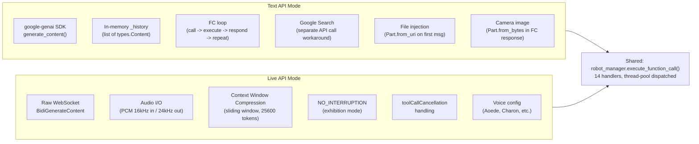

| Aspect | Text API | Live API |
|--------|----------|----------|
| Transport | REST (`generateContent` via SDK) | Raw WebSocket (`BidiGenerateContent`) |
| History | Client-managed (`_history` list) | Server-managed (Gemini side) |
| Audio | Not supported | Native (PCM 16kHz in, 24kHz out) |
| Google Search | Workaround via separate API call | Native (`googleSearch` tool in setup) |
| Camera analysis | Image attached as `Part.from_bytes` in FC response | Text-only analysis returned in `toolResponse` |
| File attachment | `Part.from_uri` on first message | Not supported |
| Context management | Full history sent each call | Sliding window compression (25600 trigger tokens) |
| Clear history | Reset `_history` list + `_files_injected` flag | Close and reconnect WebSocket |
| Safety settings | Configurable per-category thresholds | Not available (API limitation) |
| Session creation | `genai.Client` + `GenerateContentConfig` | `websockets.connect()` + JSON setup message |

---

## Data Flow

### WebSocket Message Flow

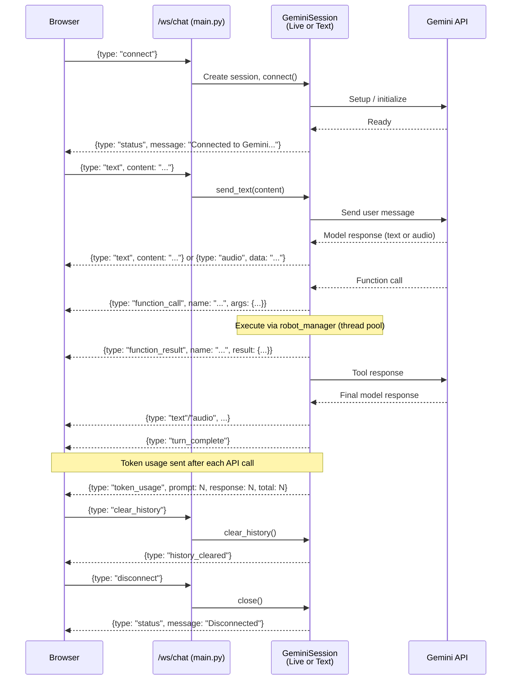

Full list of server-to-client message types:

| Type | Fields | Description |
|------|--------|-------------|
| `status` | `message`, optional `api_mode` | Connection status updates |
| `text` | `content` | Model text response |
| `audio` | `data` (base64 PCM) | Model audio response (Live only) |
| `function_call` | `name`, `args` | Function call notification |
| `function_result` | `name`, `result` | Function call result |
| `function_call_blocked` | `name`, `args` | FC blocked due to Google Search conflict |
| `turn_complete` | -- | Model turn finished |
| `interrupted` | -- | VAD interrupted model output (Live only) |
| `thinking` | -- | API call in progress (Text only) |
| `token_usage` | `prompt`, `response`, `total` | Token usage for this API call |
| `google_search` | `sources` (array of `{title, uri}`) | Google Search grounding sources |
| `gemini_disconnected` | `code`, `reason` | Gemini WebSocket closed unexpectedly |
| `error` | `message` | Error description |
| `history_cleared` | `message` | Confirmation of history clear |
| `patrol_started` | `run_id`, etc. | Patrol started via WS command |

### Text API Conversation Flow

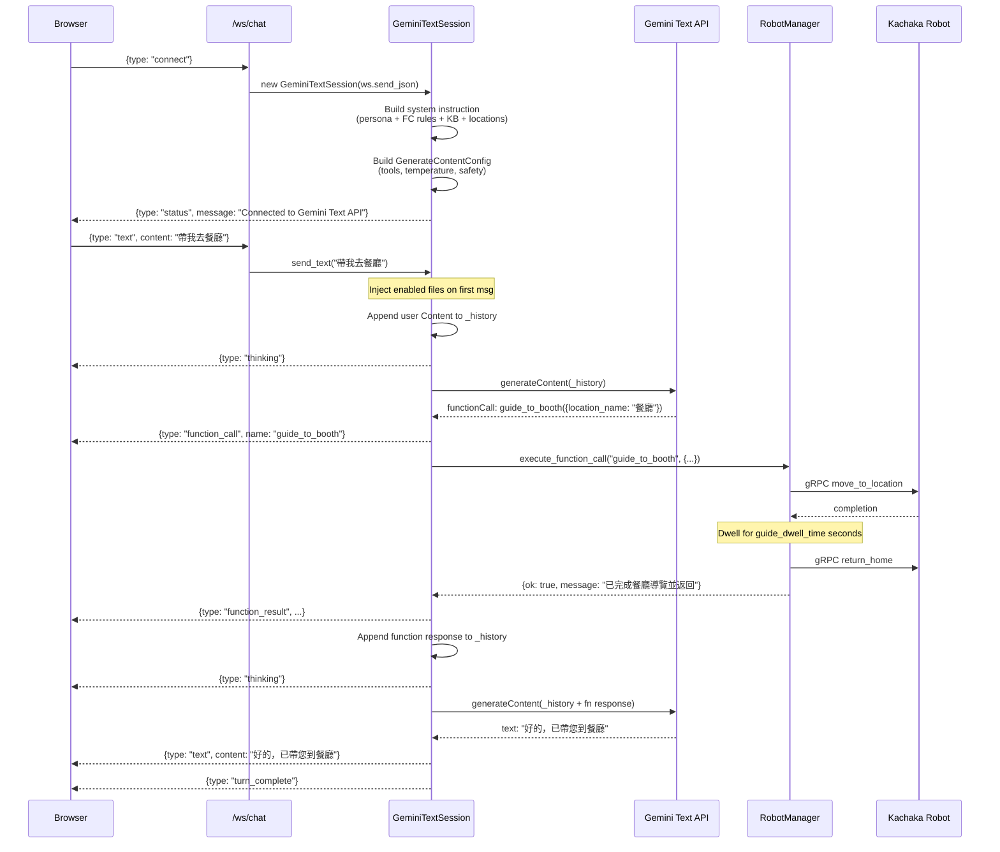

### Live API Conversation Flow

```mermaid
sequenceDiagram
    participant B as Browser
    participant WS as /ws/chat
    participant LIVE as GeminiLiveSession
    participant GEMINI as Gemini Live API
    participant RM as RobotManager

    B->>WS: {type: "connect"}
    WS->>LIVE: new GeminiLiveSession(websocket)
    LIVE->>GEMINI: WebSocket connect + setup JSON<br/>(model, tools, voice, compression)
    GEMINI-->>LIVE: setupComplete
    LIVE-->>B: {type: "status", message: "Connected to Gemini Live API"}
    Note over B: Auto-start mic in live mode

    B->>WS: {type: "audio", data: "<base64 PCM 16kHz>"}
    WS->>LIVE: send_audio(data)
    LIVE->>GEMINI: {realtimeInput: {audio: {mimeType: "audio/pcm;rate=16000", data: "..."}}}

    GEMINI-->>LIVE: serverContent.modelTurn.parts[].inlineData (audio)
    LIVE-->>B: {type: "audio", data: "<base64 PCM 24kHz>"}
    Note over B: Plays audio, shows speaking waveform

    GEMINI-->>LIVE: toolCall: capture_camera({prompt: "..."})
    LIVE-->>B: {type: "function_call", name: "capture_camera"}
    LIVE->>RM: asyncio.to_thread(execute_function_call, ...)
    RM-->>LIVE: {ok: true, image_analysis: "走廊中有..."}
    LIVE-->>B: {type: "function_result", result: {...}}

    LIVE->>GEMINI: {toolResponse: {functionResponses: [{id, name, response}]}}
    GEMINI-->>LIVE: serverContent.modelTurn (audio reading analysis)
    LIVE-->>B: {type: "audio", data: "..."}
    GEMINI-->>LIVE: turnComplete
    LIVE-->>B: {type: "turn_complete"}
```

### Function Calling Dispatch Flow

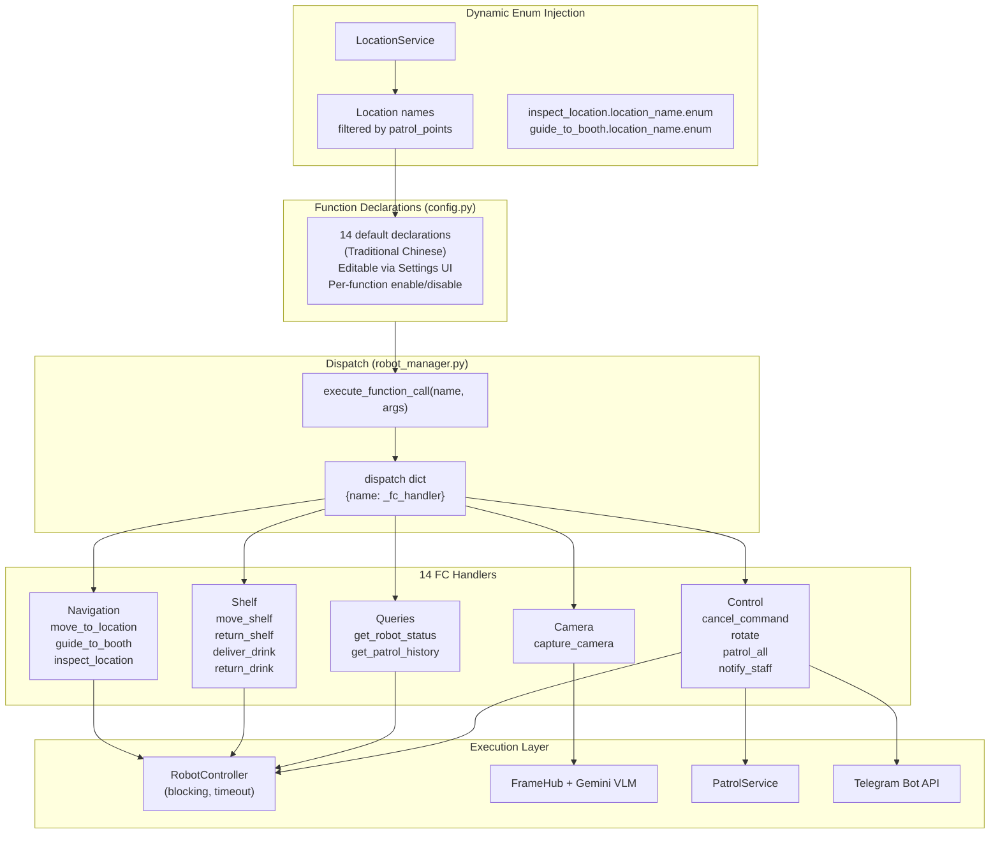

**Enable/disable pattern:**

```python
# Declarations with enabled=false are filtered out before sending to Gemini
func_decls = [
    {k: v for k, v in f.items() if k != "enabled"}
    for f in all_decls if f.get("enabled", True)
]
```

**Dynamic location enum injection:** At connect time, both `GeminiLiveSession` and `GeminiTextSession` populate the `enum` field of `location_name` parameters in `inspect_location` and `guide_to_booth` declarations. If `patrol_points` is configured in settings, only those location names are included; otherwise all locations are listed.

### Patrol Execution Flow

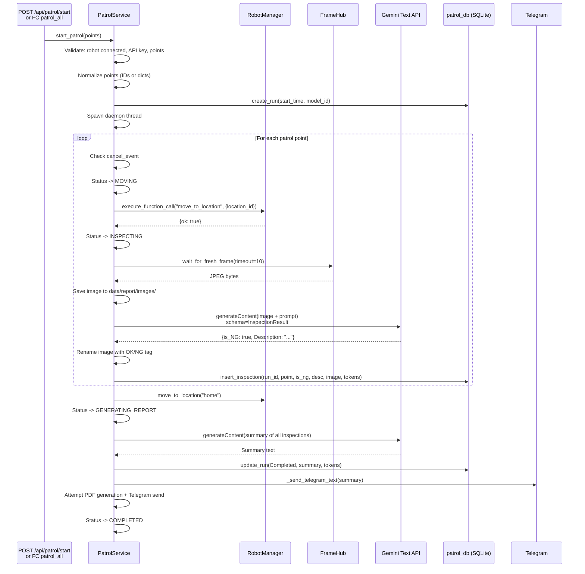

### Settings Data Flow

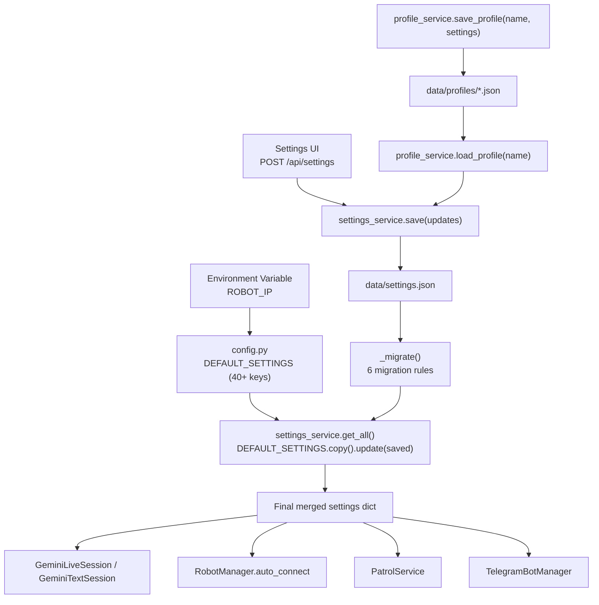

**Settings migration rules** (`_migrate()`):
1. `gemini_model` -> `text_model` or `live_model` (based on `api_mode`)
2. `enable_google_search` -> `text_enable_google_search` + `live_enable_google_search`
3. `drink_shelf_home` -> `kiosk_location`
4. `telegram_chat_id` (string) -> `telegram_chat_ids` (list)
5. `patrol_points` (list of dicts) -> (list of ID strings)
6. `function_declarations` -- reset to defaults if new FCs are missing
7. `static_knowledge`, `persona`, `robot_background_info` -- reset if outdated patterns detected

**Parameter clamping** (`config._clamp`):

| Parameter | Range | Default |
|-----------|-------|---------|
| `temperature` | [0.0, 2.0] | 1.0 |
| `max_output_tokens` | [1, 65536] | 8192 |
| `top_p` | [0.0, 1.0] | 0.95 |
| `top_k` | [1, 100] | 40 |

### Telegram Bridge Flow

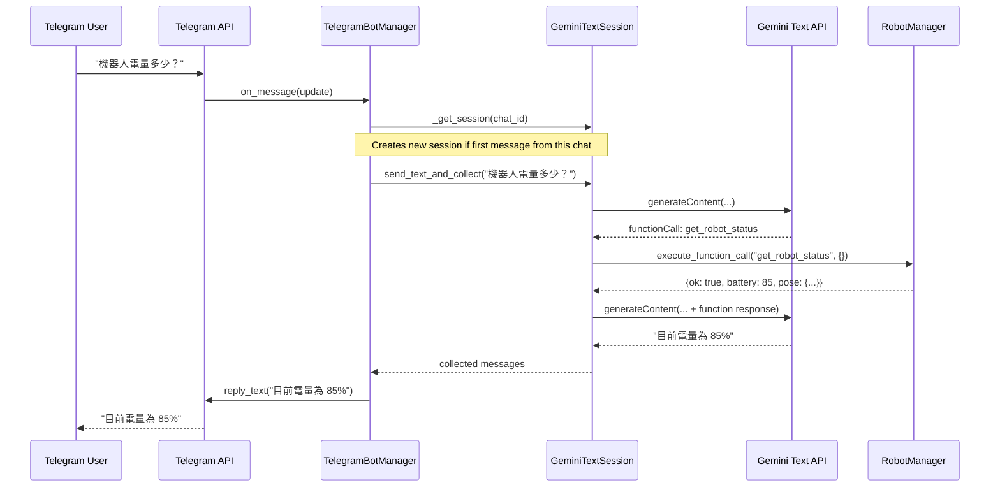

---

## Data Model

### SQLite: `data/tokens.db`

Token usage tracking for Gemini API calls (both chat sessions and patrols).

```sql
CREATE TABLE token_usage (
    id          INTEGER PRIMARY KEY AUTOINCREMENT,
    session_id  TEXT    NOT NULL,
    timestamp   TEXT    NOT NULL,  -- ISO 8601 UTC
    prompt      INTEGER NOT NULL DEFAULT 0,
    response    INTEGER NOT NULL DEFAULT 0,
    total       INTEGER NOT NULL DEFAULT 0
);
```

WAL mode enabled. Thread-safe via module-level `threading.Lock`.

### SQLite: `data/patrol.db`

Patrol run metadata and per-point inspection results.

```sql
CREATE TABLE patrol_runs (
    id                    INTEGER PRIMARY KEY AUTOINCREMENT,
    start_time            TEXT    NOT NULL,
    end_time              TEXT,
    status                TEXT    NOT NULL DEFAULT 'Running',
    report_content        TEXT,          -- AI summary
    model_id              TEXT,
    video_path            TEXT,
    video_analysis        TEXT,
    input_tokens          INTEGER NOT NULL DEFAULT 0,
    output_tokens         INTEGER NOT NULL DEFAULT 0,
    total_tokens          INTEGER NOT NULL DEFAULT 0,
    report_input_tokens   INTEGER NOT NULL DEFAULT 0,
    report_output_tokens  INTEGER NOT NULL DEFAULT 0,
    report_total_tokens   INTEGER NOT NULL DEFAULT 0,
    video_input_tokens    INTEGER NOT NULL DEFAULT 0,
    video_output_tokens   INTEGER NOT NULL DEFAULT 0,
    video_total_tokens    INTEGER NOT NULL DEFAULT 0
);

CREATE TABLE inspection_results (
    id              INTEGER PRIMARY KEY AUTOINCREMENT,
    run_id          INTEGER NOT NULL REFERENCES patrol_runs(id),
    point_name      TEXT    NOT NULL,
    coordinate_x    REAL,
    coordinate_y    REAL,
    prompt          TEXT,
    ai_response     TEXT,              -- Raw JSON from VLM
    is_ng           INTEGER NOT NULL DEFAULT 0,
    ai_description  TEXT,
    image_path      TEXT,
    timestamp       TEXT    NOT NULL,  -- ISO 8601
    input_tokens    INTEGER NOT NULL DEFAULT 0,
    output_tokens   INTEGER NOT NULL DEFAULT 0,
    total_tokens    INTEGER NOT NULL DEFAULT 0
);
```

WAL mode + 5s busy timeout. Context manager with auto-commit/rollback.

### JSON: `data/settings.json`

All user-configurable settings merged with `DEFAULT_SETTINGS` from `config.py`. Key groups:

| Group | Keys |
|-------|------|
| API credentials | `gemini_api_key`, `telegram_bot_token` |
| Mode | `api_mode` (`"text"` or `"live"`) |
| Text API | `text_model`, `text_temperature`, `text_max_output_tokens`, `text_top_p`, `text_top_k`, `text_enable_google_search`, `text_safety_settings` |
| Live API | `live_model`, `live_temperature`, `live_max_output_tokens`, `live_top_p`, `live_top_k`, `live_enable_google_search`, `live_auto_interrupt`, `mute_buffer_s`, `voice_name` |
| System instruction | `persona`, `static_knowledge`, `knowledge_base`, `robot_background_info` |
| Function declarations | `function_declarations` (array of `{name, description, parameters, enabled}`) |
| Patrol | `patrol_points` (list of location IDs), `patrol_system_prompt`, `patrol_image_prompt`, `patrol_telegram_notify`, `video_analysis_prompt` |
| Robot | `robot_ip`, `inspect_dwell_time`, `guide_dwell_time` |
| Exhibition | `exhibition_title`, `exhibition_quick_actions`, `kiosk_location`, `show_camera` |
| Drink delivery | `drink_shelf_id` |
| Telegram | `telegram_chat_ids` (list of chat ID strings) |

### JSON: `data/files.json`

Metadata for files uploaded to the Gemini Files API:

```json
[
  {
    "id": "a1b2c3d4e5f6",
    "filename": "document.pdf",
    "mime_type": "application/pdf",
    "size_bytes": 102400,
    "local_path": "/app/data/uploads/a1b2c3d4e5f6_document.pdf",
    "gemini_name": "files/abc123",
    "gemini_uri": "https://generativelanguage.googleapis.com/...",
    "uploaded_at": "2026-03-03T10:00:00+00:00",
    "expires_at": "2026-03-05T10:00:00+00:00",
    "enabled": true
  }
]
```

---

## System Instruction Assembly

Both API modes construct the system prompt identically from 4 configurable sections, then perform template variable substitution.

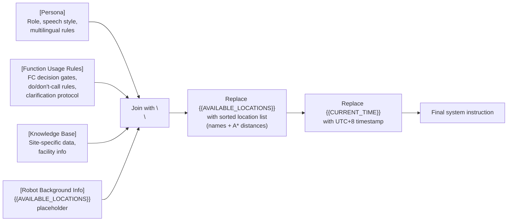

The `{{AVAILABLE_LOCATIONS}}` placeholder is replaced at connect time with a dynamically generated list of location names sorted by A* distance from the kiosk position (or current robot pose). Example output:

```
可用地點（依距離排序）：
- 充電座 (0.0m)
- 大廳 (3.2m)
- 餐廳 (8.7m)
- 辦公室101 (12.4m)
```

All 4 sections are editable through the Settings UI. The default `static_knowledge` contains detailed FC decision rules covering: when NOT to trigger function calls (questions, comments, hypotheticals), when TO trigger them (explicit action requests), multilingual location name mapping, clarification/confirmation rules, and execution protocol.

---

## Key Technical Decisions

### Why raw WebSocket for Live API instead of SDK

The `google-genai` SDK does not fully expose the `BidiGenerateContent` WebSocket protocol. Raw WebSocket allows:
- Direct control over the setup message (`contextWindowCompression`, `activityHandling`)
- Handling of `toolCallCancellation` messages
- Fine-grained audio chunk forwarding
- Custom reconnection logic

### Why kachaka_core instead of direct KachakaApiClient

`kachaka_core` (from `kachaka-sdk-toolkit`) provides:
- Connection pooling (`KachakaConnection.get(ip)`)
- `RobotController` with blocking movement commands, timeout, and command ID verification
- `CameraStreamer` with background frame capture (avoids blocking `get_front_camera_image()` in a loop)
- `KachakaQueries` for lightweight state queries

### Why separate Google Search API call

Models like `gemini-3-flash-preview` return HTTP 400 when Google Search and function declarations are in the same request. The Text API intercepts `google_search` function calls and executes them via a dedicated API call with `GoogleSearch` tool only. See [google-search-function-calling.md](google-search-function-calling.md) for the full analysis.

### Why no frontend build step

The application is designed for rapid iteration in exhibition/demo environments. Vanilla ES modules eliminate build tool complexity, allow instant edits via Docker volume mount, and keep the frontend dependency-free. External libraries (marked.js, DOMPurify, Chart.js) are loaded from CDN.

### Why SQLite (not a server database)

The application runs as a single-instance deployment on or near the robot. SQLite with WAL mode provides zero-configuration persistence, safe concurrent reads from multiple threads, and a volume-mountable data directory.

### Why Pydantic structured output for patrol inspections

Using `response_schema=InspectionResult` with `response_mime_type="application/json"` ensures Gemini returns structured JSON with `is_NG` and `Description` fields. This eliminates fragile text parsing and provides reliable OK/NG classification.

### Why A* pathfinding for location sorting

Location enums shown to the AI and in the Settings UI are sorted by A* walking distance from the kiosk position. This gives the model (and the user) spatial awareness and enables smart defaults (e.g., "go to the nearest restroom" resolves to the closest one by walkable path, not Euclidean distance).

### Why exhibition mute state machine

In noisy exhibition environments, the robot's speaker output feeds back into the microphone, causing the Live API's VAD to interrupt itself. The solution is `NO_INTERRUPTION` mode on the Gemini side plus a client-side mute state machine that mutes the mic during AI response + function execution, with a configurable buffer (`mute_buffer_s`) for gaps between turn completion and the next function call.

---

## Error Handling Patterns

### Robot Connection

- `robot_manager.connect()` returns `{"ok": bool, "error": str}` -- never throws
- Failed connections clean up via `KachakaConnection.remove(ip)`
- Auto-connect on startup logs warnings but does not crash the app

### Gemini Session Errors

- Both session types catch exceptions and send `{type: "error"}` to the client
- Live API `ConnectionClosed` triggers `{type: "gemini_disconnected"}` for frontend auto-reconnect (2s delay)
- Token usage tracking is best-effort (errors silenced)
- The frontend auto-reconnects the WebSocket after 3s on close

### Patrol Resilience

- Movement failures at a point skip that point (patrol continues)
- Camera frame timeout (10s) skips the inspection for that point
- Fatal errors update the DB run to "Error" status
- Cancellation checks occur before each move and after each movement completes

### Tool Call Cancellation (Live API)

When Gemini sends `toolCallCancellation`, the IDs are stored in `_cancelled_fc_ids`. Completed-but-cancelled calls have their `toolResponse` dropped (avoids confusing the session state).

### Telegram Notifications

All Telegram API calls (`_send_telegram_text`, `_send_telegram_photo`) are wrapped in try/except. Notification failures are logged but never crash the patrol or main application. Uses raw `urllib.request` to avoid async/sync boundary issues in the patrol daemon thread.

### Path Traversal Protection

Patrol image serving (`/api/patrol/report/image/{filepath}`) validates that the resolved path stays within `IMAGE_DIR` using `os.path.realpath()` comparison.

---

## Deployment Architecture

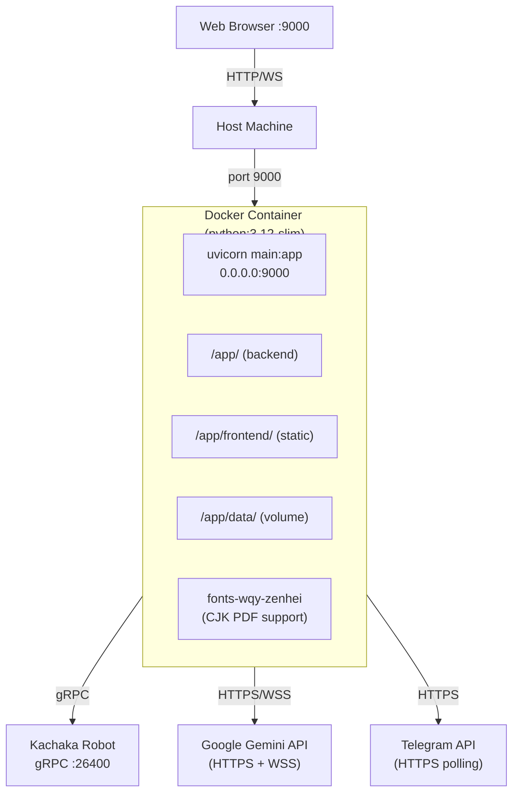

### Development Mode

```yaml
# docker-compose.yml
services:
  kachaka-gemini:
    build: .
    ports: ["9000:9000"]
    environment:
      - ROBOT_IP=${ROBOT_IP:-}
    volumes:
      - ./src/backend:/app          # Live code reload
      - ./src/frontend:/app/frontend # Live static reload
      - ./data:/app/data            # Persistent data
    command: uvicorn main:app --host 0.0.0.0 --port 9000 --reload --log-level warning
    networks:
      app-net:
        # Custom subnet avoids conflicts
```

- Source code is volume-mounted for instant edits
- `--reload` watches for file changes
- Network uses custom bridge subnet (192.168.200.0/24) to avoid conflicts

### Production Mode

```yaml
# docker-compose.prod.yml
services:
  kachaka-gemini:
    image: ghcr.io/sigma-snaken/kachaka-gemini:latest
    ports: ["9000:9000"]
    environment:
      - ROBOT_IP=${ROBOT_IP:-}
    volumes:
      - ./data:/app/data
    restart: unless-stopped
```

- Pre-built image from GHCR
- Only `data/` is volume-mounted (no source code)
- No `--reload` flag
- Health check: `curl -f http://localhost:9000/api/state` (30s interval, 3 retries)
- CJK font package (`fonts-wqy-zenhei`) installed in image for PDF generation

### Multi-Arch CI

Multi-arch images (`linux/amd64` + `linux/arm64`) are built via GitHub Actions CI (`.github/workflows/deploy.yml`):

- **Trigger**: push of `v*` tags or manual `workflow_dispatch`
- **Registry**: `ghcr.io`
- **Platforms**: `linux/amd64`, `linux/arm64`
- **Cache**: GitHub Actions cache (`type=gha`)
- **Tags**: semver (`v1.2.3`), major.minor (`1.2`), `latest` (default branch), short SHA

### Directory Layout (Container)

```
/app/
  main.py, config.py, ...       # Backend modules
  requirements.txt
  frontend/
    templates/
      index.html                 # Main SPA
      demo-patrol.html           # Patrol dashboard
    static/
      css/style.css, demo-patrol.css
      js/app.js, demo-chat.js, ...
      favicon.png
  data/                          # Volume-mounted
    settings.json
    tokens.db
    patrol.db
    files.json
    uploads/                     # Gemini Files API local copies
    profiles/                    # Named settings profiles
    report/
      images/                    # Patrol inspection images
      video/                     # Patrol video recordings
```

### Environment Variables

| Variable | Default | Description |
|----------|---------|-------------|
| `ROBOT_IP` | `""` (empty) | Kachaka robot gRPC address (e.g. `<YOUR_ROBOT_IP>:26400`). Fallback; primary source is `settings.json` `robot_ip` field. |
| `PYTHONUNBUFFERED` | `1` (set in Dockerfile) | Ensure Python output is not buffered |

### Dependencies

From `src/backend/requirements.txt`:

| Package | Version | Purpose |
|---------|---------|---------|
| `fastapi` | >=0.115,<1.0 | Web framework |
| `uvicorn` | >=0.34,<1.0 | ASGI server |
| `websockets` | >=14.0,<15.0 | Raw WebSocket for Live API |
| `kachaka-api` | >=3.14,<4.0 | Kachaka gRPC protobuf stubs |
| `kachaka-sdk-toolkit` | git | Robot control facade (kachaka_core) |
| `google-genai` | >=1.0,<2.0 | Gemini Text API SDK |
| `python-telegram-bot` | >=21.0,<22.0 | Telegram bot SDK |
| `pillow` | >=10.0,<11.0 | Image processing |
| `numpy` | >=2.2 | Array operations (pathfinding) |
| `opencv-python-headless` | >=4.8,<5.0 | Image processing |
| `reportlab` | >=4.0,<5.0 | PDF generation |
| `pydantic` | >=2.0,<3.0 | Structured output schemas |
| `jinja2` | >=3.1,<4.0 | HTML templating |
| `python-multipart` | >=0.0.9,<1.0 | File upload parsing |
