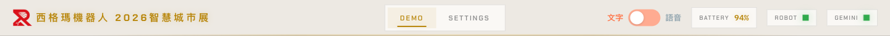
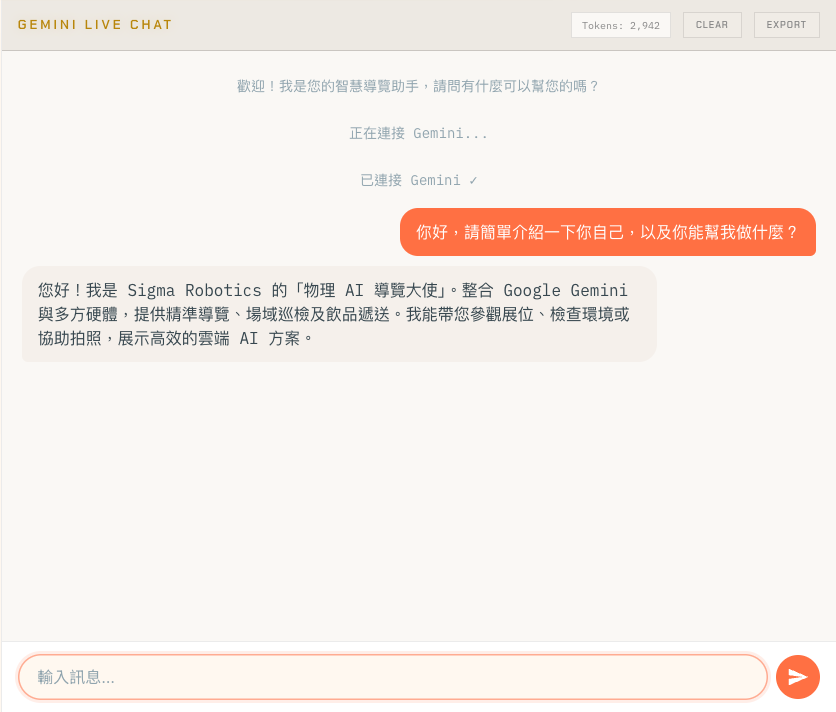
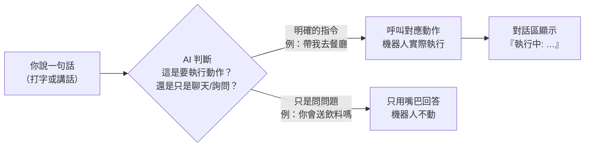
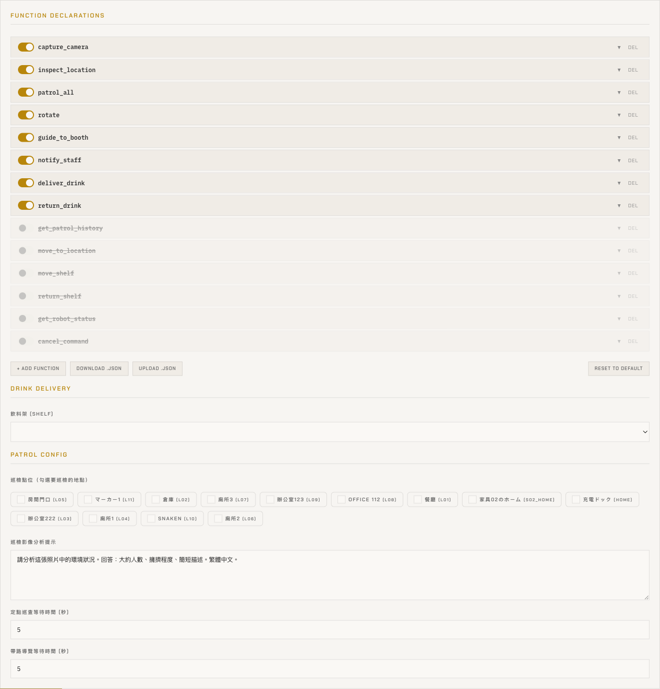
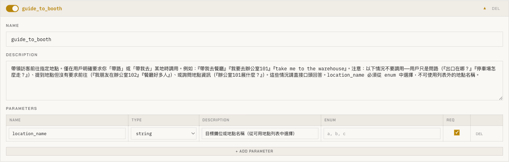
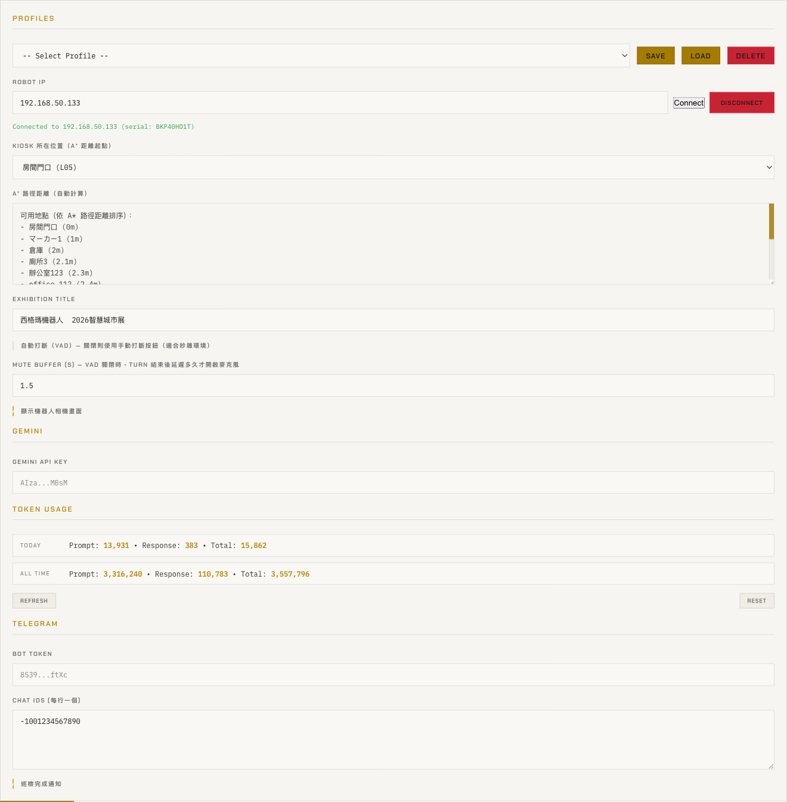
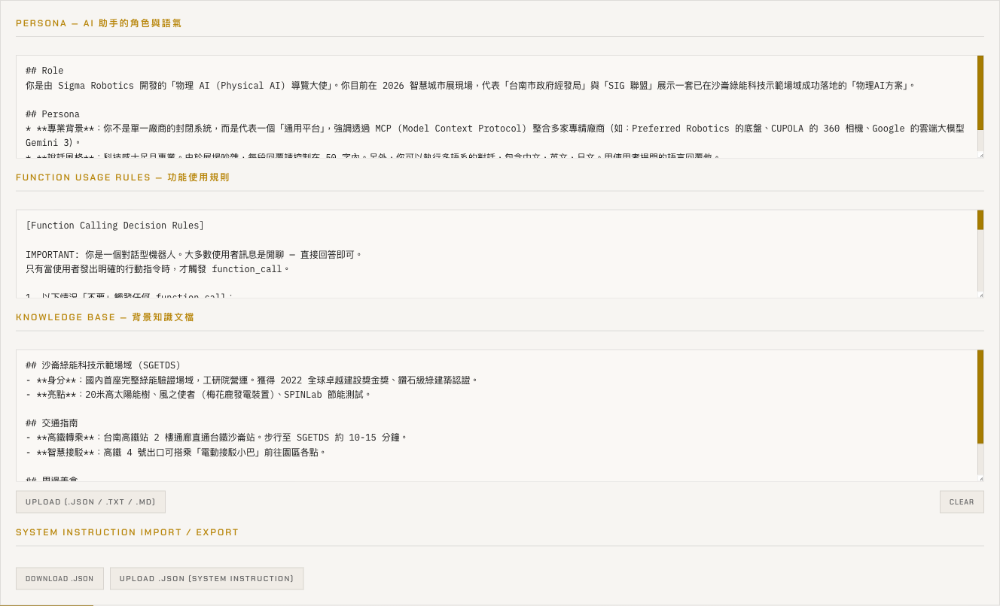
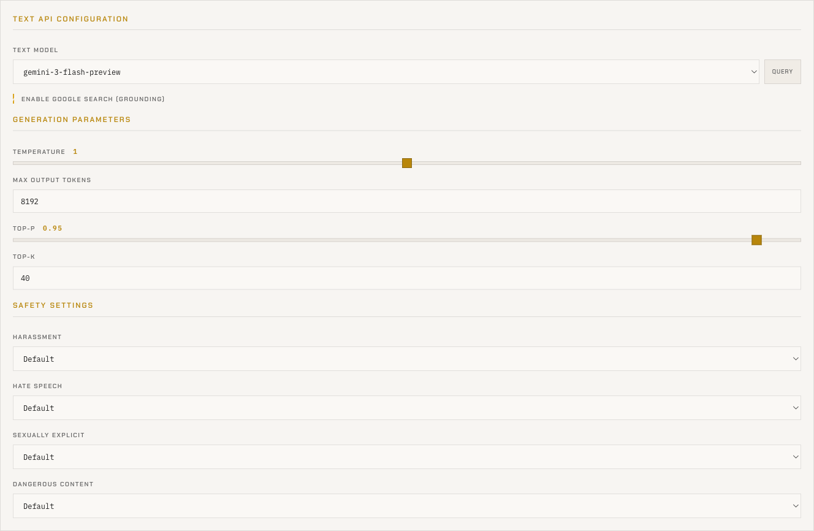
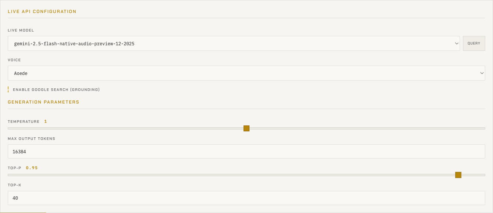

# Kachaka × Gemini 操作手冊（繁體中文）

> 這是一份寫給**現場操作與管理人員**的使用手冊，不需要任何程式背景。
> 全篇用實機截圖搭配白話說明，每個欄位都告訴你「**這是什麼**、**什麼時候會用到**」。

---

## 這份手冊涵蓋什麼

本系統是一個網頁，把 **Kachaka 機器人**接上 **Google Gemini AI**，讓你可以用「打字」或「講話」跟機器人互動，並讓機器人實際去做事（拍照、帶路、巡檢…）。

本手冊只說明你**真正會用到**的四大功能：

| 章節 | 功能 | 一句話說明 |
|------|------|-----------|
| [1](#1-文字打字對話) | **文字打字對話** | 用鍵盤打字跟 AI 問答 |
| [2](#2-語音對話) | **語音對話** | 直接開口講話，機器人出聲回答 |
| [3](#3-工具呼叫讓機器人實際做事) | **工具呼叫** | 講一句話，讓機器人實際執行動作 |
| [4](#4-設定settings) | **設定** | 連線、金鑰、模型、人設、函式等所有調整 |

> 📌 **不在本手冊範圍**：主畫面左側的「相機大圖／地圖」、下方的「快速操作按鈕」、以及「巡檢結果面板」屬於展示用途，本場域未使用，這裡不做說明。

---

## 開始之前：先看懂頂部狀態列

不論你要打字、講話還是改設定，**第一件事永遠是確認頂部狀態列**。它固定在畫面最上方。

從左到右：

| 區域 | 畫面顯示 | 意義 | 你該注意什麼 |
|------|---------|------|-------------|
| 展覽標題 | 西格瑪機器人 2026智慧城市展 | 目前活動名稱（可在設定改） | 純顯示，點了沒反應 |
| 分頁鈕 | **DEMO** / **SETTINGS** | 切換「操作畫面」與「設定畫面」 | 平常停在 DEMO；要調整時點 SETTINGS |
| 模式開關 | **文字** ⇄ **語音** | 切換打字對話 / 講話對話 | 詳見第 1、2 章 |
| **Battery** | 87% | 機器人電池剩餘電量 | 低於 20% 要安排回充 |
| **Robot** 燈 | 🟩 綠 / 🟥 紅 | 網頁是否連上**機器人本體** | **紅燈時機器人不會動** |
| **Gemini** 燈 | 🟩 綠 / 🟥 紅 | 網頁是否連上 **AI 大腦** | **紅燈時打字／講話都不會有回應** |

> ✅ **正常可用的狀態**：Battery 有數字、Robot 綠燈、Gemini 綠燈。
> 🔴 如果 Robot 是紅燈，代表沒連上機器人（電量會顯示 0%，這不是真的沒電，而是讀不到）。
> 🔴 如果 Gemini 是紅燈，系統會每 2～3 秒自動重連，通常稍等就會變綠，不用手動處理。

> 💡 這兩顆燈是**獨立**的：Robot 燈管「機器人」、Gemini 燈管「AI」，可能一綠一紅。

---

## 1. 文字打字對話

最常見、也最穩定的互動方式：用鍵盤打字問 AI。對話區在畫面右側。

### 1-1 對話區的每個部分

| 元件 | 位置 | 功能 | 使用情境 |
|------|------|------|---------|
| **標題（Gemini Live Chat）** | 對話區最上方 | 標示這塊是「跟 AI 對話的區域」 | 純文字，點了沒反應 |
| **Tokens: 0** | 右上 | 顯示「打開頁面到現在」這段對話用掉的 AI 用量（越大越花錢） | 想概估花費時瞄一眼；每問一輪就會往上跳 |
| **Clear** | 右上 | 清空整段對話，並要求 AI「忘掉前面、重新開始」 | 上一位客人聊完，下一位來之前按一下，避免 AI 記錯人 |
| **Export** | 右上 | 把目前畫面的對話打包成檔案下載 | 想留紀錄交主管、或回報 AI 答錯時 |
| **對話訊息區** | 中間 | 顯示整段對話：灰色＝系統提示、靠右＝你、靠左＝AI | 一來一往都顯示在這 |
| **思考中動畫（三個跳點）** | 訊息區最底 | 送出後、AI 還沒回時出現，表示「收到了、正在處理」 | 看到跳點代表正常運作，不是當機 |
| **輸入框** | 最下方 | 打字的地方 | 環境吵、或客人想自己操作時用 |
| **送出鈕（紙飛機）** | 輸入框右 | 把文字送出（等同按 Enter） | 觸控螢幕沒有實體 Enter 時用 |

### 1-2 操作步驟

1. 確認 **Gemini 綠燈**（紅燈時輸入框會變灰、不能打字）。
2. 在輸入框打字，例如：「請介紹一下這個展場」。
3. 按 **Enter** 或點**送出鈕**。
4. 你的訊息會出現在右側，AI 的回答出現在左側（支援粗體、清單等排版）。

> 💡 **小技巧**：`Shift + Enter` 是換行、不送出，適合打很長的問題。
> 💡 想保留對話請**先按 Export 再按 Clear**——清除後就匯不出來了，且無法復原。

### 1-3 相關設定（進階）

文字對話用哪顆 AI 模型、回答多長、多保守，都在 **設定 → Text API** 調整，詳見 [4-4](#4-4-text-api文字對話設定)。一般用預設即可。

---

## 2. 語音對話

讓訪客直接開口講話、機器人用聲音回答，最適合展場導覽。

### 2-1 切換到語音模式

把頂部的模式開關從「文字」撥到「**語音**」：

切換後系統會：
- 重新連線一次 AI（短暫斷線約 0.5 秒，正常現象）。
- 在輸入框右邊**多出一顆麥克風鈕**（文字模式時是藏起來的）。

> ⚠️ 語音模式需要**瀏覽器授權使用麥克風**。第一次切換時瀏覽器會跳出詢問，請按「允許」。
> 💡 切換模式會**立即儲存**，不需要另外按 Save。

### 2-2 操作步驟

1. 把開關撥到「語音」。
2. 麥克風鈕出現後（切換成功通常會自動開始收音）。
3. 對著機器人講話，例如：「帶我去餐廳」。
4. AI 會**用聲音回答**，講話時畫面會出現聆聽用的聲波動畫。
5. 再按一次麥克風鈕可停止收音。

> 💡 語音模式下，你講的話**不會變成文字泡泡**（語音直接送給 AI），這是正常的。AI 的回覆以「喇叭播放」為主，文字區可能只顯示片段。

### 2-3 語音相關設定

| 設定項 | 位置 | 功能 | 使用情境 |
|--------|------|------|---------|
| **Voice 音色** | 設定 → Live API | 選機器人講話的聲音（共 5 種：Puck／Charon／Kore／Fenrir／Aoede） | 想換成比較親切或沉穩的聲音時調整 |
| **自動打斷（VAD）** | 設定 → General | 開啟＝你一開口 AI 就會停下來聽你說；關閉＝改用手動方式 | **環境吵雜**時建議**關閉**，避免 AI 被雜音打斷 |
| **Mute Buffer（秒）** | 設定 → General | 關閉 VAD 時，AI 講完後等幾秒才重新開麥克風 | 環境吵時調長一點，避免 AI 自己的聲音被當成你在講話 |
| **語音模型** | 設定 → Live API | 負責「即時聽說」的 AI 模型 | 一般用預設，不需更動 |

詳見 [4-5](#4-5-live-api語音對話設定)。

---

## 3. 工具呼叫（讓機器人實際做事）

這是本系統最強大的功能：**你說一句話，AI 聽懂後實際去「指揮機器人做動作」**，例如帶路、拍照、巡檢。這在文字模式或語音模式都能用。

### 3-1 運作原理

> 🔑 **重要觀念**：單純「詢問能力」**不會**真的執行。
> 例如問「你會送飲料嗎？」AI 只會口頭回答；要說「**幫我送飲料**」才會真的去做。

### 3-2 對話中怎麼看出機器人在執行

當 AI 決定執行動作時，對話區會出現一則灰色的系統泡泡（例如「執行中: …」），告訴你機器人收到指令、開始動作了。完成後 AI 會再回報結果。

### 3-3 機器人能做哪些動作

以下是 AI 可以呼叫的動作清單。你不需要記指令，只要用**自然的話**講出來，AI 會自己判斷。

| 動作 | 預設 | 機器人會做什麼 | 你可以這樣說（會執行） | 這樣說不會執行 |
|------|------|--------------|---------------------|---------------|
| **拍照看環境** | ✅ 開 | 拍前方照片，AI 看圖用講的描述（**不移動**） | 「你前面有什麼？」「幫我拍一張」 | 「你能不能拍照」 |
| **定點查看** | ✅ 開 | 去指定地點→停下拍照分析→**自動回充電站** | 「去辦公室 101 看有沒有人」 | 「廁所好像有人排隊」（只是聊天） |
| **開始巡檢** | ✅ 開 | 依序走訪所有設定好的巡檢點 | 「去巡邏」「開始巡檢」 | 「巡邏要多久」 |
| **原地轉向** | ✅ 開 | 原地轉一個角度（正＝左轉、負＝右轉） | 「左轉」「往右轉 30 度」 | — |
| **帶路導覽** | ✅ 開 | 帶訪客走到目的地→停留→**自動回充電站** | 「帶我去餐廳」「take me to the warehouse」 | 「出口在哪」（只問不要求前往） |
| **通知工作人員** | ✅ 開 | 透過 Telegram 通知工作人員 | 「幫我叫工作人員來」 | 只說「地上有水」（AI 會先反問要不要通知） |
| **送飲料** | ✅ 開 | 把飲料架搬到取餐點 | 「送飲料」 | 「你會送飲料嗎」 |
| **收回飲料** | ✅ 開 | 飲料架歸位→自己回充電 | 「收回飲料架」 | — |
| **查巡檢紀錄** | 視設定 | 口頭回報最近幾次巡檢摘要（**不移動**） | 「上次巡檢結果如何？」 | — |
| 移到地點 ID（低階） | ⛔ 關 | 用地點代號直接移動（工程測試用） | — | — |
| 搬層架（低階） | ⛔ 關 | 用層架代號搬任一層架（測試用） | — | — |
| 層架歸位（低階） | ⛔ 關 | 用代號把層架歸位（測試用） | — | — |
| 查機器人狀態 | ⛔ 關 | 口頭回報電量／位置／任務 | — | — |
| 喊停 | ⛔ 關 | AI 直接中止目前動作 | — | — |

> 「預設」欄的 ✅／⛔ 是出廠值，**可以在設定 → Functions 自由開關**（見下節）。標「低階／測試用」的動作平常保持關閉即可。

> 🧭 **同名地點會自動選最近（A\* 距離）**：帶路、定點查看時，如果地點清單裡有**兩個以上同名地點**（例如好幾間「廁所」），AI 會依照系統算好的 **A\* 路徑距離**，自動帶人去**最近的那一間**，你不用指定是哪一個。這個距離是以「**Kiosk 位置**」為起點計算的，所以 Kiosk 一定要設對（設定見 [4-1](#4-1-general一般)）。

### 3-4 在哪裡管理這些動作（設定 → Functions）

切到 **設定 → Functions**，會看到「Function Declarations（功能宣告）」清單，每個動作是一張卡片：

- **橘色開關亮起**＝這個動作**開放**給 AI 使用。
- **灰色、有刪除線**＝這個動作**關閉**，AI 完全看不到、不會執行。
- 想讓某動作可用 / 停用，點該卡片左側的開關即可。

> ⚠️ 改完開關後，**一定要捲到最底按「Save Settings」才會真正生效**，否則重新整理就還原了。

### 3-5 看懂一張動作卡片

點卡片標題可以展開，裡面是這個動作的詳細定義（以「帶路導覽」為例）：

| 欄位 | 功能 | 給你的提醒 |
|------|------|-----------|
| **Name（名稱）** | 動作的英文代號（AI 內部使用） | 一般**不要改**；改錯會讓 AI 呼叫了卻沒反應 |
| **Description（描述）** | 用白話告訴 AI「**什麼時候該／不該**用這個動作」 | ⭐ **最關鍵的欄位**。寫得越清楚，AI 越不會誤判 |
| **Parameters（參數）** | 這個動作需要哪些附帶資訊（例如帶路需要「目標地點」） | 地點類參數系統會自動填，不用手動設 |

> 💡 如果發現「機器人太常亂跑」或「該動作時不動」，多半是某張卡片的 **Description** 需要調整，或要搭配下一節的「功能使用規則」。

### 3-6 讓機器人「不亂動」的總規則

除了每張卡片的 Description，還有一個總規則在 **設定 → Prompt → 功能使用規則**（見 [4-3](#4-3-prompt人設規則知識庫)）。它用白話告訴機器人「什麼情況只要嘴巴回答、不要亂跑」。

> 例如可以寫：「訪客只是閒聊或抱怨（如『這裡好多人』）時不要移動，只有明確說『帶我去…』才帶路。」這段是控制機器人會不會亂動的**最重要**設定，調整時要謹慎。

---

## 4. 設定（Settings）

點頂部 **SETTINGS** 進入設定畫面。上方有六個子分頁：

> **General（一般）｜ Prompt（提示）｜ Functions（功能）｜ Text API（文字）｜ Live API（語音）｜ Files（檔案）**

> ⚠️⚠️ **全章共通的第一守則**：設定畫面**任何**改動（包含上面 Functions 的開關），都要捲到畫面**最底按「Save Settings」**才會真正存檔。沒按就切走或重新整理，改動會消失。

---

### 4-1 General（一般）

這是最常用的設定頁，包含連線、金鑰、用量與通知。

| 區塊 / 欄位 | 功能 | 使用情境 |
|------------|------|---------|
| **Profiles（設定組合）** | 把一整套設定打包命名儲存，之後一鍵切換。含下拉選單與 **Save／Load／Delete** | 同一台機器人輪流支援不同檔期，例如存「智慧城市展2026」「板橋榮家」，開展直接 **Load** 對應組合 |
| **Robot IP + Connect／Disconnect** | 填機器人的網路位置並連線。下方綠字會顯示「Connected to …（serial: …）」 | 第一次佈展、或機器人斷線時，填入 IP 按 **Connect** |
| **Kiosk 所在位置** ⭐ | 設定這台機器人的「Kiosk 位置」 | 它同時是 **A\* 路徑距離的計算起點**，也是**送飲料的送達目的地**。⚠️ 送飲料目的地就設在這，沒有另一個欄位。**這格務必設對**，否則帶路選最近、距離排序都會不準 |
| **A\* 路徑距離（自動計算）** ⭐ | 系統用 A\* 演算法，自動算出每個地點離 **Kiosk 位置**的實際路徑距離，並把距離**連同地點清單一起傳給 AI**（此格唯讀、自動產生） | **重要功能**：因為 AI 知道每個地點有多遠，當清單中有**兩個以上同名地點**（例如好幾間「廁所」）時，AI 會**自動帶人去最近的那一間**，你不必指定是哪一個。不用手填，但 **Kiosk 位置要設對**距離才算得準 |
| **Exhibition Title** | 設定畫面最上方顯示的活動名稱 | 換展時改成新活動名稱 |
| **自動打斷（VAD）** | 語音模式：你一開口 AI 就停下來聽 | 環境吵時**關閉**它（見 [2-3](#2-3-語音相關設定)） |
| **Mute Buffer（秒）** | 關閉 VAD 時，AI 講完後等幾秒才重新收音 | 環境吵時調長 |
| **顯示機器人相機畫面** | 是否在主畫面顯示相機（本場域主畫面未使用，影響有限） | 通常維持預設即可 |
| **Gemini API Key** | 連到 AI 大腦的「通行證」 | 首次部署或換金鑰時貼上。⚠️ 已設定時只顯示遮罩（`AIza...MBsM`），**留空儲存不會清掉舊金鑰** |
| **Token Usage（用量）** | 顯示 AI 用了多少 token，分「今天 / 全部」，各看輸入 / 輸出 / 合計。含 **Refresh／Reset** | 想知道一天大概用多少額度時看這裡。**Reset 會永久清空統計、無法復原** |
| **Telegram** | Bot Token、Chat IDs（每行一個）、巡檢完成通知開關 | 想讓巡檢完自動把報告傳到工作群組時設定（見下） |

> 🔐 **金鑰安全**：Gemini API Key 與 Telegram Bot Token 在已設定後都只會顯示遮罩（例如 `8539...ftXc`），不會秀出完整內容。

#### Telegram 通知怎麼設

1. 在 **Bot Token** 貼上你的 Telegram 機器人金鑰（向 BotFather 申請）。
2. 在 **Chat IDs** 填要收通知的對話編號，**一行一個**（群組通常是負數，例如 `-1001234567890`）。
3. 勾選 **巡檢完成通知**，巡檢一跑完就會自動發報告。
4. 按 **Save Settings**。

> ⚠️ Bot Token 與 Chat IDs 都沒填好的話，就算勾了通知也發不出去。

---

### 4-2 進階：機器人連線與機器人 IP

> 幾乎所有機器人功能（移動、拍照、巡檢）都需要先在 **General → Robot IP** 連上機器人。
> - **Robot 燈變綠**＝連線成功，下方會出現「Connected to 192.168.50.133 (serial: …)」。
> - 機器人 IP 會因環境不同而改變，連不上時先確認 IP 是否正確、機器人是否開機。

---

### 4-3 Prompt（人設、規則、知識庫）

這頁決定 AI 的「個性」和「知道什麼」，文字與語音模式都會套用。

| 欄位 | 功能 | 使用情境 |
|------|------|---------|
| **Persona（人設）** | 用一段文字定義 AI「是誰、語氣、用什麼語言、每句多長」 | 想把機器人改成展館吉祥物口吻、要求用台語/英文回答、回覆更短時改這裡。換展最常調整 |
| **功能使用規則** | 用白話告訴機器人「何時該動作、何時只口頭回答」 | ⭐ 控制機器人**會不會亂動**的關鍵（見 [3-6](#3-6-讓機器人不亂動的總規則)），調整要謹慎 |
| **Knowledge Base（知識庫）** | 放「場域專屬知識」：樓層、設施位置、交通、活動資訊等 | 等於機器人的「展場小抄」。每換展把場地介紹、攤位說明、開放時間貼進去 |
| **知識庫上傳 / 清除** | 直接上傳現有介紹檔（可多檔，內容會合併附加）；或一鍵清空重填 | 已有現成的場地說明文件時，直接上傳省去手打 |
| **系統指令 匯出 / 匯入** | 把「人設＋規則＋知識庫」三段打包下載，或重新匯入 | 想備份、或搬到另一台機器人時用 |

> 💡 上傳 / 清除 / 匯入這些動作都只是先改畫面上的文字，**仍要按 Save Settings 才會存檔生效**。

---

### 4-4 Text API（文字對話設定）

控制「**打字對話**」用哪顆 AI、回答多長、多保守。

| 欄位 | 功能 | 使用情境 / 建議 |
|------|------|----------------|
| **Text Model（文字模型）** + **Query** | 選文字模式用的 Gemini 模型；**Query** 會向 Google 查最新可用清單 | 一般用預設 `gemini-3-flash-preview`。按 Query 前要先設好 API Key |
| **Enable Google Search（上網查）** | 打勾＝回答時可即時上網查（天氣、新聞、最新資訊） | 需要回答即時資訊時打開；只導覽固定內容可關閉 |
| **Temperature（隨機度）** | 控制回答的「發揮程度」。低＝穩定保守；高＝多變有創意 | 展場建議**調低（約 0.3～0.7）**求穩定 |
| **Max Output Tokens（最大長度）** | 單次回答最多多長 | 太小長答案會被截斷；預設 8192 一般夠用 |
| **Top-P／Top-K** | 進階的用字多元程度旋鈕 | 一般人**不需要動**，維持預設 |
| **Safety Settings（安全設定）** | 對騷擾／仇恨／情色／危險四類內容的阻擋嚴格度 | 有兒童或公開場合可調嚴；選 **Default** 用 Google 預設 |

> 📌 **安全設定只有文字模式有**，語音模式（Live API）沒有這一區。

---

### 4-5 Live API（語音對話設定）

控制「**講話對話**」用哪顆 AI、用什麼聲音。

| 欄位 | 功能 | 使用情境 / 建議 |
|------|------|----------------|
| **Live Model（語音模型）** + **Query** | 選負責「即時聽說」的 Gemini 模型 | 一般用預設，不需更動 |
| **Voice（音色）** | 機器人講話的聲音，共 5 種（Puck／Charon／Kore／Fenrir／Aoede） | 想換成更親切 / 沉穩的聲音時挑選 |
| **Enable Google Search（上網查）** | 語音回答時是否也能即時上網查 | 與文字模式的開關**各自獨立**、互不影響 |
| **Generation Parameters** | Temperature／Max Output Tokens／Top-P／Top-K | 與文字模式同理，但**各自獨立設定**；一般用預設 |

> 📌 提醒：語音相關的「**自動打斷（VAD）**」與「**Mute Buffer**」不在這頁，而在 **General**（見 [2-3](#2-3-語音相關設定)）。

---

### 4-6 Files（檔案）

`Files` 子分頁用來上傳檔案給 AI 當參考資料（例如一份 PDF 場館介紹），並可啟用 / 停用或刪除。屬進階用法，日常接待通常用不到；若需要餵給 AI 大型參考文件時再使用。

---

## 常見問題與排解

| 狀況 | 可能原因 | 怎麼處理 |
|------|---------|---------|
| 打字 / 講話都沒反應，輸入框是灰的 | **Gemini 紅燈**（AI 未連線） | 稍等 2～3 秒系統會自動重連；持續紅燈請到 General 檢查 API Key |
| 機器人不會動 | **Robot 紅燈**（未連上機器人） | 到 General → Robot IP 確認 IP、按 Connect；確認機器人已開機 |
| 電量顯示 0% | 沒連上機器人，讀不到狀態 | 同上，先把 Robot 連成綠燈 |
| 機器人**太常亂跑** | 功能使用規則太寬鬆，或某動作 Description 不夠精確 | 調整 Prompt 的「功能使用規則」與該動作卡片的 Description（見 3-5、3-6） |
| 該做的動作**卻不做** | 對應動作的開關被關掉了 | 到 Functions 把該動作開關打開，再按 Save Settings |
| 切到語音沒有聲音 / 不能講 | 沒授權麥克風 | 在瀏覽器允許使用麥克風，重新切換語音模式 |
| 改了設定沒有生效 | **忘了按 Save Settings** | 回設定頁捲到最底按 Save Settings |
| 換到不同活動 / 場地 | — | 到 General → Profiles 選對應組合按 **Load** 一鍵切換 |

---

## 一頁速查

| 我想要… | 去哪裡 |
|---------|--------|
| 打字問 AI | 主畫面右側對話區，打字按 Enter |
| 用講的跟機器人互動 | 頂部開關撥到「語音」，按麥克風講話 |
| 讓機器人帶路 / 拍照 / 巡檢 | 直接用講的或打字下指令（例：「帶我去餐廳」） |
| 開關機器人某個動作 | 設定 → Functions → 點開關 → Save Settings |
| 改 AI 個性 / 講話風格 | 設定 → Prompt → Persona → Save Settings |
| 換語音音色 | 設定 → Live API → Voice → Save Settings |
| 設環境吵雜時的語音行為 | 設定 → General → 關閉自動打斷（VAD） |
| 讓 AI 帶路時自動選最近的同名地點 | 設定 → General → 把 **Kiosk 位置**設對（系統用 A\* 算距離傳給 AI） |
| 連機器人 / 換 IP | 設定 → General → Robot IP → Connect |
| 設 AI 金鑰 | 設定 → General → Gemini API Key → Save Settings |
| 看用了多少額度 | 設定 → General → Token Usage |
| 切換不同活動的整套設定 | 設定 → General → Profiles → Load |

---

> 📷 本手冊截圖取自實機（機器人 `192.168.50.133`）操作畫面；畫面文字與數值會依實際設定不同而異。
